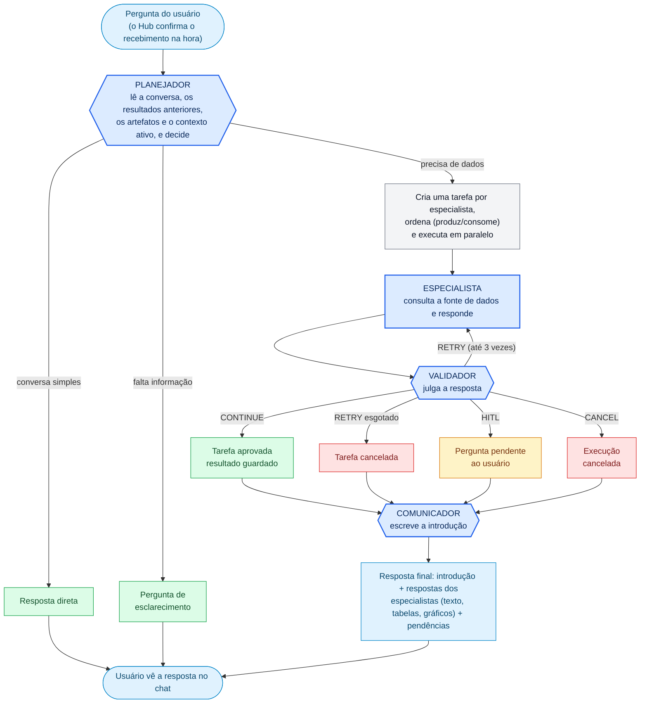
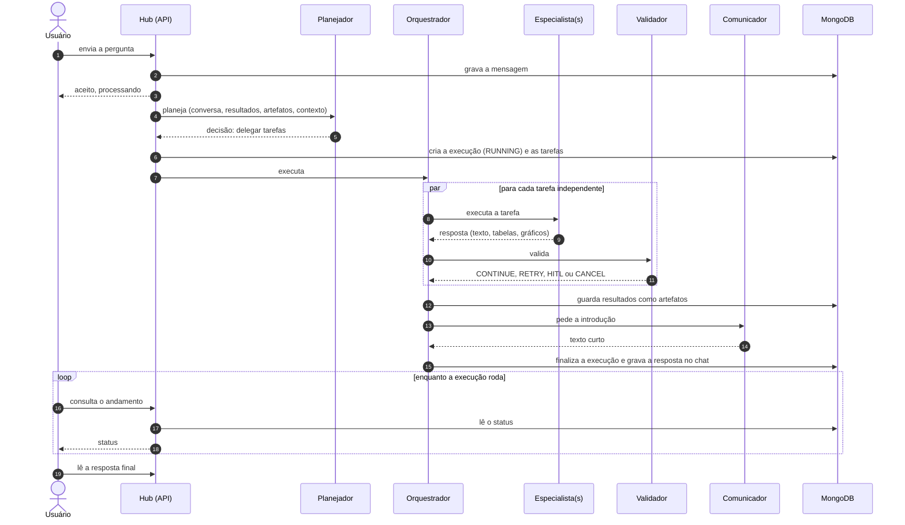

# 2. A jornada de uma pergunta

Este é o documento central: mostra o que acontece com uma pergunta, onde estão as decisões e quais são as saídas possíveis.

## O mapa completo de decisões

Legenda: azul = passo feito por um modelo de linguagem; verde = saída bem-sucedida; amarelo = depende do usuário; vermelho = cancelamento. Imagem: [jornada-da-pergunta.png](diagramas/jornada-da-pergunta.png).

## Passo a passo

### 1. Entrada
O usuário envia a mensagem. O Hub grava a mensagem, **responde imediatamente "aceito"** e processa em segundo plano (uma thread virtual por mensagem). O **planejamento** de mensagens da mesma conversa é feito uma de cada vez, na ordem de chegada (64 travas distribuídas por conversa), para que cada plano enxergue o que o anterior deixou; já a **execução dos especialistas não é serializada**, então o usuário pode continuar conversando. A tela passa a consultar o andamento por polling.

### 2. Decisão do planejador (a primeira grande bifurcação)
O planejador **lê antes de decidir**, nesta ordem: mensagens anteriores, o que cada especialista já executou e devolveu, os artefatos guardados, o contexto de trabalho ativo e as perguntas pendentes. Só então classifica o pedido:

| Caminho | Quando | Resultado |
|---|---|---|
| **Resposta direta** | Saudação, agradecimento, explicar algo que **já está escrito** na conversa | Resposta imediata, sem especialistas |
| **Pergunta de esclarecimento** | Falta período, segmento, campanha ou objetivo para dividir o trabalho | Pergunta objetiva ao usuário; a resposta volta ao planejador na próxima mensagem |
| **Delegar** | Precisa de dados, métricas, segmentação ou análise | Cria tarefas para especialistas |

Regra de ouro: **gráficos, tabelas, cálculos e números novos nunca saem do planejador**, nem quando os dados parecem estar no histórico. Se o usuário pede "agora em gráfico" sobre um resultado anterior, o pedido **volta ao mesmo especialista** que produziu aquele resultado.

O planejador responde em um formato rígido (JSON validado por esquema), e o Hub **valida tudo antes de gravar**: o contexto existe? Os especialistas pertencem àquele contexto? Se algo não bate, nada é gravado.

### 3. Execução das tarefas
Cada tarefa é autocontida: o especialista **não vê a conversa**. Ele recebe as instruções do seu perfil e do contexto de trabalho, as habilidades permitidas, os **artefatos dos tipos que ele consome**, a **memória individual** (suas últimas tarefas nesta conversa) e a tarefa escrita pelo planejador. O Hub:

- **Ordena** as tarefas pelo catálogo: se um especialista *consome* um tipo de resultado que outro *produz* e o pedido exige os dois, o consumidor espera o produtor. Tarefas sem relação rodam **em paralelo** (até 4 ao mesmo tempo, configurável).
- Se uma dependência não for aprovada, a tarefa dependente é **pulada** (cancelada) em vez de rodar sobre resultado ruim.
- O especialista conversa com o modelo e usa ferramentas (hoje, consulta a Genie) até ter a resposta.

### 4. Validação (a segunda grande bifurcação)
Cada resposta passa pelo validador, que devolve exatamente um de quatro vereditos:

| Veredito | Significado | O que o Hub faz |
|---|---|---|
| **CONTINUE** | Resposta satisfatória | Aprova a tarefa e guarda o resultado como artefato (se o especialista produz um tipo de resultado) |
| **RETRY** | Resposta ruim, vazia, irrelevante ou falha do provider | Refaz com o feedback do validador, até **3 tentativas**; esgotadas, cancela **só aquela tarefa** |
| **HITL** | O especialista precisa de uma decisão do usuário (ex.: "Business, Individual ou ambos?") | Registra a pergunta como pendente; a tarefa termina sem aprovação |
| **CANCEL** | Impedimento que inutiliza a execução | Cancela a **execução inteira**; o comunicador explica o encerramento |

HITL tem prioridade: uma resposta que apenas pede esclarecimento **nunca** é aprovada como se fosse resultado.

### 5. Resposta final
Quando todas as tarefas estão resolvidas (aprovadas ou canceladas), o comunicador escreve uma **introdução curta** e o Hub monta a resposta em blocos:

1. **Resumo** do comunicador;
2. **Resposta completa de cada especialista aprovado** (texto, tabelas e gráficos, montados em tempo de execução);
3. **Pendências** ("Ainda preciso de você"), se houver perguntas HITL.

Se há perguntas pendentes, a introdução é a de **resposta parcial**. As mensagens do assistente são gravadas no chat e a tela, ao ver o status final, recarrega a conversa.

## Exemplo ponta a ponta

> **Usuário:** "Analise o page_view por subagente."
> **Planejador:** precisa de dados, escolhe o contexto "Análise de Dados" e cria uma tarefa para o especialista de Mensuração.
> **Especialista:** consulta a Genie e devolve a análise. **Validador:** CONTINUE. Resultado guardado como artefato.
> **Usuário:** "Gere gráficos desses dados."
> **Planejador:** lê o histórico, reconhece "desses dados" como o resultado anterior e **devolve a tarefa ao mesmo especialista** (não tenta desenhar o gráfico sozinho).
> **Especialista:** gera o gráfico. **Comunicador:** introdução curta. **Usuário:** vê o texto e o gráfico.

## Quem fala com quem, em ordem

Imagem: [sequencia-executiva.png](diagramas/sequencia-executiva.png). O ciclo de cada tarefa, isolado, está em [ciclo-de-uma-tarefa.png](diagramas/ciclo-de-uma-tarefa.png).

## Estados de uma execução

Uma execução (`AgentRun`) começa em **RUNNING** e sai **uma única vez** para **FINISHED**, **CANCELLED** ou **FAILED**. Resultados tardios (de tarefas que terminam depois do encerramento) são descartados, o que impede respostas duplicadas ou fora de ordem.

Próximo: [Quem faz o quê](03-quem-faz-o-que.md).
