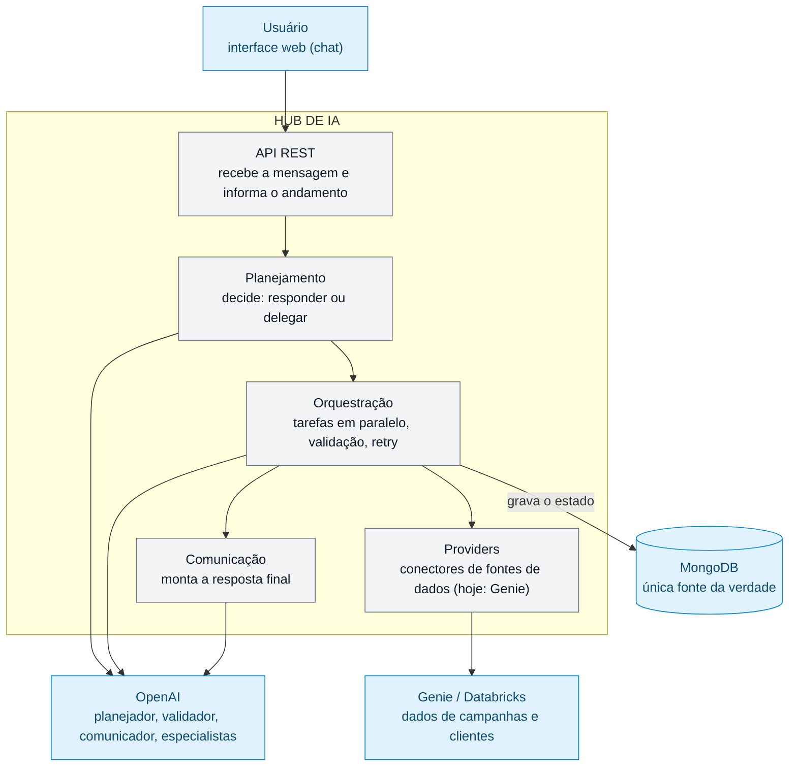

# 5. Dados e infraestrutura

## Visão em camadas

Imagem: [visao-em-camadas.png](diagramas/visao-em-camadas.png).

## MongoDB: a única fonte da verdade

O banco é `appdb`. Existem **13 coleções**, em dois grupos:

**Catálogo** (configuração; muda raramente)

| Coleção | Conteúdo |
|---|---|
| `work_contexts` | Contextos de trabalho e os especialistas de cada um |
| `subagents` | Especialistas: instruções, habilidades, o que produzem e consomem, providers |
| `skills` | Habilidades: instruções e ferramentas permitidas |
| `tools` | Ferramentas: nome da função, provider, esquemas |
| `providers` | Fontes de dados conectadas (hoje: Genie) |

**Operação** (cresce com o uso)

| Coleção | Conteúdo |
|---|---|
| `conversations` | Conversas por usuário |
| `messages` | Mensagens do usuário e do assistente |
| `agent_runs` | Execuções, com tarefas, logs e blocos da resposta final |
| `task_executions` | Cada tentativa de um especialista (mensagens e chamadas de ferramenta) |
| `artifacts` | Resultados versionados |
| `conversation_work_contexts` | Instâncias de contexto por conversa (ativo/pausado) |
| `human_input_requests` | Perguntas pendentes ao usuário |
| `provider_sessions` | Sessão por conversa, especialista e provider (permite continuar a conversa na Genie) |

Decisões de modelagem que importam:

- **Escritas atômicas.** Mudanças de estado usam atualizações condicionais (por exemplo, uma execução só sai de `RUNNING` uma vez), o que evita corridas entre tarefas paralelas.
- **Índices únicos** protegem as regras de negócio: um contexto por (conversa, contexto de catálogo); uma sessão por (conversa, especialista, provider); uma versão por (conversa, tipo, versão) de artefato; chaves únicas em habilidades e contextos.
- **Sem Redis.** O status de uma execução é lido direto do MongoDB pelo polling.
- A API usa `snake_case` nos campos JSON; os nomes no banco são definidos explicitamente no modelo de cada coleção (veja `Modelling/03-data-model.md`).

### Configuração inicial (bootstrap)

Na primeira subida, o Hub grava o catálogo inicial (`src/main/resources/bootstrap/*.json`) **somente nas coleções vazias**. Depois disso, **o banco manda**: o que você editar no MongoDB nunca é sobrescrito por reinício. Pode ser desligado com `HUB_BOOTSTRAP_ENABLED=false`.

## Serviços externos

| Serviço | Para quê | Configuração principal |
|---|---|---|
| **OpenAI** | Planejador, validador, comunicador e especialistas | `OPENAI_API_KEY`, `OPENAI_MODEL` (padrão `gpt-5`), `OPENAI_SUBAGENT_MODEL`, `OPENAI_TIMEOUT_MS` (60 s), `OPENAI_MAX_TOOL_ROUNDS` (8) |
| **Genie (Databricks)** | Consulta de dados de campanhas e clientes | `GENIE_BASE_URL`, `GENIE_CLIENT_ID`, `GENIE_CLIENT_SECRET`; consulta a cada 8 s, por até 30 min |
| **MongoDB 8** | Todo o estado | `MONGODB_URI` (padrão local via Docker Compose) |

Os gráficos vindos da Genie são convertidos para um formato neutro (Vega-Lite) por um modelo de linguagem; tabelas são renderizadas em HTML.

## Parâmetros de execução

| Parâmetro | Padrão | Efeito |
|---|---|---|
| `TASK_PARALLELISM` | 4 | Tarefas simultâneas por execução |
| `TASK_RETRY_ATTEMPTS` | 3 | Tentativas por tarefa antes de cancelar |
| `HUB_BOOTSTRAP_ENABLED` | true | Grava o catálogo inicial em coleções vazias |

## Como subir

1. `docker compose up -d` sobe o MongoDB.
2. Defina as variáveis (por exemplo, em um arquivo `.env`, lido na inicialização) com as chaves da OpenAI e da Genie.
3. `./mvnw spring-boot:run` inicia o Hub e grava o catálogo inicial se o banco estiver vazio.
4. Abra a interface em `frontend/index.html`. Por padrão ela fala com `http://localhost:8080`; o endereço da API e o identificador do usuário são editáveis na própria tela.

## Interface web

Chat estático em HTML/CSS/JS, sem build. Mostra o andamento da execução enquanto ela roda, renderiza markdown, tabelas e gráficos (Vega-Lite), mostra as pendências dentro da resposta e lista conversas e artefatos.

Próximo: [Extensibilidade](06-extensibilidade.md).
