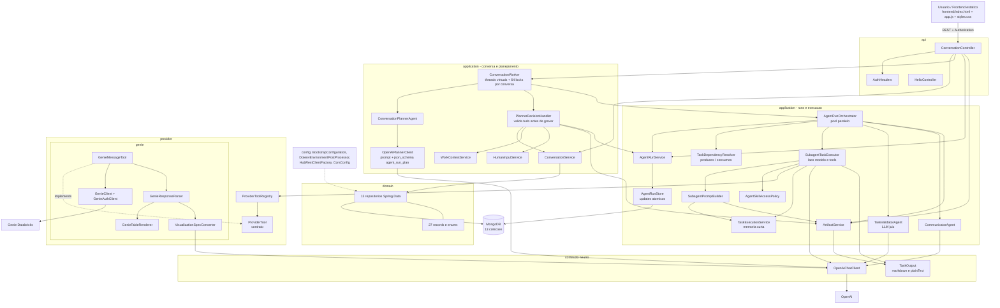
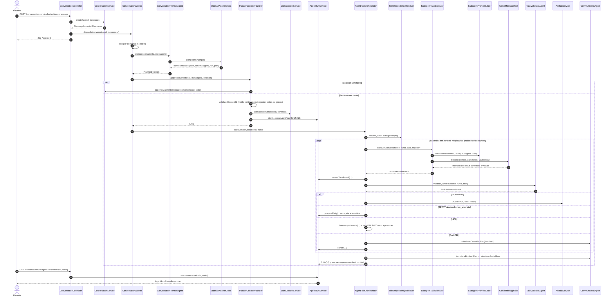
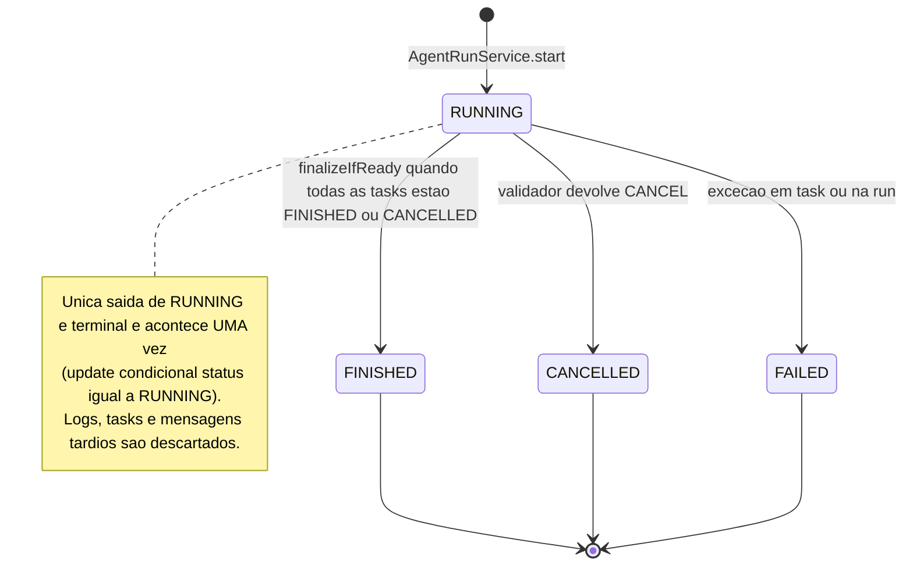
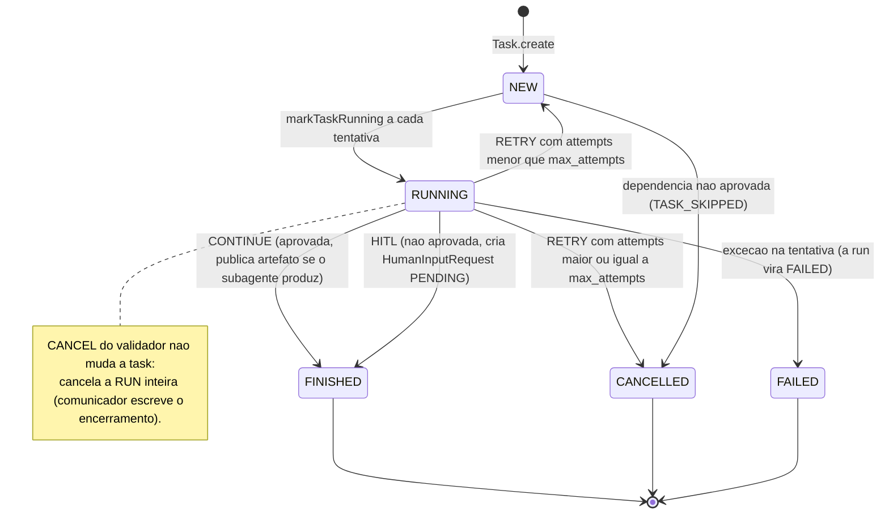
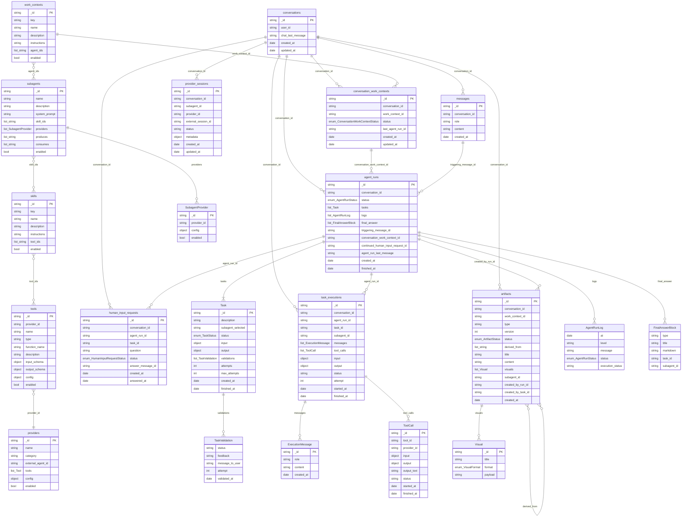
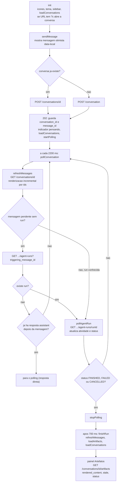

# Mermaid — mapa de conferência do Hub de IA

Estes diagramas foram **gerados a partir do código** (não desenhados à mão) e servem para uma IA **conferir** se o projeto reconstruído a partir de `specs/` + `Modelling/` está completo e fiel.

## Como a IA deve usar

1. Construa o projeto seguindo `specs/` e a **ordem do diagrama 07** (uma fase por vez; rode o gate de cada fase).
2. Ao terminar, rode o verificador mecânico na raiz do projeto reconstruído:
   ```
   python Mermaid/verify_project.py <caminho-do-projeto>
   ```
   Ele confere **06** (arquivos), **02** (dependências do construtor e `implements`) e **05** (campos/tipos/nomes das coleções). Saída `TUDO BATE` e exit code 0 = ok. Qualquer `FALHA` deve ser corrigida antes de seguir. `AVISO` = arquivo a mais (revisar; remover se não pertencer ao projeto).
3. Percorra `08-checklist-de-verificacao.md` item a item (classes, records, outros arquivos, testes) e marque cada um.
4. Use **03, 04a, 04b e 09** para conferir comportamento (o que o verificador não cobre): fluxo da mensagem, estados e frontend.
5. Gates finais: `./mvnw test` com MongoDB no ar deve terminar com `Tests run: 72, Failures: 0, Errors: 0, Skipped: 5`.

## Limites conhecidos do verificador

- Os 2 PNGs de `docs/` (`hub-ia.png`, `mermaid-diagram.png`) são binários e **não** estão nas specs: copie-os do projeto original; senão aparecem como `ARQUIVO AUSENTE`.
- Confere **estrutura** (arquivos, injeção, esquema de dados), não lógica. A lógica é coberta pelos 72 testes e pelos diagramas de sequência/estado, lidos pela IA.
- Ignora `specs/`, `Modelling/`, `Mermaid/`, `js-hub/`, `.git`, `target`, etc. ao procurar arquivos a mais.

## Diagramas

### 01 — Camadas e responsabilidades

Visão de alto nível: quem fala com quem.  
Arquivo: `01-camadas.mmd`



### 02 — Injeção de dependências (54 classes, 78 arestas)

Setas sólidas = parâmetros do construtor; tracejadas = implements. Conferido por script.  
Arquivo: `02-dependencias-completo.mmd`

```mermaid
%% Dependencias de construtor (injecao) e implementacoes entre TODAS as classes e interfaces de src/main/java (fora records/enums).
%% Gerado mecanicamente a partir do codigo. Seta solida: A recebe B no construtor. Seta tracejada: A implementa B.
flowchart LR
  subgraph pkg__raiz_["(raiz)"]
    HelloController["HelloController<br/>«RestController»"]
    HubdeiaApplication["HubdeiaApplication<br/>«SpringBootApplication»"]
  end
  subgraph pkg_api["api"]
    AuthHeaders["AuthHeaders<br/>«Component»"]
    ConversationController["ConversationController<br/>«RestController»"]
  end
  subgraph pkg_application["application"]
    ArtifactService["ArtifactService<br/>«Service»"]
    ConversationMemorySanitizer["ConversationMemorySanitizer<br/>«Component»"]
    ConversationService["ConversationService<br/>«Service»"]
    ConversationWorker["ConversationWorker<br/>«Component»"]
    HumanInputService["HumanInputService<br/>«Service»"]
    MonotonicTime["MonotonicTime"]
    TaskExecutionService["TaskExecutionService<br/>«Service»"]
    Text["Text"]
    WorkContextService["WorkContextService<br/>«Service»"]
  end
  subgraph pkg_application_communication["application.communication"]
    CommunicatorAgent["CommunicatorAgent<br/>«Component»"]
  end
  subgraph pkg_application_llm["application.llm"]
    OpenAiChatClient["OpenAiChatClient<br/>«Component»"]
  end
  subgraph pkg_application_orchestration["application.orchestration"]
    AgentRunOrchestrator["AgentRunOrchestrator<br/>«Component»"]
    AgentSkillAccessPolicy["AgentSkillAccessPolicy<br/>«Component»"]
    SubagentPromptBuilder["SubagentPromptBuilder<br/>«Component»"]
    SubagentTaskExecutor["SubagentTaskExecutor<br/>«Component»"]
    TaskDependencyResolver["TaskDependencyResolver<br/>«Component»"]
  end
  subgraph pkg_application_planner["application.planner"]
    ConversationPlannerAgent["ConversationPlannerAgent<br/>«Component»"]
    OpenAiPlannerClient["OpenAiPlannerClient<br/>«Component»"]
    PlannerAgent["PlannerAgent"]
    PlannerDecisionHandler["PlannerDecisionHandler<br/>«Component»"]
  end
  subgraph pkg_application_provider["application.provider"]
    ProgressReporter["ProgressReporter"]
    ProviderTool["ProviderTool"]
    ProviderToolRegistry["ProviderToolRegistry<br/>«Component»"]
  end
  subgraph pkg_application_provider_genie["application.provider.genie"]
    GenieAuthClient["GenieAuthClient<br/>«Component»"]
    GenieClient["GenieClient<br/>«Component»"]
    GenieMessageTool["GenieMessageTool<br/>«Component»"]
    GenieQueryResultClient["GenieQueryResultClient<br/>«Component»"]
    GenieResponseParser["GenieResponseParser<br/>«Component»"]
    GenieTableRenderer["GenieTableRenderer<br/>«Component»"]
    VisualizationSpecConverter["VisualizationSpecConverter<br/>«Component»"]
  end
  subgraph pkg_application_run["application.run"]
    AgentRunService["AgentRunService<br/>«Service»"]
    AgentRunStore["AgentRunStore<br/>«Component»"]
  end
  subgraph pkg_application_validation["application.validation"]
    TaskValidatorAgent["TaskValidatorAgent<br/>«Component»"]
  end
  subgraph pkg_config["config"]
    BootstrapConfiguration["BootstrapConfiguration<br/>«Configuration»"]
    CorsConfig["CorsConfig<br/>«Configuration»"]
    DotenvEnvironmentPostProcessor["DotenvEnvironmentPostProcessor"]
    HubRestClientFactory["HubRestClientFactory<br/>«Component»"]
  end
  subgraph pkg_domain_repository["domain.repository"]
    AgentRunRepository["AgentRunRepository<br/>«Repository»"]
    ArtifactRepository["ArtifactRepository<br/>«Repository»"]
    ConversationRepository["ConversationRepository<br/>«Repository»"]
    ConversationWorkContextRepository["ConversationWorkContextRepository<br/>«Repository»"]
    HumanInputRequestRepository["HumanInputRequestRepository<br/>«Repository»"]
    MessageRepository["MessageRepository<br/>«Repository»"]
    ProviderRepository["ProviderRepository<br/>«Repository»"]
    ProviderSessionRepository["ProviderSessionRepository<br/>«Repository»"]
    SkillRepository["SkillRepository<br/>«Repository»"]
    SubagentExecutionRepository["SubagentExecutionRepository<br/>«Repository»"]
    SubagentRepository["SubagentRepository<br/>«Repository»"]
    ToolRepository["ToolRepository<br/>«Repository»"]
    WorkContextRepository["WorkContextRepository<br/>«Repository»"]
  end
  AgentRunOrchestrator --> AgentRunService
  AgentRunOrchestrator --> SubagentTaskExecutor
  AgentRunOrchestrator --> TaskValidatorAgent
  AgentRunOrchestrator --> CommunicatorAgent
  AgentRunOrchestrator --> HumanInputService
  AgentRunOrchestrator --> ArtifactService
  AgentRunOrchestrator --> SubagentRepository
  AgentRunOrchestrator --> TaskDependencyResolver
  AgentRunService --> AgentRunStore
  AgentRunService --> AgentRunRepository
  AgentRunService --> ConversationService
  AgentRunService --> TaskExecutionService
  AgentRunService --> WorkContextService
  AgentSkillAccessPolicy --> SkillRepository
  AgentSkillAccessPolicy --> ToolRepository
  ArtifactService --> ArtifactRepository
  ArtifactService --> SubagentRepository
  ArtifactService --> WorkContextService
  CommunicatorAgent --> OpenAiChatClient
  ConversationController --> AuthHeaders
  ConversationController --> ConversationService
  ConversationController --> AgentRunService
  ConversationController --> ArtifactService
  ConversationController --> ConversationWorker
  ConversationPlannerAgent --> ConversationService
  ConversationPlannerAgent --> WorkContextService
  ConversationPlannerAgent --> SubagentRepository
  ConversationPlannerAgent --> HumanInputService
  ConversationPlannerAgent --> ArtifactService
  ConversationPlannerAgent --> AgentRunService
  ConversationPlannerAgent --> OpenAiPlannerClient
  ConversationPlannerAgent -.->|implements| PlannerAgent
  ConversationService --> ConversationRepository
  ConversationService --> MessageRepository
  ConversationWorker --> ConversationService
  ConversationWorker --> PlannerAgent
  ConversationWorker --> PlannerDecisionHandler
  ConversationWorker --> AgentRunOrchestrator
  GenieAuthClient --> HubRestClientFactory
  GenieClient --> HubRestClientFactory
  GenieClient --> GenieAuthClient
  GenieMessageTool --> GenieClient
  GenieMessageTool --> GenieResponseParser
  GenieMessageTool -.->|implements| ProviderTool
  GenieQueryResultClient --> HubRestClientFactory
  GenieQueryResultClient --> GenieAuthClient
  GenieResponseParser --> GenieQueryResultClient
  GenieResponseParser --> GenieTableRenderer
  GenieResponseParser --> VisualizationSpecConverter
  HumanInputService --> HumanInputRequestRepository
  OpenAiChatClient --> HubRestClientFactory
  OpenAiPlannerClient --> OpenAiChatClient
  OpenAiPlannerClient --> ConversationMemorySanitizer
  PlannerDecisionHandler --> ConversationService
  PlannerDecisionHandler --> WorkContextService
  PlannerDecisionHandler --> HumanInputService
  PlannerDecisionHandler --> ArtifactService
  PlannerDecisionHandler --> AgentRunService
  ProviderToolRegistry --> ProviderTool
  SubagentPromptBuilder --> AgentSkillAccessPolicy
  SubagentPromptBuilder --> AgentRunService
  SubagentPromptBuilder --> WorkContextService
  SubagentPromptBuilder --> TaskExecutionService
  SubagentPromptBuilder --> ArtifactService
  SubagentTaskExecutor --> OpenAiChatClient
  SubagentTaskExecutor --> SubagentRepository
  SubagentTaskExecutor --> AgentSkillAccessPolicy
  SubagentTaskExecutor --> ProviderToolRegistry
  SubagentTaskExecutor --> SubagentPromptBuilder
  SubagentTaskExecutor --> TaskExecutionService
  TaskExecutionService --> SubagentExecutionRepository
  TaskExecutionService --> ProviderSessionRepository
  TaskValidatorAgent --> OpenAiChatClient
  TaskValidatorAgent --> ConversationService
  TaskValidatorAgent --> TaskExecutionService
  VisualizationSpecConverter --> OpenAiChatClient
  WorkContextService --> WorkContextRepository
  WorkContextService --> ConversationWorkContextRepository
```



### 03 — Fluxo de uma mensagem

Sequência com os nomes reais dos métodos, da API até a resposta.  
Arquivo: `03-fluxo-mensagem.mmd`



### 04a — Estados do AgentRun

RUNNING → FINISHED/CANCELLED/FAILED, uma única vez.  
Arquivo: `04a-estados-agentrun.mmd`



### 04b — Estados da Task

Ciclo de vida de cada tarefa (inclui retry e HITL).  
Arquivo: `04b-estados-task.mmd`



### 05 — Modelo de dados (13 coleções + 8 embutidos)

Campos, tipos e nomes Mongo. Conferido por script contra os records.  
Arquivo: `05-modelo-de-dados.mmd`



### 06 — Árvore de arquivos (148)

Inventário exato do que deve existir.  
Arquivo: `06-arvore-de-arquivos.mmd`

```mermaid
%% Arvore completa dos 148 arquivos do projeto replicado. Cada no-folha e um arquivo que DEVE existir.
flowchart LR
  subgraph d1[".mvn/"]
    subgraph d2["wrapper/"]
      f3["maven-wrapper.properties"]
    end
  end
  subgraph d4["docs/"]
    f5["data-model.md"]
    f6["hub-ia.png"]
    f7["implementation-summary.md"]
    f8["mermaid-diagram.png"]
  end
  subgraph d9["frontend/"]
    f10["README.md"]
    f11["app.js"]
    f12["index.html"]
    f13["styles.css"]
  end
  subgraph d14["logs/"]
    f15[".gitkeep"]
  end
  subgraph d16["src/"]
    subgraph d17["main/"]
      subgraph d18["java/"]
        subgraph d19["com/"]
          subgraph d20["lamorim/"]
            subgraph d21["hubdeia/"]
              subgraph d22["api/"]
                subgraph d23["dto/"]
                  f24["AgentRunLogEntry.java"]
                  f25["AgentRunStatusResponse.java"]
                  f26["AgentRunSummaryResponse.java"]
                  f27["ConversationDetailResponse.java"]
                  f28["ConversationSummaryResponse.java"]
                  f29["CreateConversationRequest.java"]
                  f30["MessageAcceptedResponse.java"]
                  f31["SendConversationMessageRequest.java"]
                end
                f32["AuthHeaders.java"]
                f33["ConversationController.java"]
              end
              subgraph d34["application/"]
                subgraph d35["communication/"]
                  f36["CommunicatorAgent.java"]
                end
                subgraph d37["content/"]
                  f38["TaskOutput.java"]
                end
                subgraph d39["llm/"]
                  f40["OpenAiChatClient.java"]
                end
                subgraph d41["orchestration/"]
                  f42["AgentRunOrchestrator.java"]
                  f43["AgentSkillAccessPolicy.java"]
                  f44["SubagentPromptBuilder.java"]
                  f45["SubagentTaskExecutor.java"]
                  f46["TaskDependencyResolver.java"]
                  f47["TaskExecutionResult.java"]
                end
                subgraph d48["planner/"]
                  f49["ConversationPlannerAgent.java"]
                  f50["OpenAiPlannerClient.java"]
                  f51["PlannedTask.java"]
                  f52["PlannerAgent.java"]
                  f53["PlannerDecision.java"]
                  f54["PlannerDecisionHandler.java"]
                  f55["PlanningContextState.java"]
                  f56["PlanningInput.java"]
                  f57["PlanningRunSummary.java"]
                  f58["PlanningSubagentView.java"]
                  f59["PlanningTaskSummary.java"]
                  f60["PlanningWorkContextView.java"]
                  f61["WorkContextAction.java"]
                end
                subgraph d62["provider/"]
                  subgraph d63["genie/"]
                    f64["GenieAuthClient.java"]
                    f65["GenieClient.java"]
                    f66["GenieMessageResult.java"]
                    f67["GenieMessageTool.java"]
                    f68["GenieParsedResponse.java"]
                    f69["GenieQueryColumn.java"]
                    f70["GenieQueryResult.java"]
                    f71["GenieQueryResultClient.java"]
                    f72["GenieResponseParser.java"]
                    f73["GenieTableRenderer.java"]
                    f74["VisualizationSpecConverter.java"]
                  end
                  f75["ProgressReporter.java"]
                  f76["ProviderTool.java"]
                  f77["ProviderToolContext.java"]
                  f78["ProviderToolRegistry.java"]
                  f79["ProviderToolResult.java"]
                end
                subgraph d80["run/"]
                  f81["AgentRunService.java"]
                  f82["AgentRunStore.java"]
                end
                subgraph d83["validation/"]
                  f84["TaskValidationResult.java"]
                  f85["TaskValidationStatus.java"]
                  f86["TaskValidatorAgent.java"]
                end
                f87["ArtifactService.java"]
                f88["ArtifactView.java"]
                f89["ConversationMemorySanitizer.java"]
                f90["ConversationService.java"]
                f91["ConversationWorker.java"]
                f92["HumanInputService.java"]
                f93["MonotonicTime.java"]
                f94["TaskExecutionService.java"]
                f95["Text.java"]
                f96["WorkContextService.java"]
              end
              subgraph d97["config/"]
                f98["BootstrapConfiguration.java"]
                f99["CorsConfig.java"]
                f100["DotenvEnvironmentPostProcessor.java"]
                f101["HubRestClientFactory.java"]
              end
              subgraph d102["domain/"]
                subgraph d103["model/"]
                  f104["AgentRun.java"]
                  f105["AgentRunLog.java"]
                  f106["AgentRunStatus.java"]
                  f107["Artifact.java"]
                  f108["ArtifactStatus.java"]
                  f109["Conversation.java"]
                  f110["ConversationWorkContext.java"]
                  f111["ConversationWorkContextStatus.java"]
                  f112["ExecutionMessage.java"]
                  f113["FinalAnswerBlock.java"]
                  f114["HumanInputRequest.java"]
                  f115["HumanInputRequestStatus.java"]
                  f116["Message.java"]
                  f117["Provider.java"]
                  f118["ProviderSession.java"]
                  f119["Skill.java"]
                  f120["Subagent.java"]
                  f121["SubagentExecution.java"]
                  f122["SubagentProvider.java"]
                  f123["Task.java"]
                  f124["TaskStatus.java"]
                  f125["TaskValidation.java"]
                  f126["Tool.java"]
                  f127["ToolCall.java"]
                  f128["Visual.java"]
                  f129["VisualFormat.java"]
                  f130["WorkContext.java"]
                end
                subgraph d131["repository/"]
                  f132["AgentRunRepository.java"]
                  f133["ArtifactRepository.java"]
                  f134["ConversationRepository.java"]
                  f135["ConversationWorkContextRepository.java"]
                  f136["HumanInputRequestRepository.java"]
                  f137["MessageRepository.java"]
                  f138["ProviderRepository.java"]
                  f139["ProviderSessionRepository.java"]
                  f140["SkillRepository.java"]
                  f141["SubagentExecutionRepository.java"]
                  f142["SubagentRepository.java"]
                  f143["ToolRepository.java"]
                  f144["WorkContextRepository.java"]
                end
              end
              f145["HelloController.java"]
              f146["HubdeiaApplication.java"]
            end
          end
        end
      end
      subgraph d147["resources/"]
        subgraph d148["META-INF/"]
          f149["spring.factories"]
        end
        subgraph d150["bootstrap/"]
          f151["providers.json"]
          f152["skills.json"]
          f153["subagents.json"]
          f154["tools.json"]
          f155["work-contexts.json"]
        end
        f156["application.yaml"]
      end
    end
    subgraph d157["test/"]
      subgraph d158["java/"]
        subgraph d159["com/"]
          subgraph d160["lamorim/"]
            subgraph d161["hubdeia/"]
              subgraph d162["application/"]
                subgraph d163["content/"]
                  f164["TaskOutputTest.java"]
                end
                subgraph d165["orchestration/"]
                  f166["AgentRunOrchestratorTest.java"]
                  f167["AgentSkillAccessPolicyTest.java"]
                  f168["SubagentMemoryTest.java"]
                  f169["TaskDependencyResolverTest.java"]
                end
                subgraph d170["planner/"]
                  f171["ConversationPlannerAgentTest.java"]
                  f172["OpenAiPlannerClientTest.java"]
                  f173["PlannerDecisionHandlerTest.java"]
                  f174["PlannerLiveEvalTest.java"]
                end
                subgraph d175["run/"]
                  f176["AgentRunStoreTest.java"]
                end
                f177["ArtifactServiceTest.java"]
                f178["ConversationServiceTest.java"]
              end
              subgraph d179["config/"]
                f180["BootstrapConfigurationTest.java"]
              end
              f181["HubdeiaApplicationTests.java"]
              f182["MongoIntegrationTest.java"]
            end
          end
        end
      end
      subgraph d183["resources/"]
        subgraph d184["planner-eval/"]
          f185["page-view-conversation.json"]
        end
      end
    end
  end
  f186[".gitattributes"]
  f187[".gitignore"]
  f188["docker-compose.yaml"]
  f189["mvnw"]
  f190["mvnw.cmd"]
  f191["pom.xml"]
```



### 07 — Ordem de implementação (9 fases com gates)

Cada fase compila sozinha com as anteriores (verificado).  
Arquivo: `07-ordem-de-implementacao.mmd`

```mermaid
%% Fases de implementacao com PORTOES de verificacao. So avance para a fase seguinte quando o portao passar.
%% Cada fase cita a spec (specs/NN-*.md) e os arquivos que ela produz; o checklist completo esta em 08-checklist-de-verificacao.md.
flowchart TD
  F1["FASE 1 - Projeto e infra (spec 02)<br/>pom.xml, mvnw e wrapper, docker-compose.yaml, .gitignore, .gitattributes, logs/.gitkeep,<br/>application.yaml, spring.factories, HubdeiaApplication,<br/>DotenvEnvironmentPostProcessor, HubRestClientFactory, CorsConfig"]
  G1{{"PORTAO 1<br/>docker compose up -d e mongo na porta 27017<br/>mvnw -q -DskipTests compile"}}

  F2["FASE 2 - Dominio Mongo (spec 03 e Modelling/)<br/>27 records e enums em domain/model + 13 repositorios<br/>Modelling/01 e 02 criam colecoes, indices e catalogo"]
  G2{{"PORTAO 2<br/>compila<br/>mongosh --file Modelling/04-verify.js -> OK"}}

  F3["FASE 3 - Catalogo (spec 04)<br/>5 JSONs em resources/bootstrap, BootstrapConfiguration,<br/>AgentSkillAccessPolicy"]
  G3{{"PORTAO 3<br/>BootstrapConfigurationTest 3 testes (usa a base MongoIntegrationTest)<br/>AgentSkillAccessPolicyTest 1 teste"}}

  F4["FASE 4 - Conteudo, artefatos e contrato de tools (spec 08 parte 1)<br/>OpenAiChatClient, TaskOutput, ProviderTool, ProviderToolContext, ProviderToolResult,<br/>ProviderToolRegistry, ProgressReporter, ArtifactView, ArtifactService, Text, MonotonicTime,<br/>e as dependencias do ArtifactService: WorkContextService, TaskExecutionResult,<br/>ConversationMemorySanitizer (14 arquivos, compila sozinha)"]
  G4{{"PORTAO 4<br/>TaskOutputTest 7 testes<br/>ArtifactServiceTest 6 testes"}}

  F5["FASE 5 - Conversa, planejador, runs e executor (specs 06, 07 e 08 parte 2)<br/>compilam JUNTOS (dependencia circular entre os pacotes planner e run):<br/>os 8 DTOs de api/dto (ConversationService e AgentRunService os usam),<br/>ConversationService, ConversationWorker, HumanInputService, TaskExecutionService,<br/>planner/*, AgentRunStore, AgentRunService, TaskDependencyResolver, AgentRunOrchestrator,<br/>validation/*, communication/*, SubagentPromptBuilder, SubagentTaskExecutor (35 arquivos)"]
  G5{{"PORTAO 5<br/>ConversationServiceTest 4, PlannerDecisionHandlerTest 10,<br/>OpenAiPlannerClientTest 5, ConversationPlannerAgentTest 4,<br/>AgentRunStoreTest 3, AgentRunOrchestratorTest 9,<br/>TaskDependencyResolverTest 7, SubagentMemoryTest 7"}}

  F6["FASE 6 - Provider Genie (spec 09)<br/>GenieAuthClient, GenieClient, GenieQueryResultClient, GenieMessageTool,<br/>GenieResponseParser, GenieTableRenderer, VisualizationSpecConverter e 4 records"]
  G6{{"PORTAO 6<br/>compila<br/>sem testes automaticos: validar manualmente contra o Genie real"}}

  F7["FASE 7 - API REST (spec 05)<br/>AuthHeaders, ConversationController, HelloController<br/>(os DTOs ja vieram na fase 5)"]
  G7{{"PORTAO 7<br/>mvnw spring-boot:run<br/>GET /hello -> Hello World!<br/>GET /conversations sem Authorization -> 401"}}

  F8["FASE 8 - Frontend (spec 10)<br/>frontend/index.html, styles.css, app.js, README.md"]
  G8{{"PORTAO 8<br/>abrir index.html, enviar mensagem,<br/>ver atividade do agente, resposta e painel de Artefatos"}}

  F9["FASE 9 - Testes finais e docs (specs 11 e 12)<br/>HubdeiaApplicationTests, PlannerLiveEvalTest + fixture,<br/>docs/data-model.md, docs/implementation-summary.md"]
  G9{{"PORTAO FINAL<br/>mvnw test -> Tests run 72, Failures 0, Errors 0, Skipped 5<br/>checklist 08 100 por cento marcado"}}

  F1 --> G1 --> F2 --> G2 --> F3 --> G3 --> F4 --> G4 --> F5 --> G5 --> F6 --> G6 --> F7 --> G7 --> F8 --> G8 --> F9 --> G9
```



### 09 — Fluxo do frontend

Polling, renderização de markdown/visuais, HITL.  
Arquivo: `09-frontend-fluxo.mmd`



### 08 — Checklist de verificação

Arquivo: [`08-checklist-de-verificacao.md`](08-checklist-de-verificacao.md) (marcar item a item).
