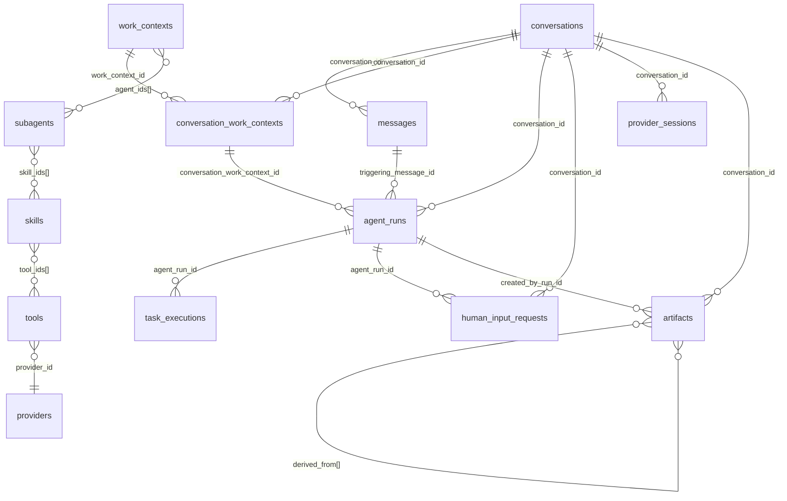

# Modelo de dados — Hub de IA (MongoDB)

Banco padrão: `appdb`. São **13 coleções**: 8 de dados da conversa e 5 de catálogo. Tudo em `snake_case`, datas como `Date` (precisão de milissegundo) e enums como **string** (nome do valor).

## Convenções

| Regra | Detalhe |
|---|---|
| `_id` | `conversations`: `ObjectId` gerado pelo Mongo. Todas as outras coleções: **string** (UUID gerado pela aplicação; no catálogo, ids legíveis como `agent-mensuracao`) |
| Objetos embutidos com `id` | O campo `id` de um objeto **dentro** de outro documento é gravado como **`_id`** (tasks, mensagens de execução, tool calls, providers do subagente, visuais de artefato) |
| Campos opcionais | Os marcados *nulo* podem estar ausentes ou `null` |
| Listas e mapas | Nunca são nulos na leitura (a aplicação trata ausência como lista/mapa vazio), mas podem ser gravados vazios |
| Campo `_class` | O Spring Data grava `_class` nos documentos; **é opcional** para criar dados à mão |
| Tipos de data | `created_at`, `updated_at`, `started_at`, `finished_at`, `at`, `validated_at`, `answered_at` são `Date` |

## Relações



Não há chaves estrangeiras no Mongo: as referências são só por id (a aplicação garante a coerência).

---

## Dados da conversa

### `conversations`

Metadados de uma conversa. Índice: `{user_id:1, updated_at:-1}`.

| Campo | Tipo | Obrigatório | Notas |
|---|---|---|---|
| `_id` | ObjectId | sim | gerado pelo Mongo |
| `user_id` | string | sim | dono (valor do cabeçalho `Authorization`) |
| `chat_last_message` | string | sim | os **primeiros 200** caracteres da última mensagem da conversa |
| `created_at`, `updated_at` | Date | sim | `updated_at` acompanha a última mensagem |

### `messages`

Uma mensagem de chat por documento. Índice: `{conversation_id:1, created_at:1}`.

| Campo | Tipo | Obrigatório | Notas |
|---|---|---|---|
| `_id` | string (UUID) | sim | |
| `conversation_id` | string | sim | id da conversa (hex do ObjectId) |
| `role` | string | sim | `user` ou `assistant` |
| `content` | string | sim | markdown; pode conter tabelas HTML delimitadas por `<!--visual:start-->`…`<!--visual:end-->` e blocos ```` ```vega-lite ```` |
| `created_at` | Date | sim | estritamente crescente (define a ordem do chat) |

### `conversation_work_contexts`

Instância de um work context do catálogo dentro de uma conversa. No máximo uma com `status = ACTIVE` por conversa. Índices: `{conversation_id:1, work_context_id:1}` **único**; `{conversation_id:1, status:1}`.

| Campo | Tipo | Obrigatório | Notas |
|---|---|---|---|
| `_id` | string | sim | |
| `conversation_id` | string | sim | |
| `work_context_id` | string | sim | `work_contexts._id` |
| `status` | string | sim | `ACTIVE` \| `PAUSED` |
| `last_agent_run_id` | string | *nulo* | última run executada neste contexto |
| `created_at`, `updated_at` | Date | sim | |

### `agent_runs`

Uma execução assíncrona criada quando o planejador delega. **Tasks, logs e resposta final ficam embutidos.** Índice: `{conversation_id:1, created_at:1}`.

| Campo | Tipo | Obrigatório | Notas |
|---|---|---|---|
| `_id` | string (UUID) | sim | |
| `conversation_id` | string | sim | |
| `status` | string | sim | `RUNNING` \| `FINISHED` \| `CANCELLED` \| `FAILED` (a run nasce `RUNNING`; `NEW` e `PLANNING` existem no enum mas não são usados). **Sai de `RUNNING` uma única vez** |
| `tasks` | array de **Task** | sim | ver abaixo |
| `logs` | array de **Log** | sim | |
| `final_answer` | array de **Bloco** | sim | vazio até terminar |
| `triggering_message_id` | string | sim | `messages._id` que disparou a run |
| `conversation_work_context_id` | string | sim | `conversation_work_contexts._id` |
| `continued_human_input_request_id` | string | *nulo* | pendência que esta run continua |
| `agent_run_last_message` | string | sim | última mensagem de progresso |
| `created_at` | Date | sim | |
| `finished_at` | Date | *nulo* | só quando termina |

**Task** (embutida em `tasks[]`):

| Campo | Tipo | Notas |
|---|---|---|
| `_id` | string (UUID) | |
| `description` | string | |
| `subagent_selected` | string | `subagents._id` |
| `status` | string | `NEW` \| `RUNNING` \| `FINISHED` \| `CANCELLED` \| `FAILED` |
| `input` | objeto | `{ "enriched_content": "...", "validator_feedback": "..." (só após retry) }` |
| `output` | objeto | `{ "content": "texto com [[visualization:id]]", "visuals": [ {id, title, format, payload} ] }` (vazio `{}` até haver resultado) |
| `validations` | array | itens `{ status: RETRY\|CONTINUE\|CANCEL\|HITL, feedback, message_to_user, attempt, validated_at }` |
| `attempts` | int | tentativas concluídas |
| `max_attempts` | int | padrão 3 |
| `created_at` | Date | |
| `finished_at` | Date, *nulo* | |

**Log** (`logs[]`): `{ at: Date, level: "INFO"\|"ERROR", message: string, status: string (status da run), execution_status: string }`.

**Bloco** (`final_answer[]`): `{ type: "communicator"\|"subagent", title: string, markdown: string, task_id: string\|null, subagent_id: string\|null }`.

Valores de `execution_status`: `TASKS_RUNNING`, `TASK_RUNNING`, `TASK_VALIDATING`, `TASK_RETRY`, `TASK_CANCELLED`, `TASK_SKIPPED`, `HITL_PENDING`, `TASK_FINISHED`, `FINALIZING`, `FINISHED`, `CANCELLED`, `FAILED`, `TOOL_CALLING`, `AWAITING_VALIDATION` e os do Genie (`GENIE_STARTING`, `GENIE_SENDING`, `GENIE_POLLING`, `GENIE_<STATUS>`, `GENIE_PROCESSING`, `GENIE_QUERY_RESULT`, `GENIE_TABLE_READY`, `GENIE_VIZ_CONVERTING`, `GENIE_VIZ_READY`, `GENIE_VIZ_FAILED`).

### `task_executions`

Cada tentativa de um subagente (registro bruto). Índices: `{conversation_id:1, task_id:1}`; `{conversation_id:1, subagent_id:1, started_at:-1}`.

| Campo | Tipo | Notas |
|---|---|---|
| `_id` | string (UUID) | |
| `conversation_id`, `agent_run_id`, `task_id`, `subagent_id` | string | |
| `messages` | array | `{ _id, role: "assistant"\|"tool", content, created_at }` |
| `tool_calls` | array | `{ _id, tool_id, provider_id, input: {}, output: {} (detalhes do provider), output_text: string, status: "FINISHED", started_at, finished_at }` |
| `input` | objeto | cópia do `input` da task |
| `output` | objeto | mesmo formato de `tasks[].output` |
| `status` | string | `OUTPUT_READY` |
| `attempt` | int | |
| `started_at`, `finished_at` | Date | |

### `human_input_requests`

Perguntas pendentes ao usuário (HITL). Índice: `{conversation_id:1, status:1}`.

| Campo | Tipo | Notas |
|---|---|---|
| `_id` | string (UUID) | |
| `conversation_id`, `agent_run_id`, `task_id` | string | |
| `question` | string | |
| `status` | string | `PENDING` \| `ANSWERED` \| `DISMISSED` (`DISMISSED` não é usado hoje) |
| `answer_message_id` | string, *nulo* | |
| `created_at` | Date | |
| `answered_at` | Date, *nulo* | |

### `provider_sessions`

Sessão do provider reaproveitada por conversa + subagente + provider. Índice **único**: `{conversation_id:1, subagent_id:1, provider_id:1}`.

| Campo | Tipo | Notas |
|---|---|---|
| `_id` | string (UUID) | |
| `conversation_id`, `subagent_id`, `provider_id` | string | |
| `external_session_id` | string | id da conversa no provider (Genie) |
| `status` | string | `ACTIVE` |
| `metadata` | objeto | Genie: `{ message_id, space_id }` |
| `created_at`, `updated_at` | Date | |

### `artifacts`

Resultados tipados e versionados; pertencem à **conversa**. Índices: `{conversation_id:1, type:1, version:1}` **único**; `{conversation_id:1, type:1, status:1}`; `{conversation_id:1, created_at:-1}`.

| Campo | Tipo | Notas |
|---|---|---|
| `_id` | string (UUID) | |
| `conversation_id` | string | |
| `work_context_id` | string, *nulo* | id do catálogo onde foi produzido |
| `type` | string | `INSIGHT`, `BRIEFING`… (vem de `subagents.produces`) |
| `version` | int | 1, 2, 3… por (conversa, tipo) |
| `status` | string | `ACTIVE` \| `SUPERSEDED` (no máximo um `ACTIVE` por conversa e tipo, em regime normal) |
| `derived_from` | array de string | ids de artefatos usados como base |
| `title` | string | |
| `content` | string | texto com marcadores `[[visualization:id]]` (**sem** HTML/gráfico embutido) |
| `visuals` | array | `{ _id, title, format: "HTML"\|"VEGA_LITE", payload: string }` |
| `subagent_id`, `created_by_run_id`, `created_by_task_id` | string | |
| `created_at` | Date | |

`stale` **não é gravado**: é calculado na leitura (algum pai em `derived_from` está `SUPERSEDED`).

---

## Catálogo (fonte da verdade do que o sistema pode fazer)

### `work_contexts`

Índice: `key` **único** (nome do índice: `key`).

| Campo | Tipo | Notas |
|---|---|---|
| `_id` | string | ex.: `work-context-analise-dados` |
| `key` | string | único, ex.: `ANALISE_DE_DADOS` |
| `name`, `description`, `instructions` | string | `instructions` entra nos prompts |
| `agent_ids` | array de string | `subagents._id` elegíveis |
| `enabled` | bool | |

### `subagents`

Índices: `name` (nome `name`) e `enabled` (nome `enabled`).

| Campo | Tipo | Notas |
|---|---|---|
| `_id` | string | ex.: `agent-mensuracao` |
| `name`, `description`, `system_prompt` | string | |
| `skill_ids` | array de string | `skills._id` |
| `providers` | array | `{ _id, provider_id, config: {...}, enabled }`; `config.space_id` é texto **ou** `{ "$env": "...", "fallback_env": "...", "fallback": "..." }` |
| `produces`, `consumes` | array de string | tipos de artefato |
| `enabled` | bool | |

### `skills`

Índice: `key` **único** (nome `key`).

| Campo | Tipo | Notas |
|---|---|---|
| `_id`, `key`, `name`, `description`, `instructions` | string | `instructions` vira trecho do prompt do subagente |
| `tool_ids` | array de string | `tools._id` permitidas |
| `enabled` | bool | |

### `tools`

| Campo | Tipo | Notas |
|---|---|---|
| `_id` | string | ex.: `tool-enviar-mensagem-genie` |
| `provider_id` | string | `providers._id` |
| `name`, `type`, `description` | string | `type` = `FUNCTION` |
| `function_name` | string | **igual** ao nome da função implementada em Java (`ProviderTool.name()`) |
| `input_schema`, `output_schema`, `config` | objeto | existem no modelo mas **não são usados** (ficam `{}`) |
| `enabled` | bool | |

### `providers`

| Campo | Tipo | Notas |
|---|---|---|
| `_id`, `name`, `category` | string | ex.: `provider-genie`, `Genie`, `GENIE` |
| `external_agent_id` | string, *nulo* | |
| `tools` | array | vazio na semente |
| `config` | objeto | `{}` |
| `enabled` | bool | |

---

## Regras de integridade (garantidas pelo código, não pelo Mongo)

1. Uma run só sai de `RUNNING` uma vez; depois disso nenhum log, task ou mensagem é gravado nela.
2. Uma instância `ACTIVE` por conversa em `conversation_work_contexts`.
3. `provider_sessions`, `artifacts (conversation_id,type,version)` e `conversation_work_contexts (conversation_id,work_context_id)` são únicos por índice.
4. Os ids em `agent_ids`, `skill_ids`, `tool_ids`, `provider_id` devem existir; um id inexistente é ignorado em silêncio pela aplicação.
5. Apagar um registro do catálogo é permanente: a carga inicial **não** o recria (só semeia coleção vazia).
