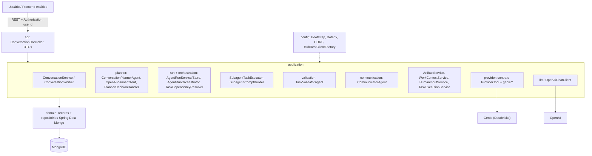
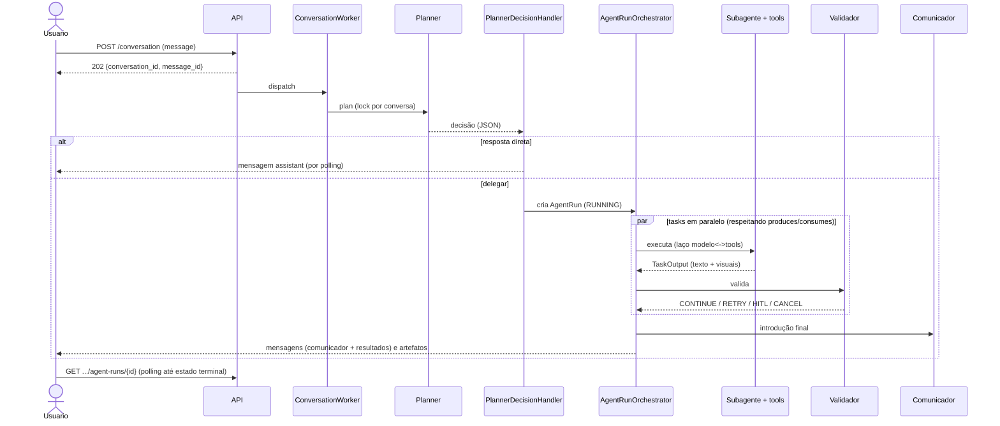

# 01 — Visão geral, arquitetura e fluxos ponta a ponta

> Spec do projeto **Hub de IA** (pacote base `com.lamorim.hubdeia`). Leia antes `00-LEIA-ME.md`.

## Objetivo

Dar ao LLM de código (e a quem for revisar) o **mapa completo** do sistema antes dos detalhes: o que ele é, como é dividido, os conceitos, os fluxos ponta a ponta, as decisões de projeto e os limites. As specs 02 a 12 detalham cada parte; esta é a leitura de orientação e **não substitui** as demais.

## Arquivos cobertos

Esta spec é transversal e não é dona de nenhum arquivo; ela se apoia em `docs/implementation-summary.md`, `docs/data-model.md` (literais em `12-docs-e-anexos.md`) e em todo o código descrito nas specs 02–10.

## Depende de

Nada (é a primeira a ser lida depois do índice).

## 1. O que é o sistema

O **Hub de IA** é um serviço (Java 21, Spring Boot 4.1.1, MongoDB) que recebe perguntas de usuários em linguagem natural por um chat e as atende de uma de três formas:

1. **Resposta direta** — conversa, esclarecimentos, explicações de algo já escrito.
2. **Pergunta de volta** — quando falta informação para dividir o trabalho.
3. **Delegação a especialistas de IA** (*subagentes*) que consultam fontes de dados corporativas (hoje o **Genie** da Databricks), produzem análises com tabelas e gráficos, são **revisados** automaticamente por um agente validador e consolidados por um agente comunicador.

Há também um frontend web estático (spec 10) que conversa com a API REST (spec 05).

## 2. Princípios de projeto (não negociáveis)

1. **MongoDB é a única fonte de verdade** — inclusive o catálogo de agentes. Não existe Redis nem outro armazenamento.
2. **O LLM decide, o backend garante**: planejador e validador são LLMs; mas permissões de tools, limites de tentativas, estados finais, validações e ordenação são regras do código.
3. **Providers atrás de um contrato neutro**: o núcleo nunca conhece o formato de um provider; tools devolvem texto + `Visual`s (`HTML`/`VEGA_LITE`).
4. **Escritas atômicas, um agregado por coleção**: sem ler-modificar-gravar de documentos grandes.
5. **Estado terminal de uma run é final** (`RUNNING` → `FINISHED`/`CANCELLED`/`FAILED` uma única vez).
6. **Falha nunca é silenciosa**: cancelamento, erro e pendência sempre geram mensagem no chat.
7. **Visuais montados em runtime**: guardados separados do texto; pessoas veem markdown completo, modelos veem texto puro com `[visual: título]`.
8. **O planejador não escreve no banco**: devolve uma decisão que o `PlannerDecisionHandler` valida inteira **antes** de gravar.

## 3. Arquitetura em camadas

Pacotes: `api` (REST), `application` (serviços e agentes), `domain` (modelo e repositórios), `config` (infraestrutura). Detalhes em 02–09.

## 4. Glossário

| Termo | Significado |
|---|---|
| **WorkContext** | Modo de trabalho do catálogo que agrupa os especialistas elegíveis (`agent_ids`) e carrega `instructions`; **não** limita a conversa. Uma conversa pode ter nenhum ativo; no máximo um `ACTIVE` por vez (instância `ConversationWorkContext`) |
| **Subagent** | Especialista com prompt próprio, skills, providers habilitados e `produces`/`consumes` |
| **Skill** | Capacidade de negócio: instruções (viram prompt) + `tool_ids` permitidas |
| **Tool** | Função exposta ao modelo (`function_name`); implementada por uma `ProviderTool` |
| **Provider** | Fonte de dados externa (hoje `provider-genie`) |
| **Planner (planejador)** | LLM que decide: responder, perguntar, reativar artefato ou criar tasks (JSON estrito) |
| **AgentRun** | Execução assíncrona criada quando o planejador delega; contém `Task`s e `logs` |
| **Task** | Unidade de trabalho de **um** subagente, com `input.enriched_content` |
| **Validator (validador)** | LLM-as-a-judge: `CONTINUE`, `RETRY`, `CANCEL` ou `HITL` para cada saída |
| **HITL** | *Human in the loop*: a task precisa de uma resposta do usuário; vira `HumanInputRequest` (não trava a conversa) |
| **Communicator (comunicador)** | LLM que escreve só a introdução curta da resposta final |
| **Artifact** | Resultado tipado e versionado (`INSIGHT`, `BRIEFING`…) publicado quando uma task é aprovada; pertence à conversa |
| **Visual** | Tabela/gráfico neutro construído pela tool (`HTML` ou `VEGA_LITE`) |
| **TaskOutput** | Saída de uma task = texto (com marcadores `[[visualization:id]]`) + visuais |
| **Memória curta** | Últimas 5 tasks do **mesmo subagente** na conversa (texto puro, truncado) |

## 5. Fluxo ponta a ponta

Passo a passo:

1. `POST /conversation` grava a conversa e a mensagem e responde **202**; o `ConversationWorker` processa em segundo plano.
2. O planejador lê histórico (10 mensagens), últimas 3 runs, contexto ativo/pausados, pendências, artefatos e o catálogo, e devolve uma decisão (spec 06).
3. O `PlannerDecisionHandler` valida e aplica: resposta direta, resposta a pendência, reativação de artefato, ativação de contexto e criação da run.
4. O `AgentRunOrchestrator` executa as tasks em paralelo (pool de 4 por padrão); quem consome um tipo de artefato espera quem o produz (spec 07).
5. Cada task roda o laço do subagente (spec 08), é validada, pode refazer (até 3 tentativas), pedir informação ao usuário (HITL) ou cancelar a run.
6. Tasks aprovadas publicam artefatos (se o subagente declara `produces`).
7. A run termina: o comunicador escreve a introdução e os blocos viram mensagens do chat; o cliente acompanha por *polling* (spec 05).

## 6. Persistência

Um agregado por coleção (`conversations`, `messages`, `conversation_work_contexts`, `agent_runs`, `task_executions`, `human_input_requests`, `provider_sessions`, `artifacts`) mais o catálogo (`providers`, `tools`, `skills`, `subagents`, `work_contexts`), com índices e regras de mapeamento em `03-dominio-e-mongodb.md`.

## 7. Limites e itens fora de escopo declarados

- **Autenticação**: o `Authorization` é só o id do usuário em texto puro; não há perfis nem token validado.
- **Sem avaliação automatizada** da qualidade das respostas (exceto o teste live opt-in do planejador), **sem observabilidade** de custo/tokens, **sem retomada** de runs interrompidas por queda do serviço (runs órfãs ficam `RUNNING`), **sem SSE** (só *polling*), **sem DAG explícito** vindo do planejador.
- O planejador não informa em qual work context cada run ocorreu: com **vários** contextos, uma continuação de especialista de outro contexto exigiria `ACTIVATE` e hoje o prompt orienta `KEEP` (limitação conhecida; hoje há um único contexto no catálogo).
- Não há API administrativa do catálogo: edita-se o MongoDB (spec 04).
- O Genie é o único provider implementado.

## Armadilhas e decisões não óbvias

1. "WorkContext" **não** é um estado de dados da conversa: é um agrupamento de especialistas elegíveis. Os dados que "atravessam" trocas de contexto vivem na **conversa** (mensagens, runs, artefatos, memória do subagente, sessões de provider).
2. Os nomes de campo JSON/Mongo são `snake_case`; os nomes Java são `camelCase`.
3. Os textos de prompts e mensagens ao usuário estão em português **sem acentos** de propósito; copie-os literalmente.

## Critérios de aceite

Os mesmos do projeto inteiro (spec 11): a suíte passa, a API responde conforme a spec 05, o frontend funciona conforme a spec 10 e um fluxo real (pergunta → delegação → resposta com artefato) é observável de ponta a ponta com credenciais válidas.

## Ordem de implementação sugerida (do projeto inteiro)

1. `02` → 2. `03` → 3. `04` → 4. `08` (contrato de tools, conteúdo, artefatos) → 5. `06` (conversa e planejador) → 6. `07` (runs) → 7. `09` (Genie) → 8. `05` (API) → 9. `10` (frontend) → 10. `11` (testes, em paralelo a cada passo) → 11. `12` (docs).
