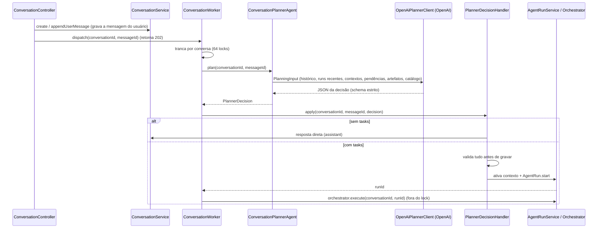

# 06 — Conversas, mensagens, worker assíncrono, planejador (LLM) e aplicação da decisão

> Spec do projeto **Hub de IA** (pacote base `com.lamorim.hubdeia`). Leia antes `00-LEIA-ME.md`.

## Objetivo

Especificar o caminho que uma mensagem do usuário percorre **até a decisão do planejador ser aplicada**: gravação da mensagem, despacho assíncrono, montagem do contexto, chamada ao modelo (prompt e *schema* literais), interpretação da decisão e seus efeitos (resposta direta, troca de work context, reativação de artefato, resposta a pendência, criação de uma run). A execução da run está em `07-orquestracao-de-runs.md`.

## Arquivos cobertos

`application/ConversationService.java`, `ConversationWorker.java`, `MonotonicTime.java`, `Text.java`, `ConversationMemorySanitizer.java`, `WorkContextService.java`, `HumanInputService.java` e todo o pacote `application/planner/` (`ConversationPlannerAgent`, `OpenAiPlannerClient`, `PlannerAgent`, `PlannerDecision`, `PlannerDecisionHandler`, `PlannedTask`, `PlanningContextState`, `PlanningInput`, `PlanningRunSummary`, `PlanningSubagentView`, `PlanningTaskSummary`, `PlanningWorkContextView`, `WorkContextAction`).

## Depende de

`02` (propriedades `hub.openai.*`), `03` (records e repositórios), `07` (`AgentRunService.start/recent/lastMessage`), `08` (`ArtifactService`, `ArtifactView`, `TaskOutput`, `OpenAiChatClient`).

## 1. Visão do fluxo



## 2. `ConversationService` — conversas e mensagens

**Arquivo `src/main/java/com/lamorim/hubdeia/application/ConversationService.java`** (literal):

```java
package com.lamorim.hubdeia.application;

import static org.springframework.data.mongodb.core.query.Criteria.where;

import java.time.Instant;
import java.util.List;
import java.util.UUID;

import org.springframework.data.domain.PageRequest;
import org.springframework.data.mongodb.core.MongoTemplate;
import org.springframework.data.mongodb.core.query.Query;
import org.springframework.data.mongodb.core.query.Update;
import org.springframework.http.HttpStatus;
import org.springframework.stereotype.Service;
import org.springframework.util.StringUtils;
import org.springframework.web.server.ResponseStatusException;

import com.lamorim.hubdeia.api.dto.ConversationDetailResponse;
import com.lamorim.hubdeia.api.dto.ConversationSummaryResponse;
import com.lamorim.hubdeia.api.dto.MessageAcceptedResponse;
import com.lamorim.hubdeia.domain.model.Conversation;
import com.lamorim.hubdeia.domain.model.FinalAnswerBlock;
import com.lamorim.hubdeia.domain.model.Message;
import com.lamorim.hubdeia.domain.repository.ConversationRepository;
import com.lamorim.hubdeia.domain.repository.MessageRepository;

/** Conversations and their chat messages. Ownership is checked here, never deeper in the stack. */
@Service
public class ConversationService {

	private static final int LAST_MESSAGE_PREVIEW = 200;

	private final ConversationRepository conversations;
	private final MessageRepository messages;
	private final MongoTemplate mongo;

	public ConversationService(ConversationRepository conversations, MessageRepository messages, MongoTemplate mongo) {
		this.conversations = conversations;
		this.messages = messages;
		this.mongo = mongo;
	}

	public MessageAcceptedResponse create(String userId, String content) {
		requireText(content);
		Instant now = Instant.now();
		Conversation saved = conversations.save(new Conversation(null, userId, preview(content), now, now));
		return accepted(saved.id(), addMessage(saved.id(), "user", content));
	}

	public MessageAcceptedResponse appendUserMessage(String userId, String conversationId, String content) {
		requireText(content);
		requireOwned(userId, conversationId);
		return accepted(conversationId, addMessage(conversationId, "user", content));
	}

	public void appendAssistantMessage(String conversationId, String content) {
		addMessage(conversationId, "assistant", content);
	}

	public void appendAssistantBlocks(String conversationId, List<FinalAnswerBlock> blocks) {
		blocks.stream().map(FinalAnswerBlock::markdown).filter(StringUtils::hasText)
				.forEach(markdown -> addMessage(conversationId, "assistant", markdown));
	}

	public Conversation requireOwned(String userId, String conversationId) {
		return conversations.findByIdAndUserId(conversationId, userId)
				.orElseThrow(() -> new ResponseStatusException(HttpStatus.NOT_FOUND, "Conversation not found."));
	}

	public ConversationDetailResponse detail(String userId, String conversationId) {
		Conversation conversation = requireOwned(userId, conversationId);
		return new ConversationDetailResponse(conversation.id(), conversation.chatLastMessage(),
				messages.findByConversationIdOrderByCreatedAtAsc(conversationId), conversation.createdAt(), conversation.updatedAt());
	}

	public List<Message> messages(String userId, String conversationId) {
		requireOwned(userId, conversationId);
		return messages.findByConversationIdOrderByCreatedAtAsc(conversationId);
	}

	public List<ConversationSummaryResponse> summaries(String userId) {
		return conversations.findByUserIdOrderByUpdatedAtDesc(userId).stream()
				.map(value -> new ConversationSummaryResponse(value.id(), value.chatLastMessage(), value.createdAt(), value.updatedAt()))
				.toList();
	}

	public Message message(String conversationId, String messageId) {
		return messages.findByIdAndConversationId(messageId, conversationId)
				.orElseThrow(() -> new ResponseStatusException(HttpStatus.NOT_FOUND, "Message not found."));
	}

	/** Up to {@code limit} messages written before {@code message}, oldest first. */
	public List<Message> historyBefore(Message message, int limit) {
		return messages.findByConversationIdAndCreatedAtBeforeOrderByCreatedAtDesc(
				message.conversationId(), message.createdAt(), PageRequest.of(0, limit)).reversed();
	}

	/** The last {@code limit} messages of the conversation, oldest first. */
	public List<Message> recent(String conversationId, int limit) {
		return messages.findByConversationIdOrderByCreatedAtDesc(conversationId, PageRequest.of(0, limit)).reversed();
	}

	private Message addMessage(String conversationId, String role, String content) {
		Message message = messages.insert(new Message(UUID.randomUUID().toString(), conversationId, role, content, MonotonicTime.next()));
		mongo.updateFirst(Query.query(where("_id").is(conversationId)),
				new Update().set("chatLastMessage", preview(content)).set("updatedAt", message.createdAt()), Conversation.class);
		return message;
	}

	private static MessageAcceptedResponse accepted(String conversationId, Message message) {
		return new MessageAcceptedResponse("ACCEPTED", conversationId, message.id());
	}

	private static String preview(String content) {
		return content.length() <= LAST_MESSAGE_PREVIEW ? content : content.substring(0, LAST_MESSAGE_PREVIEW);
	}

	private static void requireText(String value) {
		if (!StringUtils.hasText(value)) {
			throw new ResponseStatusException(HttpStatus.BAD_REQUEST, "message is required.");
		}
	}
}
```

Regras:

- `create(userId, content)`: valida o texto (400 `"message is required."`); salva `Conversation(null, userId, preview(content), now, now)` (o Mongo gera o id); grava a mensagem do usuário via `addMessage`; devolve `MessageAcceptedResponse("ACCEPTED", conversationId, messageId)`.
- `appendUserMessage`: valida o texto **antes** da posse; depois `requireOwned`; grava e devolve o `MessageAcceptedResponse`.
- `addMessage(conversationId, role, content)`: insere uma `Message` com id `UUID`, `createdAt = MonotonicTime.next()` (ordem estável) e **atualiza a conversa** com `$set chatLastMessage = preview(content)` e `$set updatedAt = createdAt` (via `MongoTemplate.updateFirst` por `_id`). O *preview* é o texto cortado em **200** caracteres, sem reticências.
- `appendAssistantBlocks(conversationId, blocks)`: para cada bloco com `markdown` não vazio grava uma mensagem `assistant` (na ordem).
- `requireOwned`: 404 `"Conversation not found."` se a conversa não existe **ou** é de outro usuário.
- `historyBefore(message, limit)`: as `limit` mensagens **anteriores** (`createdAt` estritamente menor) em ordem **crescente** (consulta desc paginada + `.reversed()`). `recent(conversationId, limit)`: as últimas `limit`, também em ordem crescente.
- `message(conversationId, messageId)`: 404 `"Message not found."`.

## 3. `MonotonicTime` e `Text`

**Arquivo `src/main/java/com/lamorim/hubdeia/application/MonotonicTime.java`** (literal):

```java
package com.lamorim.hubdeia.application;

import java.time.Instant;
import java.util.concurrent.atomic.AtomicLong;

/**
 * Timestamps that never repeat within this process (millisecond precision, the most MongoDB keeps),
 * so records written back to back keep a well-defined order when sorted by time.
 */
public final class MonotonicTime {

	private static final AtomicLong LAST = new AtomicLong();

	private MonotonicTime() {
	}

	public static Instant next() {
		long now = System.currentTimeMillis();
		return Instant.ofEpochMilli(LAST.updateAndGet(previous -> Math.max(previous + 1, now)));
	}
}
```

**Arquivo `src/main/java/com/lamorim/hubdeia/application/Text.java`** (literal):

```java
package com.lamorim.hubdeia.application;

public final class Text {

	private Text() {
	}

	/** Cuts the value to {@code max} characters, appending an ellipsis when something was removed. */
	public static String truncate(String value, int max) {
		return value == null || value.length() <= max ? value : value.substring(0, max) + "...";
	}
}
```

- `MonotonicTime.next()` devolve instantes (ms) **estritamente crescentes dentro do processo**: o Mongo trunca para milissegundo, e sem isso duas gravações no mesmo ms empatariam e a ordenação por data ficaria ambígua (mensagens e execuções). Usado em `ConversationService.addMessage` e `TaskExecutionService.record`.
- `Text.truncate(value, max)`: devolve `value` se `null` ou com tamanho ≤ `max`; senão `value.substring(0, max) + "..."`.

## 4. `ConversationMemorySanitizer`

**Arquivo `src/main/java/com/lamorim/hubdeia/application/ConversationMemorySanitizer.java`** (literal):

````java
package com.lamorim.hubdeia.application;

import java.util.regex.Pattern;

import org.springframework.stereotype.Component;

import com.lamorim.hubdeia.application.content.TaskOutput;

/** Keeps rendered visuals (chart specs, HTML tables) out of what models read from the chat history. */
@Component
public class ConversationMemorySanitizer {

	private static final String OMITTED = "[visual omitido da memoria]";
	private static final Pattern VEGA_LITE_BLOCK = Pattern.compile("(?is)```\\s*vega-lite\\s+.*?```");
	private static final Pattern HTML_VISUAL = Pattern.compile("(?s)" + Pattern.quote(TaskOutput.VISUAL_START) + ".*?" + Pattern.quote(TaskOutput.VISUAL_END));

	public String sanitizeForAgent(String content) {
		if (content == null || content.isBlank()) {
			return "";
		}
		String withoutCharts = VEGA_LITE_BLOCK.matcher(content).replaceAll(OMITTED);
		return HTML_VISUAL.matcher(withoutCharts).replaceAll(OMITTED);
	}
}
````

Remove, do texto do histórico enviado aos modelos, os blocos ```` ```vega-lite … ``` ```` e os trechos HTML delimitados por `TaskOutput.VISUAL_START`…`TaskOutput.VISUAL_END` (ver 08), trocando-os por `[visual omitido da memoria]`. Texto `null`/em branco vira `""`.

## 5. `ConversationWorker` — processamento assíncrono

**Arquivo `src/main/java/com/lamorim/hubdeia/application/ConversationWorker.java`** (literal):

```java
package com.lamorim.hubdeia.application;

import java.util.Optional;
import java.util.concurrent.ExecutorService;
import java.util.concurrent.Executors;
import java.util.concurrent.locks.ReentrantLock;
import java.util.stream.Stream;

import org.slf4j.Logger;
import org.slf4j.LoggerFactory;
import org.springframework.stereotype.Component;

import jakarta.annotation.PreDestroy;

import com.lamorim.hubdeia.application.orchestration.AgentRunOrchestrator;
import com.lamorim.hubdeia.application.planner.PlannerAgent;
import com.lamorim.hubdeia.application.planner.PlannerDecision;
import com.lamorim.hubdeia.application.planner.PlannerDecisionHandler;

/** Processes each accepted user message in the background: plan, apply the decision, run the agents. */
@Component
public class ConversationWorker {

	private static final Logger logger = LoggerFactory.getLogger(ConversationWorker.class);

	private final ExecutorService executor = Executors.newVirtualThreadPerTaskExecutor();
	private final ReentrantLock[] planningLocks = Stream.generate(ReentrantLock::new).limit(64).toArray(ReentrantLock[]::new);
	private final ConversationService conversations;
	private final PlannerAgent planner;
	private final PlannerDecisionHandler decisions;
	private final AgentRunOrchestrator orchestrator;

	public ConversationWorker(ConversationService conversations, PlannerAgent planner, PlannerDecisionHandler decisions, AgentRunOrchestrator orchestrator) {
		this.conversations = conversations;
		this.planner = planner;
		this.decisions = decisions;
		this.orchestrator = orchestrator;
	}

	public void dispatch(String conversationId, String messageId) {
		executor.execute(() -> process(conversationId, messageId));
	}

	/**
	 * Messages of one conversation are planned one at a time, in arrival order, so each plan sees the
	 * context left by the previous one. Running the agents is not serialized: the user can keep chatting.
	 */
	private Optional<String> planAndApply(String conversationId, String messageId) {
		ReentrantLock lock = planningLocks[Math.floorMod(conversationId.hashCode(), planningLocks.length)];
		lock.lock();
		try {
			PlannerDecision decision = planner.plan(conversationId, messageId);
			return decisions.apply(conversationId, messageId, decision);
		} finally {
			lock.unlock();
		}
	}

	@PreDestroy
	void shutdown() {
		executor.shutdown();
	}

	private void process(String conversationId, String messageId) {
		try {
			logger.info("Processing message. conversationId={}, messageId={}", conversationId, messageId);
			planAndApply(conversationId, messageId).ifPresent(runId -> {
				logger.info("Starting AgentRun. conversationId={}, agentRunId={}", conversationId, runId);
				orchestrator.execute(conversationId, runId);
			});
		} catch (Exception error) {
			logger.error("Message processing failed. conversationId={}, messageId={}", conversationId, messageId, error);
			conversations.appendAssistantMessage(conversationId, "Nao foi possivel processar sua mensagem agora.");
		}
	}
}
```

- Um `ExecutorService` de **threads virtuais** (`Executors.newVirtualThreadPerTaskExecutor()`), encerrado em `@PreDestroy`.
- `dispatch(conversationId, messageId)` só agenda `process`.
- **Planejar e aplicar são serializados por conversa**: há **64** `ReentrantLock`; o lock é `planningLocks[Math.floorMod(conversationId.hashCode(), 64)]`. Assim cada mensagem é planejada na ordem e enxerga o contexto deixado pela anterior. **Executar a run não é serializado** (acontece depois de soltar o lock), então o usuário pode continuar conversando.
- Qualquer exceção em planejar/aplicar/executar é registrada (`logger.error`) e grava a mensagem `assistant` **`"Nao foi possivel processar sua mensagem agora."`**.

## 6. `WorkContextService`

**Arquivo `src/main/java/com/lamorim/hubdeia/application/WorkContextService.java`** (literal):

```java
package com.lamorim.hubdeia.application;

import static org.springframework.data.mongodb.core.query.Criteria.where;

import java.time.Instant;
import java.util.List;
import java.util.Map;
import java.util.Optional;
import java.util.UUID;
import java.util.stream.Collectors;

import org.springframework.data.mongodb.core.FindAndModifyOptions;
import org.springframework.data.mongodb.core.MongoTemplate;
import org.springframework.data.mongodb.core.query.Query;
import org.springframework.data.mongodb.core.query.Update;
import org.springframework.stereotype.Service;

import com.lamorim.hubdeia.domain.model.ConversationWorkContext;
import com.lamorim.hubdeia.domain.model.ConversationWorkContextStatus;
import com.lamorim.hubdeia.domain.model.WorkContext;
import com.lamorim.hubdeia.domain.repository.ConversationWorkContextRepository;
import com.lamorim.hubdeia.domain.repository.WorkContextRepository;

/** Catalog work contexts and their per-conversation instances (at most one ACTIVE at a time). */
@Service
public class WorkContextService {

	private final WorkContextRepository definitions;
	private final ConversationWorkContextRepository instances;
	private final MongoTemplate mongo;

	public WorkContextService(WorkContextRepository definitions, ConversationWorkContextRepository instances, MongoTemplate mongo) {
		this.definitions = definitions;
		this.instances = instances;
		this.mongo = mongo;
	}

	public List<WorkContext> enabledDefinitions() {
		return definitions.findByEnabledTrue();
	}

	public Optional<WorkContext> definition(String workContextId) {
		return workContextId == null ? Optional.empty() : definitions.findById(workContextId);
	}

	public Optional<ConversationWorkContext> find(String instanceId) {
		return instanceId == null ? Optional.empty() : instances.findById(instanceId);
	}

	public Optional<ConversationWorkContext> active(String conversationId) {
		return instances.findFirstByConversationIdAndStatus(conversationId, ConversationWorkContextStatus.ACTIVE);
	}

	public List<ConversationWorkContext> paused(String conversationId) {
		return instances.findByConversationIdAndStatus(conversationId, ConversationWorkContextStatus.PAUSED);
	}

	/** Maps instance id to catalog work context id for every instance of the conversation. */
	public Map<String, String> definitionIds(String conversationId) {
		return instances.findByConversationId(conversationId).stream()
				.collect(Collectors.toMap(ConversationWorkContext::id, ConversationWorkContext::workContextId));
	}

	/** Makes the catalog context the active one, reusing its instance when the conversation already has it. */
	public ConversationWorkContext activate(String conversationId, String workContextId) {
		WorkContext definition = definition(workContextId).filter(WorkContext::enabled)
				.orElseThrow(() -> new IllegalStateException("WorkContext selecionado nao encontrado: " + workContextId));
		Instant now = Instant.now();
		ConversationWorkContext selected = mongo.findAndModify(
				Query.query(where("conversationId").is(conversationId).and("workContextId").is(definition.id())),
				new Update().set("status", ConversationWorkContextStatus.ACTIVE).set("updatedAt", now)
						.setOnInsert("_id", UUID.randomUUID().toString()).setOnInsert("createdAt", now),
				FindAndModifyOptions.options().upsert(true).returnNew(true),
				ConversationWorkContext.class);
		mongo.updateMulti(
				Query.query(where("conversationId").is(conversationId).and("status").is(ConversationWorkContextStatus.ACTIVE).and("_id").ne(selected.id())),
				new Update().set("status", ConversationWorkContextStatus.PAUSED).set("updatedAt", now),
				ConversationWorkContext.class);
		return selected;
	}

	public void recordRun(String instanceId, String runId) {
		mongo.updateFirst(Query.query(where("_id").is(instanceId)),
				new Update().set("lastAgentRunId", runId).set("updatedAt", Instant.now()), ConversationWorkContext.class);
	}
}
```

- `activate(conversationId, workContextId)`: o contexto do catálogo precisa existir **e** estar `enabled` (senão `IllegalStateException("WorkContext selecionado nao encontrado: <id>")`). Faz um `findAndModify` com `upsert` e `returnNew` (cria a instância se não existir, com `_id` UUID e `createdAt`; sempre grava `status=ACTIVE` e `updatedAt`) e, em seguida, um `updateMulti` que põe em `PAUSED` todas as outras instâncias `ACTIVE` da conversa. Há no máximo uma ativa; voltar a um contexto reutiliza a instância existente (mantém `lastAgentRunId`).
- `recordRun(instanceId, runId)`: `$set lastAgentRunId` e `updatedAt`.
- `definitionIds(conversationId)`: mapa `idDaInstância -> workContextId` do catálogo.

## 7. `HumanInputService`

**Arquivo `src/main/java/com/lamorim/hubdeia/application/HumanInputService.java`** (literal):

```java
package com.lamorim.hubdeia.application;

import static org.springframework.data.mongodb.core.query.Criteria.where;

import java.time.Instant;
import java.util.List;
import java.util.UUID;

import org.springframework.data.mongodb.core.MongoTemplate;
import org.springframework.data.mongodb.core.query.Query;
import org.springframework.data.mongodb.core.query.Update;
import org.springframework.stereotype.Service;
import org.springframework.util.StringUtils;

import com.lamorim.hubdeia.domain.model.HumanInputRequest;
import com.lamorim.hubdeia.domain.model.HumanInputRequestStatus;
import com.lamorim.hubdeia.domain.repository.HumanInputRequestRepository;

/** Questions an agent run needs the user to answer. They never block the conversation. */
@Service
public class HumanInputService {

	private static final String DEFAULT_QUESTION = "Preciso de uma confirmacao para continuar.";

	private final HumanInputRequestRepository requests;
	private final MongoTemplate mongo;

	public HumanInputService(HumanInputRequestRepository requests, MongoTemplate mongo) {
		this.requests = requests;
		this.mongo = mongo;
	}

	public HumanInputRequest create(String conversationId, String runId, String taskId, String question) {
		return requests.insert(new HumanInputRequest(UUID.randomUUID().toString(), conversationId, runId, taskId,
				StringUtils.hasText(question) ? question : DEFAULT_QUESTION, HumanInputRequestStatus.PENDING, null, Instant.now(), null));
	}

	/** Marks a pending request of this conversation as answered. Unknown or already answered ids are ignored. */
	public void answer(String conversationId, String requestId, String answerMessageId) {
		if (!StringUtils.hasText(requestId)) {
			return;
		}
		mongo.updateFirst(
				Query.query(where("_id").is(requestId).and("conversationId").is(conversationId).and("status").is(HumanInputRequestStatus.PENDING)),
				new Update().set("status", HumanInputRequestStatus.ANSWERED).set("answerMessageId", answerMessageId).set("answeredAt", Instant.now()),
				HumanInputRequest.class);
	}

	public List<HumanInputRequest> pendingForConversation(String conversationId) {
		return requests.findByConversationIdAndStatus(conversationId, HumanInputRequestStatus.PENDING);
	}

	public List<HumanInputRequest> pendingForRun(String runId) {
		return requests.findByAgentRunIdAndStatus(runId, HumanInputRequestStatus.PENDING);
	}
}
```

- `create` grava a pendência `PENDING` com a pergunta (ou `"Preciso de uma confirmacao para continuar."` se vazia).
- `answer` só marca como `ANSWERED` uma pendência **desta conversa** que ainda esteja `PENDING` (`answerMessageId` e `answeredAt`); id vazio, desconhecido, de outra conversa ou já respondido é ignorado em silêncio.

## 8. Planejador: coleta do contexto

**Arquivo `src/main/java/com/lamorim/hubdeia/application/planner/PlannerAgent.java`** (literal):

```java
package com.lamorim.hubdeia.application.planner;

public interface PlannerAgent {

	/** Decides how to handle the given user message of the conversation. */
	PlannerDecision plan(String conversationId, String messageId);
}
```

**Arquivo `src/main/java/com/lamorim/hubdeia/application/planner/ConversationPlannerAgent.java`** (literal):

```java
package com.lamorim.hubdeia.application.planner;

import java.util.List;

import org.springframework.stereotype.Component;

import com.lamorim.hubdeia.application.ArtifactService;
import com.lamorim.hubdeia.application.ConversationService;
import com.lamorim.hubdeia.application.HumanInputService;
import com.lamorim.hubdeia.application.Text;
import com.lamorim.hubdeia.application.WorkContextService;
import com.lamorim.hubdeia.application.content.TaskOutput;
import com.lamorim.hubdeia.application.run.AgentRunService;
import com.lamorim.hubdeia.domain.model.AgentRun;
import com.lamorim.hubdeia.domain.model.ConversationWorkContext;
import com.lamorim.hubdeia.domain.model.Message;
import com.lamorim.hubdeia.domain.model.WorkContext;
import com.lamorim.hubdeia.domain.repository.SubagentRepository;

/** Gathers the conversation state and hands it to the planner model. */
@Component
public class ConversationPlannerAgent implements PlannerAgent {

	private static final int HISTORY_SIZE = 10;
	private static final int RECENT_RUNS = 3;
	private static final int REQUEST_CHARS = 400;
	private static final int RESULT_CHARS = 700;

	private final ConversationService conversations;
	private final WorkContextService contexts;
	private final SubagentRepository subagents;
	private final HumanInputService humanInput;
	private final ArtifactService artifacts;
	private final AgentRunService runs;
	private final OpenAiPlannerClient client;

	public ConversationPlannerAgent(
			ConversationService conversations,
			WorkContextService contexts,
			SubagentRepository subagents,
			HumanInputService humanInput,
			ArtifactService artifacts,
			AgentRunService runs,
			OpenAiPlannerClient client
	) {
		this.conversations = conversations;
		this.contexts = contexts;
		this.subagents = subagents;
		this.humanInput = humanInput;
		this.artifacts = artifacts;
		this.runs = runs;
		this.client = client;
	}

	@Override
	public PlannerDecision plan(String conversationId, String messageId) {
		Message current = conversations.message(conversationId, messageId);
		PlanningInput input = new PlanningInput(
				current.content(),
				conversations.historyBefore(current, HISTORY_SIZE),
				contexts.active(conversationId).map(this::toState).orElse(null),
				contexts.paused(conversationId).stream().map(this::toState).toList(),
				runs.recent(conversationId, RECENT_RUNS).stream().map(this::toSummary).toList(),
				humanInput.pendingForConversation(conversationId),
				contexts.enabledDefinitions().stream().map(this::toView).toList(),
				artifacts.list(conversationId));
		return client.plan(input);
	}

	/** What each specialist was asked and answered, in plain text: the planner decides from facts, not from guesses. */
	private PlanningRunSummary toSummary(AgentRun run) {
		return new PlanningRunSummary(run.id(), run.status().name(), run.tasks().stream().map(task -> new PlanningTaskSummary(
				task.subagentSelected(), task.description(), task.status().name(),
				Text.truncate(String.valueOf(task.input().getOrDefault("enriched_content", "")), REQUEST_CHARS),
				Text.truncate(TaskOutput.from(task.output()).plainText(), RESULT_CHARS))).toList());
	}

	private PlanningContextState toState(ConversationWorkContext context) {
		return new PlanningContextState(context.id(), context.workContextId(), context.lastAgentRunId(), runs.lastMessage(context.lastAgentRunId()));
	}

	private PlanningWorkContextView toView(WorkContext context) {
		List<PlanningSubagentView> agents = context.agentIds().isEmpty() ? List.of()
				: subagents.findAllById(context.agentIds()).stream().filter(subagent -> subagent.enabled()).map(PlanningSubagentView::from).toList();
		return new PlanningWorkContextView(context.id(), context.key(), context.name(), context.description(), context.instructions(), agents);
	}
}
```

O `PlanningInput` montado contém: o texto da mensagem atual; as **10** mensagens anteriores; o contexto ativo e os pausados (cada um com a última mensagem da última run); as **3** últimas runs resumidas; as pendências abertas da conversa; o catálogo de work contexts **habilitados** com seus subagentes **habilitados** (`produces`/`consumes` incluídos); e os artefatos recentes (`ArtifactService.list`, máx. 20). Em cada task de uma run recente: pedido (`enriched_content`) truncado em **400** caracteres e resultado em **texto puro** (`TaskOutput.plainText()`) truncado em **700**.

Records do planejador (literais):

**Arquivo `src/main/java/com/lamorim/hubdeia/application/planner/PlanningInput.java`** (literal):

```java
package com.lamorim.hubdeia.application.planner;

import java.util.List;

import com.lamorim.hubdeia.application.ArtifactView;
import com.lamorim.hubdeia.domain.model.HumanInputRequest;
import com.lamorim.hubdeia.domain.model.Message;

/** Everything the planner model needs to decide how to handle one user message. */
public record PlanningInput(
		String currentRequest,
		List<Message> history,
		PlanningContextState activeContext,
		List<PlanningContextState> pausedContexts,
		List<PlanningRunSummary> recentRuns,
		List<HumanInputRequest> pendingRequests,
		List<PlanningWorkContextView> availableContexts,
		List<ArtifactView> artifacts
) {
}
```

**Arquivo `src/main/java/com/lamorim/hubdeia/application/planner/PlanningContextState.java`** (literal):

```java
package com.lamorim.hubdeia.application.planner;

/** What the planner knows about a work context instance already used in the conversation. */
public record PlanningContextState(
		String id,
		String workContextId,
		String lastAgentRunId,
		String lastAgentRunMessage
) {
}
```

**Arquivo `src/main/java/com/lamorim/hubdeia/application/planner/PlanningRunSummary.java`** (literal):

```java
package com.lamorim.hubdeia.application.planner;

import java.util.List;

/** An earlier agent run of the conversation. */
public record PlanningRunSummary(
		String runId,
		String status,
		List<PlanningTaskSummary> tasks
) {
}
```

**Arquivo `src/main/java/com/lamorim/hubdeia/application/planner/PlanningTaskSummary.java`** (literal):

```java
package com.lamorim.hubdeia.application.planner;

/** One task of an earlier run, as the planner sees it: who did it, what they were asked and what came back. */
public record PlanningTaskSummary(
		String subagentId,
		String description,
		String status,
		String request,
		String result
) {
}
```

**Arquivo `src/main/java/com/lamorim/hubdeia/application/planner/PlanningWorkContextView.java`** (literal):

```java
package com.lamorim.hubdeia.application.planner;

import java.util.List;

public record PlanningWorkContextView(
		String id,
		String key,
		String name,
		String description,
		String instructions,
		List<PlanningSubagentView> subagents
) {
}
```

**Arquivo `src/main/java/com/lamorim/hubdeia/application/planner/PlanningSubagentView.java`** (literal):

```java
package com.lamorim.hubdeia.application.planner;

import java.util.List;

import com.lamorim.hubdeia.domain.model.Subagent;

public record PlanningSubagentView(
		String id,
		String name,
		String description,
		List<String> produces,
		List<String> consumes
) {

	public static PlanningSubagentView from(Subagent subagent) {
		return new PlanningSubagentView(subagent.id(), subagent.name(), subagent.description(), subagent.produces(), subagent.consumes());
	}
}
```

**Arquivo `src/main/java/com/lamorim/hubdeia/application/planner/PlannedTask.java`** (literal):

```java
package com.lamorim.hubdeia.application.planner;

public record PlannedTask(
		String description,
		String enrichedContent,
		String subagentId
) {
}
```

**Arquivo `src/main/java/com/lamorim/hubdeia/application/planner/PlannerDecision.java`** (literal):

```java
package com.lamorim.hubdeia.application.planner;

import java.util.List;

public record PlannerDecision(
		boolean shouldCreateTasks,
		String responseMessage,
		WorkContextAction workContextAction,
		String workContextId,
		String relatedHumanInputRequestId,
		String reactivateArtifactId,
		List<PlannedTask> tasks
) {

	public PlannerDecision {
		workContextAction = workContextAction == null ? WorkContextAction.NONE : workContextAction;
		tasks = tasks == null ? List.of() : tasks;
	}

	public boolean hasTasks() {
		return shouldCreateTasks && !tasks.isEmpty();
	}
}
```

**Arquivo `src/main/java/com/lamorim/hubdeia/application/planner/WorkContextAction.java`** (literal):

```java
package com.lamorim.hubdeia.application.planner;

public enum WorkContextAction {
	/** No delegation: keep whatever context is active without using it. */
	NONE,
	/** Continue in the active context. */
	KEEP,
	/** Start or return to the catalog context named by the decision. */
	ACTIVATE;

	public static WorkContextAction parse(String value) {
		try {
			return valueOf(value);
		} catch (IllegalArgumentException | NullPointerException error) {
			return NONE;
		}
	}
}
```

## 9. `OpenAiPlannerClient` — prompt, entrada e *schema* (literais)

**Arquivo `src/main/java/com/lamorim/hubdeia/application/planner/OpenAiPlannerClient.java`** (literal):

```java
package com.lamorim.hubdeia.application.planner;

import java.util.ArrayList;
import java.util.List;

import org.bson.Document;
import org.springframework.beans.factory.annotation.Value;
import org.springframework.stereotype.Component;

import com.lamorim.hubdeia.application.ArtifactView;
import com.lamorim.hubdeia.application.ConversationMemorySanitizer;
import com.lamorim.hubdeia.application.Text;
import com.lamorim.hubdeia.application.llm.OpenAiChatClient;
import com.lamorim.hubdeia.domain.model.HumanInputRequest;

/** Builds the planner prompt and parses the structured decision returned by the model. */
@Component
public class OpenAiPlannerClient {

	private static final int ARTIFACT_SUMMARY_CHARS = 1200;

	private final OpenAiChatClient chat;
	private final String model;
	private final ConversationMemorySanitizer sanitizer;

	public OpenAiPlannerClient(
			OpenAiChatClient chat,
			@Value("${hub.openai.model:gpt-5}") String model,
			ConversationMemorySanitizer sanitizer
	) {
		this.chat = chat;
		this.model = model;
		this.sanitizer = sanitizer;
	}

	public PlannerDecision plan(PlanningInput input) {
		Document request = new Document("model", model)
				.append("messages", messages(input))
				.append("response_format", responseFormat());
		return parse(chat.completeJson(request));
	}

	private List<Document> messages(PlanningInput input) {
		List<Document> messages = new ArrayList<>();
		messages.add(new Document("role", "system").append("content", systemPrompt()));
		input.history().forEach(message -> messages.add(
				new Document("role", message.role()).append("content", sanitizer.sanitizeForAgent(message.content()))));
		messages.add(new Document("role", "user").append("content", planningInput(input).toJson()));
		return messages;
	}

	private String systemPrompt() {
		return String.join("\n",
				"PAPEL",
				"Voce e o planejador de um Hub de IA conversacional. Sua funcao e decidir quem faz o que: responder direto ou acionar especialistas que consultam dados e produzem uma resposta confiavel.",
				"O usuario conversa livremente. WorkContext organiza especialistas, mas nunca limita nem interrompe a conversa.",
				"Voce NAO acessa fontes de dados, NAO calcula e NAO produz graficos, tabelas, metricas ou analises. Isso e trabalho exclusivo dos especialistas, que consultam a fonte de dados e dispoem das ferramentas de visualizacao. Nunca diga ao usuario que nao ha ferramenta ou acesso para algo que um especialista pode fazer: delegue.",
				"",
				"LEIA O CONTEXTO ANTES DE DECIDIR",
				"Nunca decida olhando apenas current_request. Antes de qualquer decisao, leia o contexto nesta ordem:",
				"1. As mensagens anteriores da conversa.",
				"2. recent_runs: o que cada especialista ja executou nesta conversa, o que lhe foi pedido (request) e o que ele devolveu (result).",
				"3. artifacts: resultados ja produzidos e guardados.",
				"4. active_context e paused_contexts: em que modo de trabalho a conversa esta.",
				"5. pending_human_input_requests: perguntas que ainda aguardam resposta do usuario.",
				"Referencias como 'isso', 'esses dados', 'o grafico', 'continue', 'de novo' e 'agora' apontam para o resultado mais recente desse contexto. Resolva a referencia antes de classificar o pedido.",
				"Depois classifique current_request em uma destas tres situacoes:",
				"a) CONTINUACAO de trabalho de especialista: o usuario pede algo novo sobre dados ou resultados que um especialista ja produziu, como um formato (grafico, tabela, ranking, comparativo), um recorte (periodo, segmento, canal) ou um detalhamento. Exemplos: 'gere graficos dos dados', 'agora so os jovens', 'mostre em tabela', 'detalhe por canal'. DEVOLVA o trabalho ao mesmo especialista que produziu o resultado anterior (veja recent_runs e artifacts), com work_context_action KEEP.",
				"b) NOVO pedido de dados ou analise: delegue ao especialista adequado.",
				"c) CONVERSA: saudacao, agradecimento, ou explicacao e reformulacao de algo que ja esta escrito na conversa e pode ser respondido so com esse texto: responda direto.",
				"Regra de ouro: graficos, tabelas, calculos e numeros novos nunca saem de voce, mesmo quando os dados parecerem estar no historico. O historico pode ter apenas um resumo, e quem tem a fonte e as ferramentas e o especialista. Se o pedido toca em dados ou resultados anteriores e voce estiver em duvida entre responder e delegar, delegue.",
				"",
				"RESPOSTA DIRETA",
				"Use should_create_tasks=false somente quando o pedido nao exigir consultar nem transformar dados: saudacoes, despedidas, agradecimentos, explicar ou reformular algo que ja esta escrito na conversa, pedidos para repetir algo e perguntas gerais. Nunca use resposta direta para produzir graficos, tabelas, calculos ou numeros novos, nem para sugerir codigo ou ferramentas externas no lugar do especialista.",
				"Nessa decisao, response_message deve ser a resposta final que o usuario leria: clara, natural, curta quando o pedido for simples e no idioma do usuario. Nao mencione JSON, tasks, WorkContext, agentes ou o processo interno.",
				"Nunca invente dados, resultados de campanhas, clientes ou fatos que exigem consulta. Quando a solicitacao estiver fora dos WorkContexts disponiveis e exigir dados especializados, explique a limitacao de forma objetiva em response_message e nao crie tasks.",
				"Se a conversa ainda nao permite decidir como dividir o trabalho (falta periodo, segmento, campanha ou objetivo), faca uma pergunta objetiva em response_message e nao crie tasks. A resposta do usuario volta para voce na proxima mensagem.",
				"",
				"DELEGACAO",
				"Use should_create_tasks=true somente quando a solicitacao precisar de dados, metricas, segmentacao, clientes, campanhas ou uma analise que um subagente precise consultar na fonte autorizada.",
				"Escolha no maximo um WorkContext. Se a solicitacao exige delegacao, work_context_id deve ser um id presente em available_work_contexts. Escolha subagent_id somente entre os subagents daquele contexto.",
				"O especialista NAO ve a conversa. Cada task deve ser autocontida, orientada a resultado e ter um unico dono. Inclua em enriched_content: o que o usuario pede agora; o contexto herdado da conversa que o especialista precisa (tema, metrica, periodo, filtros e segmento ja analisados, e o que ele ja produziu antes); e o resultado esperado, incluindo o formato (por exemplo: grafico de barras de page_view por dia). Nao atribua ao subagente tarefas fora de sua descricao.",
				"Em continuacoes, use o mesmo subagent_id do trabalho anterior e cite explicitamente o resultado a ser reaproveitado.",
				"Crie varias tasks apenas quando especialistas diferentes precisarem produzir partes independentes da resposta. Se um unico especialista resolve o pedido, crie uma unica task. As tasks sem relacao entre si executam em paralelo.",
				"Se um subagente consome um tipo de resultado (consumes) que outro produz (produces) e o pedido exige os dois, crie as duas tasks: o sistema ordena sozinho e o consumidor parte do resultado novo. Nao declare dependencias.",
				"Quando should_create_tasks=true, response_message deve conter apenas uma atualizacao breve e natural para o usuario, por exemplo: 'Vou analisar os dados solicitados.'",
				"",
				"WORKCONTEXT E HISTORICO",
				"Use NONE quando nao houver delegacao. Use KEEP para continuar o WorkContext ativo. Use ACTIVATE para iniciar ou retornar a outro, informando o id do catalogo em work_context_id. Nunca use KEEP sem contexto ativo.",
				"Considere a conversa anterior para resolver referencias como 'isso', 'a campanha anterior' e 'continue'. A mensagem atual em current_request e a solicitacao que voce deve decidir agora.",
				"Se a mensagem responder uma pending_human_input_request, informe seu id em related_human_input_request_id. Caso contrario, envie uma string vazia.",
				"",
				"ARTEFATOS",
				"artifacts lista resultados ja produzidos nesta conversa (tipo, versao, status ACTIVE ou SUPERSEDED, stale, titulo e resumo).",
				"Se um artefato ACTIVE e nao stale ja responde ao pedido com os mesmos filtros, periodo e foco, responda direto com base nele ou crie tasks apenas para o que falta. Se o usuario mudar filtros, periodo ou foco, ou pedir dados mais recentes, crie tasks novamente.",
				"Quando o usuario pedir para voltar a uma versao anterior (por exemplo 'volta pro briefing anterior'), informe em reactivate_artifact_id o id de um artefato da lista e confirme em response_message. Nunca invente ids. Caso contrario, envie uma string vazia.",
				"",
				"CONTRATO DE SAIDA",
				"Retorne somente JSON valido conforme o schema. Preencha todas as strings: use string vazia quando um campo nao se aplicar. should_create_tasks=false exige tasks vazio. should_create_tasks=true exige ao menos uma task valida.");
	}

	private Document planningInput(PlanningInput input) {
		return new Document("current_request", input.currentRequest())
				.append("recent_runs", input.recentRuns().stream().map(this::run).toList())
				.append("active_context", input.activeContext() == null ? new Document() : contextState(input.activeContext()))
				.append("paused_contexts", input.pausedContexts().stream().map(this::contextState).toList())
				.append("pending_human_input_requests", input.pendingRequests().stream().map(this::pendingRequest).toList())
				.append("artifacts", input.artifacts().stream().map(this::artifact).toList())
				.append("available_work_contexts", input.availableContexts().stream().map(this::availableContext).toList());
	}

	private Document run(PlanningRunSummary run) {
		return new Document("agent_run_id", run.runId()).append("status", run.status()).append("tasks", run.tasks().stream()
				.map(task -> new Document("subagent_id", task.subagentId()).append("description", task.description()).append("status", task.status())
						.append("request", task.request()).append("result", task.result())).toList());
	}

	private Document contextState(PlanningContextState state) {
		return new Document("id", state.id())
				.append("work_context_id", state.workContextId())
				.append("last_agent_run_id", state.lastAgentRunId())
				.append("last_agent_run_message", state.lastAgentRunMessage());
	}

	private Document pendingRequest(HumanInputRequest request) {
		return new Document("id", request.id()).append("agent_run_id", request.agentRunId())
				.append("task_id", request.taskId()).append("question", request.question());
	}

	private Document artifact(ArtifactView artifact) {
		return new Document("id", artifact.id())
				.append("type", artifact.type())
				.append("version", artifact.version())
				.append("status", artifact.status().name())
				.append("stale", artifact.stale())
				.append("title", artifact.title())
				.append("subagent_id", artifact.subagentId())
				.append("created_at", artifact.createdAt().toString())
				.append("summary", Text.truncate(artifact.content(), ARTIFACT_SUMMARY_CHARS));
	}

	private Document availableContext(PlanningWorkContextView context) {
		return new Document()
				.append("id", context.id()).append("key", context.key()).append("name", context.name()).append("description", context.description())
				.append("instructions", context.instructions())
				.append("subagents", context.subagents().stream().map(agent -> new Document()
						.append("id", agent.id()).append("name", agent.name()).append("description", agent.description())
						.append("produces", agent.produces()).append("consumes", agent.consumes())).toList());
	}

	private Document responseFormat() {
		Document task = new Document("type", "object")
				.append("additionalProperties", false)
				.append("required", List.of("task_description", "enriched_content", "subagent_id"))
				.append("properties", new Document()
						.append("task_description", new Document("type", "string"))
						.append("enriched_content", new Document("type", "string"))
						.append("subagent_id", new Document("type", "string")));
		Document schema = new Document("type", "object")
				.append("additionalProperties", false)
				.append("required", List.of("should_create_tasks", "response_message", "work_context_action", "work_context_id",
						"related_human_input_request_id", "reactivate_artifact_id", "tasks"))
				.append("properties", new Document()
						.append("should_create_tasks", new Document("type", "boolean"))
						.append("response_message", new Document("type", "string"))
						.append("work_context_action", new Document("type", "string").append("enum", List.of("NONE", "KEEP", "ACTIVATE")))
						.append("work_context_id", new Document("type", "string"))
						.append("related_human_input_request_id", new Document("type", "string"))
						.append("reactivate_artifact_id", new Document("type", "string"))
						.append("tasks", new Document("type", "array").append("items", task)));
		return new Document("type", "json_schema")
				.append("json_schema", new Document("name", "agent_run_plan").append("strict", true).append("schema", schema));
	}

	private PlannerDecision parse(Document content) {
		List<PlannedTask> tasks = content.getList("tasks", Document.class, List.of()).stream()
				.map(task -> new PlannedTask(task.getString("task_description"), task.getString("enriched_content"), task.getString("subagent_id")))
				.toList();
		return new PlannerDecision(Boolean.TRUE.equals(content.getBoolean("should_create_tasks")), content.getString("response_message"),
				WorkContextAction.parse(content.getString("work_context_action")), content.getString("work_context_id"),
				content.getString("related_human_input_request_id"), content.getString("reactivate_artifact_id"), tasks);
	}
}
```

Como funciona:

1. **Mensagens enviadas ao modelo**, nesta ordem: (a) `system` com `systemPrompt()` (linhas unidas por `\n`; as linhas vazias do código são as separações de seção); (b) uma mensagem por item do histórico, com o `role` original e o conteúdo passado por `ConversationMemorySanitizer.sanitizeForAgent`; (c) uma mensagem `user` cujo conteúdo é o JSON de `planningInput(...)`.
2. **JSON do usuário (`planningInput`)**: `current_request`, `recent_runs` (`agent_run_id`, `status`, `tasks[]` com `subagent_id`, `description`, `status`, `request`, `result`), `active_context` (objeto vazio `{}` se não houver; senão `id`, `work_context_id`, `last_agent_run_id`, `last_agent_run_message`), `paused_contexts[]` (mesmo formato), `pending_human_input_requests[]` (`id`, `agent_run_id`, `task_id`, `question`), `artifacts[]` (`id`, `type`, `version`, `status`, `stale`, `title`, `subagent_id`, `created_at`, `summary` = conteúdo em texto puro truncado a **1200** caracteres), `available_work_contexts[]` (`id`, `key`, `name`, `description`, `instructions`, `subagents[]` com `id`, `name`, `description`, `produces`, `consumes`).
3. **Resposta estruturada**: `response_format` do tipo `json_schema`, nome `agent_run_plan`, `strict: true`. O *schema* (literal no código acima) exige os 7 campos `should_create_tasks`, `response_message`, `work_context_action` (enum `NONE`/`KEEP`/`ACTIVATE`), `work_context_id`, `related_human_input_request_id`, `reactivate_artifact_id`, `tasks[]` (cada uma com `task_description`, `enriched_content`, `subagent_id`); `additionalProperties:false` em todos os níveis.
4. `plan(input)` chama `OpenAiChatClient.completeJson(request)` e `parse` converte o JSON em `PlannerDecision` (`WorkContextAction.parse` cai em `NONE` para valor desconhecido; `should_create_tasks` só é verdadeiro se for exatamente `true`).
5. O modelo usado é `hub.openai.model` (default `gpt-5`).

Estrutura do *system prompt* (as seções, na ordem): `PAPEL`; `LEIA O CONTEXTO ANTES DE DECIDIR` (ordem de leitura 1–5, classificação a/b/c, regra de ouro); `RESPOSTA DIRETA`; `DELEGACAO`; `WORKCONTEXT E HISTORICO`; `ARTEFATOS`; `CONTRATO DE SAIDA`. O texto exato é o do código acima: **copie-o sem alterar nenhum caractere** (sem acentos, aspas simples dentro do texto).

## 10. `PlannerDecisionHandler` — aplicar a decisão

**Arquivo `src/main/java/com/lamorim/hubdeia/application/planner/PlannerDecisionHandler.java`** (literal):

```java
package com.lamorim.hubdeia.application.planner;

import java.util.Optional;

import org.slf4j.Logger;
import org.slf4j.LoggerFactory;
import org.springframework.stereotype.Component;
import org.springframework.util.StringUtils;

import com.lamorim.hubdeia.application.ArtifactService;
import com.lamorim.hubdeia.application.ConversationService;
import com.lamorim.hubdeia.application.HumanInputService;
import com.lamorim.hubdeia.application.WorkContextService;
import com.lamorim.hubdeia.application.run.AgentRunService;
import com.lamorim.hubdeia.domain.model.AgentRun;
import com.lamorim.hubdeia.domain.model.Artifact;
import com.lamorim.hubdeia.domain.model.ConversationWorkContext;
import com.lamorim.hubdeia.domain.model.WorkContext;

/**
 * Turns a {@link PlannerDecision} into side effects: answers, context switches, artifact reuse and
 * agent runs. A decision that needs tasks is validated completely before anything is written, so a
 * rejected plan leaves no trace.
 */
@Component
public class PlannerDecisionHandler {

	private static final Logger logger = LoggerFactory.getLogger(PlannerDecisionHandler.class);
	private static final String DEFAULT_RESPONSE = "Posso ajudar com isso.";
	private static final String ARTIFACT_NOT_FOUND_RESPONSE = "Nao encontrei essa versao para retomar.";

	private final ConversationService conversations;
	private final WorkContextService contexts;
	private final HumanInputService humanInput;
	private final ArtifactService artifacts;
	private final AgentRunService runs;

	public PlannerDecisionHandler(ConversationService conversations, WorkContextService contexts, HumanInputService humanInput,
			ArtifactService artifacts, AgentRunService runs) {
		this.conversations = conversations;
		this.contexts = contexts;
		this.humanInput = humanInput;
		this.artifacts = artifacts;
		this.runs = runs;
	}

	/** Applies the decision and returns the id of the agent run it started, if any. */
	public Optional<String> apply(String conversationId, String messageId, PlannerDecision decision) {
		String contextId = decision.hasTasks() ? validatedContextId(conversationId, decision) : null;

		humanInput.answer(conversationId, decision.relatedHumanInputRequestId(), messageId);
		Optional<Artifact> reactivated = reactivateArtifact(conversationId, decision);

		if (contextId == null) {
			conversations.appendAssistantMessage(conversationId, responseText(decision, reactivated));
			return Optional.empty();
		}
		ConversationWorkContext context = contexts.activate(conversationId, contextId);
		AgentRun run = runs.start(conversationId, messageId, context, decision.relatedHumanInputRequestId(), decision.responseMessage(), decision.tasks());
		return Optional.of(run.id());
	}

	/** Catalog context the tasks run in, after checking that it exists and offers every selected subagent. */
	private String validatedContextId(String conversationId, PlannerDecision decision) {
		String definitionId = switch (decision.workContextAction()) {
			case ACTIVATE -> decision.workContextId();
			case KEEP, NONE -> contexts.active(conversationId).map(ConversationWorkContext::workContextId)
					.orElseThrow(() -> new IllegalStateException("Planner criou tasks sem WorkContext ativo."));
		};
		WorkContext definition = contexts.definition(definitionId).filter(WorkContext::enabled)
				.orElseThrow(() -> new IllegalStateException("WorkContext selecionado nao encontrado: " + definitionId));
		decision.tasks().stream().filter(task -> !definition.agentIds().contains(task.subagentId())).findFirst().ifPresent(task -> {
			throw new IllegalStateException("Planner selecionou subagente fora do WorkContext: " + task.subagentId());
		});
		return definition.id();
	}

	private Optional<Artifact> reactivateArtifact(String conversationId, PlannerDecision decision) {
		if (!StringUtils.hasText(decision.reactivateArtifactId())) {
			return Optional.empty();
		}
		Optional<Artifact> artifact = artifacts.reactivate(conversationId, decision.reactivateArtifactId());
		if (artifact.isEmpty()) {
			logger.warn("Planner asked to reactivate an unknown artifact. conversationId={}, artifactId={}", conversationId, decision.reactivateArtifactId());
		}
		return artifact;
	}

	private String responseText(PlannerDecision decision, Optional<Artifact> reactivated) {
		if (StringUtils.hasText(decision.reactivateArtifactId()) && reactivated.isEmpty()) {
			return ARTIFACT_NOT_FOUND_RESPONSE;
		}
		if (StringUtils.hasText(decision.responseMessage())) {
			return decision.responseMessage();
		}
		return reactivated.map(artifact -> "Retomei \"%s\" (versao %d).".formatted(artifact.title(), artifact.version())).orElse(DEFAULT_RESPONSE);
	}
}
```

Ordem exata de `apply(conversationId, messageId, decision)`:

1. Se `decision.hasTasks()` (`shouldCreateTasks` **e** lista não vazia), **valida primeiro**, sem gravar nada (`validatedContextId`): o id do work context é `workContextId` quando a ação é `ACTIVATE`; quando é `KEEP` ou `NONE`, é o contexto do catálogo da instância **ativa** (se não houver, `IllegalStateException("Planner criou tasks sem WorkContext ativo.")`). O contexto precisa existir e estar habilitado (`IllegalStateException("WorkContext selecionado nao encontrado: <id>")`) e **cada** `subagentId` das tasks precisa estar em `agentIds` (`IllegalStateException("Planner selecionou subagente fora do WorkContext: <id>")`). Qualquer falha aqui aborta **antes** de gravar qualquer coisa (o worker converte em `"Nao foi possivel processar sua mensagem agora."`).
2. `humanInput.answer(conversationId, relatedHumanInputRequestId, messageId)`.
3. Reativação de artefato: se `reactivateArtifactId` tem texto, chama `ArtifactService.reactivate`; se não encontra (inexistente ou de outra conversa) apenas registra `logger.warn`.
4. **Sem tasks**: grava **uma** mensagem `assistant` com `responseText` e devolve `Optional.empty()`. A ação de contexto (`ACTIVATE`/`KEEP`) é **ignorada** quando não há tasks.
5. **Com tasks**: `contexts.activate(conversationId, contextId)` e `AgentRunService.start(conversationId, messageId, contexto, relatedHumanInputRequestId, responseMessage, tasks)`; devolve o id da run. (`responseMessage` vira a mensagem de progresso inicial da run; **não** é gravada no chat.)

`responseText`: (a) se pediu reativação e o artefato não foi achado → `"Nao encontrei essa versao para retomar."` (o texto do planejador é descartado para não afirmar uma restauração que não ocorreu); (b) senão, o `responseMessage` do planejador se tiver texto; (c) senão, se reativou → `Retomei "<título>" (versao <n>).`; (d) senão `"Posso ajudar com isso."`.

Matriz *ação do planejador → efeito*:

| `should_create_tasks` | `work_context_action` | Efeito |
|---|---|---|
| false | qualquer | Só resposta direta (e, se houver, responde pendência / reativa artefato). Nenhum contexto muda |
| true | `ACTIVATE` | Ativa o contexto do catálogo indicado (pausa o anterior), cria a run |
| true | `KEEP` | Usa o contexto ativo; erro se não houver |
| true | `NONE` | Igual a `KEEP` (usa o ativo; erro se não houver) |

## Armadilhas e decisões não óbvias

1. O planejador **nunca** grava nada diretamente: só devolve uma decisão. Toda gravação passa por `PlannerDecisionHandler`, que valida antes de agir.
2. Mensagens de uma mesma conversa são planejadas **uma por vez** (lock por hash de 64 posições); conversas diferentes não se bloqueiam (exceto colisão de hash, inofensiva).
3. O especialista **não vê o chat**: o planejador precisa carregar o contexto relevante em `enriched_content`. Por isso o prompt manda incluir o que já foi analisado e o formato esperado, e manda devolver continuações **ao mesmo especialista** (`recent_runs`).
4. `recent_runs` não informa em qual work context cada run ocorreu: com **um** contexto isso não importa; com vários, `KEEP` em continuação de especialista de outro contexto falharia na validação. (Limitação conhecida, não corrigida.)
5. O histórico enviado ao modelo é limpo de HTML/Vega para não poluir o prompt; os visuais só existem nas mensagens do chat.
6. Sem `OPENAI_API_KEY` o planejador falha (`IllegalStateException("OPENAI_API_KEY nao configurada.")` vindo de `OpenAiChatClient`) e o usuário recebe a mensagem genérica de falha.

## Critérios de aceite

- Mensagens gravadas em sequência rápida mantêm a ordem; `GET /conversations/{id}` as devolve em ordem cronológica.
- `historyBefore` exclui a própria mensagem; `recent` devolve as últimas em ordem crescente (`ConversationServiceTest`).
- Resposta direta não cria run; decisão com subagente fora do contexto não grava nada e não cria contexto (`PlannerDecisionHandlerTest`).
- O prompt menciona todos os campos que a entrada realmente contém (`OpenAiPlannerClientTest`).
- Trocar de contexto pausa o anterior e voltar reutiliza a instância (`PlannerDecisionHandlerTest`).

## Ordem de implementação sugerida

`Text` → `MonotonicTime` → `ConversationService` → `ConversationMemorySanitizer` → `HumanInputService` → `WorkContextService` → records do planejador → `ConversationPlannerAgent` → `OpenAiPlannerClient` → `PlannerDecisionHandler` → `ConversationWorker` (por último, pois chama o orquestrador de `07`).
