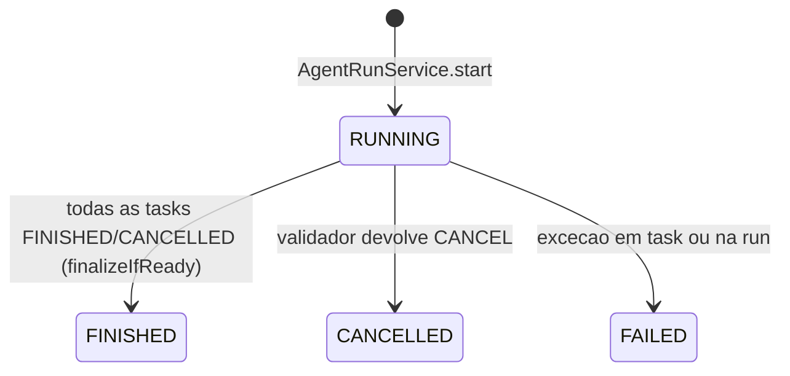

# 07 — AgentRun: ciclo de vida, orquestração paralela, dependências, validação e comunicador

> Spec do projeto **Hub de IA** (pacote base `com.lamorim.hubdeia`). Leia antes `00-LEIA-ME.md`.

## Objetivo

Especificar como uma **AgentRun** nasce, executa suas tasks em paralelo (respeitando dependências derivadas do catálogo), é validada, reentra em retry, pede informação ao usuário, é cancelada ou falha, e como a resposta final é consolidada e gravada no chat. Inclui o armazenamento atômico da run, o registro de execuções/memória curta, o validador (LLM como juiz) e o comunicador.

## Arquivos cobertos

`application/run/AgentRunStore.java`, `application/run/AgentRunService.java`, `application/orchestration/AgentRunOrchestrator.java`, `application/orchestration/TaskDependencyResolver.java`, `application/orchestration/TaskExecutionResult.java`, `application/TaskExecutionService.java`, `application/validation/TaskValidatorAgent.java`, `application/validation/TaskValidationResult.java`, `application/validation/TaskValidationStatus.java`, `application/communication/CommunicatorAgent.java`.

## Depende de

`03` (records `AgentRun`, `Task`, `TaskValidation`, `AgentRunLog`, `FinalAnswerBlock`, `SubagentExecution`, `ProviderSession`), `06` (`ConversationService`, `WorkContextService`, `HumanInputService`, `MonotonicTime`, `Text`), `08` (`SubagentTaskExecutor`, `TaskOutput`, `ArtifactService`, `OpenAiChatClient`).

## 1. Modelo de estados

**AgentRun** (`status`): nasce **`RUNNING`** (nunca `NEW`/`PLANNING`) e sai de `RUNNING` **exatamente uma vez**, para `FINISHED`, `CANCELLED` ou `FAILED`. A transição é um *update condicional* (`status == RUNNING`), então uma task atrasada não pode "ressuscitar" uma run encerrada nem gravar logs/mensagens nela.



**Task** (`status`): `NEW` → `RUNNING` (a cada tentativa) → `FINISHED` (aprovada, ou HITL) | `CANCELLED` (limite de tentativas, dependência não aprovada) | `FAILED` (exceção). Em retry volta a `NEW` e reentra no laço. Uma task é **aprovada** (`Task.isApproved()`) quando a **última** validação é `CONTINUE`.

Transições por veredito do validador (em `route`):

| Veredito | Efeito na task | Efeito na run |
|---|---|---|
| `CONTINUE` | `FINISHED`; publica artefato (se o subagente produz tipo); log `TASK_FINISHED` | segue |
| `RETRY` com `attempts < maxAttempts` | reset para `NEW` com `validator_feedback` no `input`; log `TASK_RETRY`; **repete** | segue |
| `RETRY` com `attempts >= maxAttempts` | `CANCELLED`; log `TASK_CANCELLED` | segue (a run termina `FINISHED` com a task cancelada) |
| `HITL` | cria `HumanInputRequest` PENDING; task `FINISHED` (mas **não aprovada**); log `HITL_PENDING` | segue; termina `FINISHED` com resposta parcial |
| `CANCEL` | — | o comunicador escreve a introdução e `runs.cancel(...)` leva a run a `CANCELLED` |

## 2. `AgentRunStore` — persistência atômica

**Arquivo `src/main/java/com/lamorim/hubdeia/application/run/AgentRunStore.java`** (literal):

```java
package com.lamorim.hubdeia.application.run;

import static org.springframework.data.mongodb.core.query.Criteria.where;

import java.time.Instant;
import java.util.List;
import java.util.Map;
import java.util.Optional;

import org.springframework.data.mongodb.core.MongoTemplate;
import org.springframework.data.mongodb.core.query.Query;
import org.springframework.data.mongodb.core.query.Update;
import org.springframework.stereotype.Component;

import com.lamorim.hubdeia.domain.model.AgentRun;
import com.lamorim.hubdeia.domain.model.AgentRunLog;
import com.lamorim.hubdeia.domain.model.AgentRunStatus;
import com.lamorim.hubdeia.domain.model.FinalAnswerBlock;
import com.lamorim.hubdeia.domain.model.Task;
import com.lamorim.hubdeia.domain.model.TaskStatus;
import com.lamorim.hubdeia.domain.model.TaskValidation;

/**
 * Persistence of {@link AgentRun} state. Every write is a single atomic update on one run document,
 * so parallel tasks never overwrite each other. Terminal states are final: a run only leaves
 * RUNNING once.
 */
@Component
public class AgentRunStore {

	private final MongoTemplate mongo;

	public AgentRunStore(MongoTemplate mongo) {
		this.mongo = mongo;
	}

	public AgentRun insert(AgentRun run) {
		return mongo.insert(run);
	}

	public Optional<AgentRun> find(String runId) {
		return Optional.ofNullable(mongo.findById(runId, AgentRun.class));
	}

	public AgentRun require(String runId) {
		return find(runId).orElseThrow(() -> new IllegalStateException("AgentRun nao encontrado: " + runId));
	}

	public Task requireTask(String runId, String taskId) {
		return require(runId).tasks().stream().filter(task -> task.id().equals(taskId)).findFirst()
				.orElseThrow(() -> new IllegalStateException("Task nao encontrada: " + taskId));
	}

	public boolean isRunning(String runId) {
		return mongo.exists(running(runId), AgentRun.class);
	}

	/** Appends a log entry while the run is still RUNNING. Returns false once the run has ended. */
	public boolean appendLog(String runId, AgentRunLog log) {
		Update update = new Update().push("logs", log).set("agentRunLastMessage", log.message());
		return mongo.updateFirst(running(runId), update, AgentRun.class).getModifiedCount() > 0;
	}

	/** Moves the run from RUNNING to a terminal status. Returns false if it had already ended. */
	public boolean complete(String runId, AgentRunStatus terminal, List<FinalAnswerBlock> blocks, AgentRunLog log) {
		Update update = new Update()
				.set("status", terminal)
				.set("finalAnswer", blocks)
				.set("finishedAt", Instant.now())
				.set("agentRunLastMessage", log.message())
				.push("logs", log);
		return mongo.updateFirst(running(runId), update, AgentRun.class).getModifiedCount() > 0;
	}

	public void markTaskRunning(String runId, String taskId) {
		patchTask(runId, taskId, new Update().set("tasks.$.status", TaskStatus.RUNNING).set("tasks.$.finishedAt", null));
	}

	public void recordTaskOutput(String runId, String taskId, Map<String, Object> output, int attempts) {
		patchTask(runId, taskId, new Update().set("tasks.$.output", output).set("tasks.$.attempts", attempts));
	}

	public void appendTaskValidation(String runId, String taskId, TaskValidation validation) {
		patchTask(runId, taskId, new Update().push("tasks.$.validations", validation));
	}

	public void finishTask(String runId, String taskId, TaskStatus status) {
		patchTask(runId, taskId, new Update().set("tasks.$.status", status).set("tasks.$.finishedAt", Instant.now()));
	}

	public void resetTaskForRetry(String runId, String taskId, String validatorFeedback) {
		patchTask(runId, taskId, new Update()
				.set("tasks.$.status", TaskStatus.NEW)
				.set("tasks.$.output", Map.of())
				.set("tasks.$.finishedAt", null)
				.set("tasks.$.input.validator_feedback", validatorFeedback == null ? "" : validatorFeedback));
	}

	private void patchTask(String runId, String taskId, Update update) {
		mongo.updateFirst(Query.query(where("_id").is(runId).and("tasks.id").is(taskId)), update, AgentRun.class);
	}

	private static Query running(String runId) {
		return Query.query(where("_id").is(runId).and("status").is(AgentRunStatus.RUNNING));
	}
}
```

Regras:

- Toda escrita é **um único update** num documento de `agent_runs`; nada de ler-modificar-gravar.
- `running(runId)` = `Query(_id == runId AND status == RUNNING)`. `appendLog` e `complete` usam essa guarda e retornam `modifiedCount > 0`; assim logs tardios e uma segunda transição terminal são descartados.
- `complete(runId, terminal, blocks, log)` define `status`, `finalAnswer`, `finishedAt = now`, `agentRunLastMessage = log.message()` e adiciona o log.
- As operações de task usam o operador posicional: filtro `_id == runId AND tasks.id == taskId` e `tasks.$.campo`. `markTaskRunning` zera `finishedAt`; `recordTaskOutput` grava `output` e `attempts`; `appendTaskValidation` faz `$push` em `validations`; `finishTask` grava `status` e `finishedAt = now`; `resetTaskForRetry` põe `status NEW`, `output {}`, `finishedAt null` e `input.validator_feedback` (texto ou `""`), **preservando** o resto do `input` (incluindo `enriched_content`).
- `require`/`requireTask` lançam `IllegalStateException("AgentRun nao encontrado: <id>")` / `("Task nao encontrada: <id>")`.

## 3. `AgentRunService` — ciclo de vida e leitura

**Arquivo `src/main/java/com/lamorim/hubdeia/application/run/AgentRunService.java`** (literal):

```java
package com.lamorim.hubdeia.application.run;

import java.time.Instant;
import java.util.List;
import java.util.Map;
import java.util.UUID;

import org.springframework.beans.factory.annotation.Value;
import org.springframework.data.domain.PageRequest;
import org.springframework.http.HttpStatus;
import org.springframework.stereotype.Service;
import org.springframework.util.StringUtils;
import org.springframework.web.server.ResponseStatusException;

import com.lamorim.hubdeia.api.dto.AgentRunLogEntry;
import com.lamorim.hubdeia.api.dto.AgentRunStatusResponse;
import com.lamorim.hubdeia.api.dto.AgentRunSummaryResponse;
import com.lamorim.hubdeia.application.ConversationService;
import com.lamorim.hubdeia.application.TaskExecutionService;
import com.lamorim.hubdeia.application.WorkContextService;
import com.lamorim.hubdeia.application.orchestration.TaskExecutionResult;
import com.lamorim.hubdeia.application.planner.PlannedTask;
import com.lamorim.hubdeia.application.validation.TaskValidationResult;
import com.lamorim.hubdeia.domain.model.AgentRun;
import com.lamorim.hubdeia.domain.model.AgentRunLog;
import com.lamorim.hubdeia.domain.model.AgentRunStatus;
import com.lamorim.hubdeia.domain.model.ConversationWorkContext;
import com.lamorim.hubdeia.domain.model.FinalAnswerBlock;
import com.lamorim.hubdeia.domain.model.Task;
import com.lamorim.hubdeia.domain.model.TaskStatus;
import com.lamorim.hubdeia.domain.model.TaskValidation;
import com.lamorim.hubdeia.domain.repository.AgentRunRepository;

/** Lifecycle of an agent run: every transition is persisted, and polling reads the same document. */
@Service
public class AgentRunService {

	private static final String FAILURE_MESSAGE = "Nao foi possivel concluir esta analise agora. Tente novamente em instantes.";

	private final AgentRunStore store;
	private final AgentRunRepository runs;
	private final ConversationService conversations;
	private final TaskExecutionService executions;
	private final WorkContextService contexts;
	private final int taskMaxAttempts;

	public AgentRunService(
			AgentRunStore store,
			AgentRunRepository runs,
			ConversationService conversations,
			TaskExecutionService executions,
			WorkContextService contexts,
			@Value("${hub.agent-run.task-max-attempts:3}") int taskMaxAttempts
	) {
		this.store = store;
		this.runs = runs;
		this.conversations = conversations;
		this.executions = executions;
		this.contexts = contexts;
		this.taskMaxAttempts = Math.max(1, taskMaxAttempts);
	}

	public AgentRun start(String conversationId, String triggeringMessageId, ConversationWorkContext context,
			String continuedRequestId, String plannerMessage, List<PlannedTask> plannedTasks) {
		Instant now = Instant.now();
		List<Task> tasks = plannedTasks.stream()
				.map(planned -> Task.create(UUID.randomUUID().toString(), planned.description(), planned.subagentId(), planned.enrichedContent(), taskMaxAttempts, now))
				.toList();
		AgentRunLog log = AgentRunLog.info(AgentRunStatus.RUNNING, "TASKS_RUNNING", "Tasks planejadas.");
		AgentRun run = store.insert(new AgentRun(UUID.randomUUID().toString(), conversationId, AgentRunStatus.RUNNING, tasks, List.of(log), List.of(),
				triggeringMessageId, context.id(), StringUtils.hasText(continuedRequestId) ? continuedRequestId : null, plannerMessage, now, null));
		contexts.recordRun(context.id(), run.id());
		return run;
	}

	public AgentRun get(String runId) {
		return store.require(runId);
	}

	public Task task(String runId, String taskId) {
		return store.requireTask(runId, taskId);
	}

	public boolean isRunning(String runId) {
		return store.isRunning(runId);
	}

	/** The most recent runs of the conversation, oldest first. */
	public List<AgentRun> recent(String conversationId, int limit) {
		return runs.findByConversationIdOrderByCreatedAtDesc(conversationId, PageRequest.of(0, limit)).reversed();
	}

	public String lastMessage(String runId) {
		return runId == null ? "" : store.find(runId).map(AgentRun::agentRunLastMessage).orElse("");
	}

	public void progress(String runId, String executionStatus, String message) {
		store.appendLog(runId, AgentRunLog.info(AgentRunStatus.RUNNING, executionStatus, message));
	}

	public void markTaskRunning(String runId, String taskId) {
		store.markTaskRunning(runId, taskId);
	}

	public void recordTaskResult(String conversationId, String runId, Task task, TaskExecutionResult result) {
		executions.record(conversationId, runId, task, result);
		store.recordTaskOutput(runId, task.id(), result.output(), task.attempts() + 1);
	}

	public void recordValidation(String runId, Task task, TaskValidationResult validation) {
		store.appendTaskValidation(runId, task.id(),
				new TaskValidation(validation.status().name(), validation.feedback(), validation.messageToUser(), task.attempts(), validation.validatedAt()));
	}

	public void finishTask(String runId, String taskId, TaskStatus status) {
		store.finishTask(runId, taskId, status);
	}

	public void prepareRetry(String runId, String taskId, String feedback) {
		store.resetTaskForRetry(runId, taskId, feedback);
	}

	public void finish(String conversationId, String runId, List<FinalAnswerBlock> blocks, String message) {
		terminate(conversationId, runId, AgentRunStatus.FINISHED, blocks, AgentRunLog.info(AgentRunStatus.FINISHED, "FINISHED", message));
	}

	public void cancel(String conversationId, String runId, List<FinalAnswerBlock> blocks, String message) {
		terminate(conversationId, runId, AgentRunStatus.CANCELLED, blocks, AgentRunLog.info(AgentRunStatus.CANCELLED, "CANCELLED", message));
	}

	/** Ends the run and tells the user in the chat, so a failure is never silent. */
	public void fail(String conversationId, String runId, String message) {
		List<FinalAnswerBlock> blocks = List.of(new FinalAnswerBlock("communicator", "Falha", FAILURE_MESSAGE, null, null));
		terminate(conversationId, runId, AgentRunStatus.FAILED, blocks, AgentRunLog.error(AgentRunStatus.FAILED, "FAILED", message));
	}

	public AgentRunStatusResponse status(String conversationId, String runId) {
		return toStatusResponse(require(conversationId, runId));
	}

	public List<AgentRunSummaryResponse> summaries(String conversationId, String triggeringMessageId) {
		Map<String, String> definitionIds = contexts.definitionIds(conversationId);
		List<AgentRun> found = StringUtils.hasText(triggeringMessageId)
				? runs.findByConversationIdAndTriggeringMessageIdOrderByCreatedAtAsc(conversationId, triggeringMessageId)
				: runs.findByConversationIdOrderByCreatedAtAsc(conversationId);
		return found.stream()
				.map(run -> new AgentRunSummaryResponse(run.id(), run.status().name(), run.triggeringMessageId(),
						definitionIds.get(run.conversationWorkContextId()), run.createdAt(), run.finishedAt()))
				.toList();
	}

	private void terminate(String conversationId, String runId, AgentRunStatus status, List<FinalAnswerBlock> blocks, AgentRunLog log) {
		if (store.complete(runId, status, blocks, log)) {
			conversations.appendAssistantBlocks(conversationId, blocks);
		}
	}

	private AgentRun require(String conversationId, String runId) {
		return runs.findByIdAndConversationId(runId, conversationId)
				.orElseThrow(() -> new ResponseStatusException(HttpStatus.NOT_FOUND, "AgentRun not found."));
	}

	private AgentRunStatusResponse toStatusResponse(AgentRun run) {
		List<AgentRunLogEntry> logs = run.logs().stream().map(log -> new AgentRunLogEntry(log.at().toString(), log.level(), log.message())).toList();
		Instant updatedAt = run.finishedAt() != null ? run.finishedAt() : run.logs().isEmpty() ? run.createdAt() : run.logs().getLast().at();
		return new AgentRunStatusResponse(run.conversationId(), run.id(), run.status().name(), run.status().name(), run.agentRunLastMessage(),
				logs, run.finalAnswer(), updatedAt.toString(), "database");
	}
}
```

Regras:

- `taskMaxAttempts = Math.max(1, hub.agent-run.task-max-attempts)` (default 3). `start(...)` monta as tasks com `Task.create(UUID, description, subagentId, enrichedContent, taskMaxAttempts, now)`, a run `RUNNING` com **um** log inicial (`INFO`, status `RUNNING`, `executionStatus "TASKS_RUNNING"`, mensagem `"Tasks planejadas."`), `finalAnswer` vazio, `conversationWorkContextId = context.id()`, `continuedHumanInputRequestId` (nulo se vazio) e `agentRunLastMessage = plannerMessage`; depois `contexts.recordRun(context.id(), run.id())`.
- `progress(runId, executionStatus, message)` adiciona log `INFO` (status `RUNNING`) **só enquanto a run está `RUNNING`**.
- `recordTaskResult` grava a execução (`TaskExecutionService.record`) e atualiza o `output` e `attempts = task.attempts() + 1` da task.
- `recordValidation` grava um `TaskValidation(status.name(), feedback, messageToUser, task.attempts(), validatedAt)` — `attempts` é o da task **relida depois** de `recordTaskResult` (já incrementado).
- `finish`/`cancel`/`fail` chamam `terminate`: **só se** `store.complete` ganhar a transição, gravam os blocos como mensagens `assistant` (`appendAssistantBlocks`). `fail` usa `FAILURE_MESSAGE` (`"Nao foi possivel concluir esta analise agora. Tente novamente em instantes."`) como único bloco (`type "communicator"`, `title "Falha"`), log de nível `ERROR` com a mensagem técnica; assim **a falha nunca é silenciosa** no chat.
- `status(conversationId, runId)` lê o documento (404 `"AgentRun not found."` se a run não é da conversa) e monta `AgentRunStatusResponse` com `status = executionStatus = run.status().name()`, `current_message = agentRunLastMessage`, logs, `final_answer` e `updated_at` = `finishedAt` ou o último log ou `createdAt`; `source` fixo `"database"`.
- `summaries(conversationId, triggeringMessageId)` mapeia para `AgentRunSummaryResponse` usando `contexts.definitionIds` para trocar o id da instância pelo id do catálogo.
- `recent(conversationId, limit)`: últimas runs em ordem crescente. `lastMessage(runId)`: `agentRunLastMessage` ou `""`.

## 4. `AgentRunOrchestrator` — execução

**Arquivo `src/main/java/com/lamorim/hubdeia/application/orchestration/AgentRunOrchestrator.java`** (literal):

```java
package com.lamorim.hubdeia.application.orchestration;

import java.util.ArrayList;
import java.util.List;
import java.util.Map;
import java.util.HashMap;
import java.util.Set;
import java.util.concurrent.CompletableFuture;
import java.util.concurrent.ExecutorService;
import java.util.concurrent.Executors;
import java.util.function.Function;
import java.util.stream.Collectors;

import org.slf4j.Logger;
import org.slf4j.LoggerFactory;
import org.springframework.beans.factory.annotation.Value;
import org.springframework.stereotype.Component;

import com.lamorim.hubdeia.application.ArtifactService;
import com.lamorim.hubdeia.application.HumanInputService;
import com.lamorim.hubdeia.application.communication.CommunicatorAgent;
import com.lamorim.hubdeia.application.content.TaskOutput;
import com.lamorim.hubdeia.application.run.AgentRunService;
import com.lamorim.hubdeia.application.validation.TaskValidationResult;
import com.lamorim.hubdeia.application.validation.TaskValidatorAgent;
import com.lamorim.hubdeia.domain.model.AgentRun;
import com.lamorim.hubdeia.domain.model.FinalAnswerBlock;
import com.lamorim.hubdeia.domain.model.HumanInputRequest;
import com.lamorim.hubdeia.domain.model.Subagent;
import com.lamorim.hubdeia.domain.model.Task;
import com.lamorim.hubdeia.domain.model.TaskStatus;
import com.lamorim.hubdeia.domain.repository.SubagentRepository;

/** Runs the tasks of an agent run in parallel, validates each output and consolidates the final answer. */
@Component
public class AgentRunOrchestrator {

	private static final Logger logger = LoggerFactory.getLogger(AgentRunOrchestrator.class);

	private final AgentRunService runs;
	private final SubagentTaskExecutor executor;
	private final TaskValidatorAgent validator;
	private final CommunicatorAgent communicator;
	private final HumanInputService humanInput;
	private final ArtifactService artifacts;
	private final SubagentRepository subagents;
	private final TaskDependencyResolver dependencies;
	private final int parallelism;

	public AgentRunOrchestrator(
			AgentRunService runs,
			SubagentTaskExecutor executor,
			TaskValidatorAgent validator,
			CommunicatorAgent communicator,
			HumanInputService humanInput,
			ArtifactService artifacts,
			SubagentRepository subagents,
			TaskDependencyResolver dependencies,
			@Value("${hub.agent-run.task-parallelism:4}") int parallelism
	) {
		this.runs = runs;
		this.executor = executor;
		this.validator = validator;
		this.communicator = communicator;
		this.humanInput = humanInput;
		this.artifacts = artifacts;
		this.subagents = subagents;
		this.dependencies = dependencies;
		this.parallelism = Math.max(1, parallelism);
	}

	public void execute(String conversationId, String runId) {
		logger.info("Executing AgentRun. conversationId={}, agentRunId={}", conversationId, runId);
		try {
			List<Task> pending = runs.get(runId).tasks().stream().filter(task -> task.status() == TaskStatus.NEW).toList();
			if (!pending.isEmpty()) {
				runs.progress(runId, "TASKS_RUNNING", "Executando tasks planejadas");
				runRespectingDependencies(conversationId, runId, pending);
			}
			finalizeIfReady(conversationId, runId);
		} catch (Exception error) {
			logger.error("AgentRun failed. conversationId={}, agentRunId={}", conversationId, runId, error);
			runs.fail(conversationId, runId, "Falha executando AgentRun: " + error.getMessage());
		}
	}

	/**
	 * Independent tasks run in parallel. A task that consumes an artifact type starts only after the
	 * tasks of this run that produce it have finished, so it builds on their fresh result.
	 */
	private void runRespectingDependencies(String conversationId, String runId, List<Task> tasks) {
		Map<String, Subagent> subagentsById = subagents.findAllById(tasks.stream().map(Task::subagentSelected).distinct().toList()).stream()
				.collect(Collectors.toMap(Subagent::id, Function.identity()));
		TaskDependencyResolver.Plan plan = dependencies.resolve(tasks, subagentsById);
		try (ExecutorService pool = Executors.newFixedThreadPool(Math.min(parallelism, tasks.size()))) {
			Map<String, CompletableFuture<Void>> futures = new HashMap<>();
			for (Task task : plan.order()) {
				Set<String> prerequisites = plan.prerequisites().getOrDefault(task.id(), Set.of());
				CompletableFuture<?>[] waitFor = prerequisites.stream().map(futures::get).toArray(CompletableFuture[]::new);
				futures.put(task.id(), CompletableFuture.allOf(waitFor)
						.thenRunAsync(() -> runTask(conversationId, runId, task.id(), prerequisites), pool));
			}
			CompletableFuture.allOf(futures.values().toArray(CompletableFuture[]::new)).join();
		}
	}

	private void runTask(String conversationId, String runId, String taskId, Set<String> prerequisites) {
		boolean prerequisitesApproved = prerequisites.stream().allMatch(id -> runs.task(runId, id).isApproved());
		if (!prerequisitesApproved && runs.isRunning(runId)) {
			runs.finishTask(runId, taskId, TaskStatus.CANCELLED);
			runs.progress(runId, "TASK_SKIPPED", "Task nao executada: depende de um resultado que nao foi aprovado");
			return;
		}
		executeTask(conversationId, runId, taskId);
	}

	/** Attempts the task until it is settled or the run ends (cancelled or failed elsewhere). */
	private void executeTask(String conversationId, String runId, String taskId) {
		try {
			boolean settled = false;
			while (!settled && runs.isRunning(runId)) {
				settled = attempt(conversationId, runId, taskId);
			}
		} catch (Exception error) {
			logger.error("Task execution failed. conversationId={}, agentRunId={}, taskId={}", conversationId, runId, taskId, error);
			runs.finishTask(runId, taskId, TaskStatus.FAILED);
			runs.fail(conversationId, runId, "Falha executando task: " + error.getMessage());
		}
	}

	/** One execute + validate cycle. Returns true when the task is settled and needs no further attempt. */
	private boolean attempt(String conversationId, String runId, String taskId) {
		Task task = runs.task(runId, taskId);
		runs.markTaskRunning(runId, taskId);
		runs.progress(runId, "TASK_RUNNING", "Executando task: " + task.description());
		TaskExecutionResult result = executor.execute(conversationId, runId, task,
				(status, message) -> runs.progress(runId, status, message));
		runs.recordTaskResult(conversationId, runId, task, result);

		runs.progress(runId, "TASK_VALIDATING", "Validando task: " + task.description());
		Task validated = runs.task(runId, taskId);
		TaskValidationResult validation = validator.validate(conversationId, runId, validated);
		runs.recordValidation(runId, validated, validation);
		return route(conversationId, runId, validated, validation, result);
	}

	private boolean route(String conversationId, String runId, Task task, TaskValidationResult validation, TaskExecutionResult result) {
		if (!runs.isRunning(runId)) {
			return true; // cancelled or failed while this task was in flight: no request, artifact or retry
		}
		switch (validation.status()) {
			case CONTINUE -> approve(conversationId, runId, task, result);
			case RETRY -> {
				if (task.attempts() < task.maxAttempts()) {
					runs.prepareRetry(runId, task.id(), validation.feedback());
					runs.progress(runId, "TASK_RETRY", "Retry da task: " + task.description());
					return false;
				}
				runs.finishTask(runId, task.id(), TaskStatus.CANCELLED);
				runs.progress(runId, "TASK_CANCELLED", "Task cancelada por limite de tentativas");
			}
			case HITL -> {
				humanInput.create(conversationId, runId, task.id(), validation.messageToUser());
				runs.finishTask(runId, task.id(), TaskStatus.FINISHED);
				runs.progress(runId, "HITL_PENDING", "Aguardando informacao do usuario");
			}
			case CANCEL -> {
				String intro = communicator.introduceCancelledRun(validation.feedback());
				runs.cancel(conversationId, runId, List.of(new FinalAnswerBlock("communicator", "Encerramento", intro, null, null)), "AgentRun cancelado.");
			}
		}
		return true;
	}

	private void approve(String conversationId, String runId, Task task, TaskExecutionResult result) {
		runs.finishTask(runId, task.id(), TaskStatus.FINISHED);
		artifacts.publish(runs.get(runId), task, result);
		runs.progress(runId, "TASK_FINISHED", "Task aprovada: " + task.description());
	}

	private void finalizeIfReady(String conversationId, String runId) {
		AgentRun run = runs.get(runId);
		boolean allSettled = run.tasks().stream().allMatch(task -> task.status() == TaskStatus.FINISHED || task.status() == TaskStatus.CANCELLED);
		if (!allSettled || !runs.isRunning(runId)) {
			return;
		}
		List<Task> approved = run.tasks().stream().filter(Task::isApproved).toList();
		List<Task> cancelled = run.tasks().stream().filter(task -> task.status() == TaskStatus.CANCELLED).toList();
		List<HumanInputRequest> pending = humanInput.pendingForRun(runId);
		runs.progress(runId, "FINALIZING", "Consolidando resposta");
		runs.finish(conversationId, runId, finalBlocks(approved, cancelled, pending),
				pending.isEmpty() ? "AgentRun finalizado." : "Resposta parcial com pendencias.");
	}

	private List<FinalAnswerBlock> finalBlocks(List<Task> approved, List<Task> cancelled, List<HumanInputRequest> pending) {
		List<FinalAnswerBlock> blocks = new ArrayList<>();
		String intro = pending.isEmpty() ? communicator.introduceFinishedRun(approved, cancelled) : communicator.introducePartialRun(approved, pending);
		blocks.add(new FinalAnswerBlock("communicator", "Resumo", intro, null, null));
		approved.forEach(task -> blocks.add(new FinalAnswerBlock("subagent", task.description(), outputText(task.output()), task.id(), task.subagentSelected())));
		if (!pending.isEmpty()) {
			String questions = String.join("\n", pending.stream().map(request -> "- " + request.question()).toList());
			blocks.add(new FinalAnswerBlock("communicator", "Pendencias", "## Ainda preciso de voce\n" + questions, null, null));
		}
		return blocks;
	}

	/** Assembles the text and visuals of the output into the markdown people read. */
	private String outputText(Map<String, Object> output) {
		return TaskOutput.from(output).markdown();
	}
}
```

Algoritmo (`execute(conversationId, runId)`):

1. Seleciona as tasks `NEW`. Se houver, log `TASKS_RUNNING` (`"Executando tasks planejadas"`) e chama `runRespectingDependencies`.
2. `runRespectingDependencies`: carrega os subagentes das tasks, calcula o `Plan` com `TaskDependencyResolver` e cria um `ExecutorService` fixo de `min(parallelism, nº de tasks)` threads (`parallelism = max(1, hub.agent-run.task-parallelism)`, default 4). Para cada task na ordem do plano cria um `CompletableFuture` que **só dispara depois** de todos os pré-requisitos terminarem (`allOf(...).thenRunAsync`), então nenhuma thread fica bloqueada esperando. Aguarda tudo com `allOf(...).join()` (o *try-with-resources* encerra o pool).
3. `runTask`: se algum pré-requisito **não foi aprovado** e a run ainda está `RUNNING`, a task vira `CANCELLED` com log `TASK_SKIPPED` (`"Task nao executada: depende de um resultado que nao foi aprovado"`) — evita construir sobre um resultado antigo. Senão `executeTask`.
4. `executeTask`: laço `while (!settled && runs.isRunning(runId))` chamando `attempt`; qualquer exceção → log de erro, task `FAILED`, `runs.fail(conversationId, runId, "Falha executando task: " + mensagem)`.
5. `attempt`: relê a task; `markTaskRunning`; log `TASK_RUNNING` (`"Executando task: <descricao>"`); executa o subagente passando um `ProgressReporter` que escreve logs; `recordTaskResult`; log `TASK_VALIDATING` (`"Validando task: <descricao>"`); relê a task (agora com `attempts` atualizado e `output`); valida; `recordValidation`; `route`.
6. `route`: **se a run já não está `RUNNING`, retorna sem efeito** (nada de HITL, artefato ou retry vindo de task em voo depois de cancelamento/falha). Depois aplica a tabela da seção 1. Mensagens de log: `TASK_RETRY` `"Retry da task: <descricao>"`; `TASK_CANCELLED` `"Task cancelada por limite de tentativas"`; `HITL_PENDING` `"Aguardando informacao do usuario"`; `TASK_FINISHED` `"Task aprovada: <descricao>"`. Em `CANCEL` o texto vem de `communicator.introduceCancelledRun(feedback)` e a run termina com bloco `("communicator","Encerramento", intro)` e mensagem `"AgentRun cancelado."`.
7. `approve`: `finishTask(FINISHED)`, `ArtifactService.publish(run, task, result)` (ver 08), log `TASK_FINISHED`.
8. `finalizeIfReady`: só age se **todas** as tasks estão `FINISHED` ou `CANCELLED` **e** a run ainda está `RUNNING`. Aprovadas = `Task::isApproved`; canceladas = status `CANCELLED`; pendências = `humanInput.pendingForRun(runId)`. Log `FINALIZING` (`"Consolidando resposta"`) e `runs.finish(..., blocos, pendências vazias ? "AgentRun finalizado." : "Resposta parcial com pendencias.")`.
9. Blocos finais (`finalBlocks`): primeiro `("communicator","Resumo", intro)` onde `intro` = `introduceFinishedRun(aprovadas, canceladas)` (sem pendências) ou `introducePartialRun(aprovadas, pendências)`; depois, para cada task aprovada, `("subagent", task.description(), TaskOutput.from(output).markdown(), task.id(), task.subagentSelected())`; se houver pendências, o bloco `("communicator","Pendencias", "## Ainda preciso de voce\n- <pergunta>…")`.
10. Qualquer exceção fora das tasks → `runs.fail(conversationId, runId, "Falha executando AgentRun: " + mensagem)`.

Lista completa de `execution_status` gravados **pelo orquestrador/serviço**: `TASKS_RUNNING`, `TASK_RUNNING`, `TASK_VALIDATING`, `TASK_RETRY`, `TASK_CANCELLED`, `TASK_SKIPPED`, `HITL_PENDING`, `TASK_FINISHED`, `FINALIZING`, `FINISHED`, `CANCELLED`, `FAILED`. O executor do subagente acrescenta `TOOL_CALLING` e `AWAITING_VALIDATION` (ver 08) e o provider Genie acrescenta os seus (ver 09).

## 5. `TaskDependencyResolver`

**Arquivo `src/main/java/com/lamorim/hubdeia/application/orchestration/TaskDependencyResolver.java`** (literal):

```java
package com.lamorim.hubdeia.application.orchestration;

import java.util.ArrayList;
import java.util.HashSet;
import java.util.LinkedHashMap;
import java.util.LinkedHashSet;
import java.util.List;
import java.util.Map;
import java.util.Set;

import org.slf4j.Logger;
import org.slf4j.LoggerFactory;
import org.springframework.stereotype.Component;

import com.lamorim.hubdeia.domain.model.Subagent;
import com.lamorim.hubdeia.domain.model.Task;

/**
 * Orders the tasks of one run from the catalog alone: a task whose subagent consumes an artifact
 * type waits for the tasks of other subagents that produce it. The planner never declares
 * dependencies. If the catalog yields a cycle, the run falls back to fully parallel tasks.
 */
@Component
public class TaskDependencyResolver {

	private static final Logger logger = LoggerFactory.getLogger(TaskDependencyResolver.class);

	/** {@code order} lists producers before consumers; {@code prerequisites} maps a task id to the task ids it waits for. */
	public record Plan(List<Task> order, Map<String, Set<String>> prerequisites) {
	}

	public Plan resolve(List<Task> tasks, Map<String, Subagent> subagentsById) {
		Map<String, Set<String>> prerequisites = new LinkedHashMap<>();
		for (Task consumer : tasks) {
			prerequisites.put(consumer.id(), producersFor(consumer, tasks, subagentsById));
		}
		List<Task> order = topologicalOrder(tasks, prerequisites);
		if (order == null) {
			logger.warn("Artifact dependencies between tasks form a cycle; running them in parallel. tasks={}", tasks.stream().map(Task::id).toList());
			return new Plan(tasks, Map.of());
		}
		return new Plan(order, prerequisites);
	}

	private Set<String> producersFor(Task consumer, List<Task> tasks, Map<String, Subagent> subagentsById) {
		Subagent consumerAgent = subagentsById.get(consumer.subagentSelected());
		Set<String> producers = new LinkedHashSet<>();
		if (consumerAgent == null || consumerAgent.consumes().isEmpty()) {
			return producers;
		}
		for (Task other : tasks) {
			Subagent otherAgent = subagentsById.get(other.subagentSelected());
			boolean differentAgent = otherAgent != null && !otherAgent.id().equals(consumerAgent.id());
			if (differentAgent && otherAgent.produces().stream().anyMatch(consumerAgent.consumes()::contains)) {
				producers.add(other.id());
			}
		}
		return producers;
	}

	/** Kahn's algorithm; returns null when the dependencies are cyclic. */
	private List<Task> topologicalOrder(List<Task> tasks, Map<String, Set<String>> prerequisites) {
		List<Task> ordered = new ArrayList<>();
		Set<String> done = new HashSet<>();
		while (ordered.size() < tasks.size()) {
			List<Task> ready = tasks.stream()
					.filter(task -> !done.contains(task.id()) && done.containsAll(prerequisites.getOrDefault(task.id(), Set.of())))
					.toList();
			if (ready.isEmpty()) {
				return null;
			}
			ready.forEach(task -> done.add(task.id()));
			ordered.addAll(ready);
		}
		return ordered;
	}
}
```

- A ordem vem **só do catálogo**: a task de um subagente que **consome** (`consumes`) um tipo espera as tasks **de outros subagentes** (mesmo subagente nunca espera a si mesmo) cujo `produces` contém o tipo. O planejador **não** declara dependências.
- Ordenação topológica por camadas (algoritmo de Kahn: a cada rodada pega todas as tasks cujos pré-requisitos já estão prontos). Se não houver progresso (**ciclo**), devolve `Plan(tasks, Map.of())` — tudo em paralelo — e registra `logger.warn`.
- Subagente desconhecido (não encontrado no mapa) não gera dependência.

## 6. `TaskExecutionService` — execuções e memória curta

**Arquivo `src/main/java/com/lamorim/hubdeia/application/TaskExecutionService.java`** (literal):

```java
package com.lamorim.hubdeia.application;

import static org.springframework.data.mongodb.core.query.Criteria.where;

import java.time.Instant;
import java.util.LinkedHashMap;
import java.util.List;
import java.util.Map;
import java.util.Optional;
import java.util.UUID;

import org.springframework.data.domain.PageRequest;
import org.springframework.data.mongodb.core.MongoTemplate;
import org.springframework.data.mongodb.core.query.Query;
import org.springframework.data.mongodb.core.query.Update;
import org.springframework.stereotype.Service;

import com.lamorim.hubdeia.application.orchestration.TaskExecutionResult;
import com.lamorim.hubdeia.domain.model.ProviderSession;
import com.lamorim.hubdeia.domain.model.SubagentExecution;
import com.lamorim.hubdeia.domain.model.Task;
import com.lamorim.hubdeia.domain.repository.ProviderSessionRepository;
import com.lamorim.hubdeia.domain.repository.SubagentExecutionRepository;

/** Raw subagent attempts (messages, tool calls) and the provider sessions they reuse. */
@Service
public class TaskExecutionService {

	private static final int MEMORY_TASKS = 5;
	/** Several attempts of one task count once, so look far enough back to still find MEMORY_TASKS distinct tasks. */
	private static final int MEMORY_SCAN = 40;

	private final SubagentExecutionRepository executions;
	private final ProviderSessionRepository sessions;
	private final MongoTemplate mongo;

	public TaskExecutionService(SubagentExecutionRepository executions, ProviderSessionRepository sessions, MongoTemplate mongo) {
		this.executions = executions;
		this.sessions = sessions;
		this.mongo = mongo;
	}

	public void record(String conversationId, String runId, Task task, TaskExecutionResult result) {
		Instant now = MonotonicTime.next();
		executions.insert(new SubagentExecution(UUID.randomUUID().toString(), conversationId, runId, task.id(), result.subagentId(),
				result.messages(), result.toolCalls(), task.input(), result.output(), "OUTPUT_READY", task.attempts() + 1, now, now));
		result.providerSessions().forEach(this::upsertSession);
	}

	public Optional<SubagentExecution> latestForTask(String taskId) {
		return executions.findFirstByTaskIdOrderByStartedAtDesc(taskId);
	}

	/** Latest execution of each of the subagent's most recent tasks, oldest first. */
	public List<SubagentExecution> recentMemory(String conversationId, String subagentId) {
		Map<String, SubagentExecution> latestByTask = new LinkedHashMap<>();
		executions.findByConversationIdAndSubagentIdOrderByStartedAtDesc(conversationId, subagentId, PageRequest.of(0, MEMORY_SCAN))
				.forEach(execution -> latestByTask.putIfAbsent(execution.taskId(), execution));
		return latestByTask.values().stream().limit(MEMORY_TASKS).toList().reversed();
	}

	public Optional<ProviderSession> session(String conversationId, String subagentId, String providerId) {
		return sessions.findByConversationIdAndSubagentIdAndProviderId(conversationId, subagentId, providerId);
	}

	/** Atomic per (conversation, subagent, provider), so parallel tasks of one subagent cannot collide. */
	private void upsertSession(ProviderSession session) {
		Query query = Query.query(where("conversationId").is(session.conversationId())
				.and("subagentId").is(session.subagentId()).and("providerId").is(session.providerId()));
		Update update = new Update()
				.set("externalSessionId", session.externalSessionId())
				.set("status", session.status())
				.set("metadata", session.metadata())
				.set("updatedAt", session.updatedAt())
				.setOnInsert("_id", session.id())
				.setOnInsert("createdAt", session.createdAt());
		mongo.upsert(query, update, ProviderSession.class);
	}
}
```

- `record`: insere um `SubagentExecution` (id UUID, `startedAt = finishedAt = MonotonicTime.next()`, `status "OUTPUT_READY"`, `attempt = task.attempts() + 1`, `input = task.input()`, `output`, mensagens e tool calls do resultado) e faz **upsert atômico** de cada `ProviderSession` do resultado por `(conversationId, subagentId, providerId)` (`$set` externalSessionId/status/metadata/updatedAt; `$setOnInsert` `_id` e `createdAt`) — duas tasks paralelas do mesmo subagente não colidem no índice único.
- `recentMemory(conversationId, subagentId)`: lê as **40** execuções mais recentes do subagente na conversa (mais novas primeiro), guarda **a mais recente de cada task** (várias tentativas contam uma vez), limita a **5** tasks e devolve em ordem **cronológica crescente**. (A janela de 40 existe para que retries não "expulsem" outras tasks da memória.)
- `latestForTask(taskId)`: execução mais recente da task (usada pelo validador). `session(...)`: sessão existente.

**Arquivo `src/main/java/com/lamorim/hubdeia/application/orchestration/TaskExecutionResult.java`** (literal):

```java
package com.lamorim.hubdeia.application.orchestration;

import java.util.List;
import java.util.Map;

import com.lamorim.hubdeia.domain.model.ExecutionMessage;
import com.lamorim.hubdeia.domain.model.ProviderSession;
import com.lamorim.hubdeia.domain.model.ToolCall;

public record TaskExecutionResult(
		String taskId,
		String subagentId,
		Map<String, Object> output,
		List<ExecutionMessage> messages,
		List<ProviderSession> providerSessions,
		List<ToolCall> toolCalls,
		List<String> consumedArtifactIds
) {
}
```

## 7. Validador — `TaskValidatorAgent`

**Arquivo `src/main/java/com/lamorim/hubdeia/application/validation/TaskValidatorAgent.java`** (literal):

```java
package com.lamorim.hubdeia.application.validation;

import java.time.Instant;
import java.util.List;

import org.bson.Document;
import org.springframework.beans.factory.annotation.Value;
import org.springframework.stereotype.Component;

import com.lamorim.hubdeia.application.ConversationService;
import com.lamorim.hubdeia.application.TaskExecutionService;
import com.lamorim.hubdeia.application.Text;
import com.lamorim.hubdeia.application.content.TaskOutput;
import com.lamorim.hubdeia.application.llm.OpenAiChatClient;
import com.lamorim.hubdeia.domain.model.Message;
import com.lamorim.hubdeia.domain.model.SubagentExecution;
import com.lamorim.hubdeia.domain.model.Task;
import com.lamorim.hubdeia.domain.model.ToolCall;

/** LLM-as-a-judge that decides whether a subagent output is good enough to continue. */
@Component
public class TaskValidatorAgent {

	private static final int MEMORY_MESSAGES = 8;
	private static final int MAX_TEXT_CHARS = 4000;

	private final OpenAiChatClient chat;
	private final ConversationService conversations;
	private final TaskExecutionService executions;
	private final String model;

	public TaskValidatorAgent(
			OpenAiChatClient chat,
			ConversationService conversations,
			TaskExecutionService executions,
			@Value("${hub.openai.model:gpt-5}") String model
	) {
		this.chat = chat;
		this.conversations = conversations;
		this.executions = executions;
		this.model = model;
	}

	public TaskValidationResult validate(String conversationId, String agentRunId, Task task) {
		Document payload = new Document()
				.append("conversation_id", conversationId)
				.append("agent_run_id", agentRunId)
				.append("task_id", task.id())
				.append("task_description", task.description())
				.append("task_input", task.input())
				.append("subagent_selected", task.subagentSelected())
				.append("subagent_output", outputPayload(task))
				.append("subagent_execution", executions.latestForTask(task.id()).map(this::executionPayload).orElseGet(Document::new))
				.append("conversation_memory", conversationMemory(conversationId));

		Document request = new Document("model", model)
				.append("messages", List.of(
						new Document("role", "system").append("content", systemPrompt()),
						new Document("role", "user").append("content", payload.toJson())))
				.append("response_format", responseFormat());
		Document content = chat.completeJson(request);
		return new TaskValidationResult(TaskValidationStatus.valueOf(content.getString("status")),
				content.getString("feedback"), content.getString("message_to_user"), Instant.now());
	}

	private String systemPrompt() {
		return String.join("\n",
				"Voce e o agente validador de uma execucao agentica, atuando como LLM-as-a-judge.",
				"Valide a resposta de um subagente contra o objetivo da task, o input recebido e a memoria curta da conversa.",
				"RETRY: resposta nao satisfatoria, acuracia muito baixa, vazia, irrelevante ou falha sistemica de provider/API.",
				"CONTINUE: resposta satisfatoria, util e condizente com o pedido da task.",
				"CANCEL: falha total pos retry ou impedimento que torna a task inutil para a resposta final.",
				"HITL: o subagente precisa de uma decisao, confirmacao ou dado do usuario para conseguir concluir a task.",
				"A regra de HITL tem prioridade: se o output pedir segmento, periodo, filtro, escopo, aprovacao ou qualquer informacao ausente necessaria para concluir a task, escolha HITL.",
				"Nao escolha CONTINUE para uma resposta que apenas pede esclarecimento, mesmo que a pergunta esteja bem escrita ou seja tecnicamente correta.",
				"Exemplo: se a task pede analisar clientes e o output pergunta 'Business, Individual ou ambos?', o status obrigatorio e HITL.",
				"Nao aplique regras de negocio de retry, cancelamento ou HITL; apenas julgue e reporte o estado.",
				"Quando escolher HITL, escreva em message_to_user a pergunta objetiva que o usuario precisa responder para destravar a task.",
				"Quando nao for HITL, deixe message_to_user vazio.",
				"Retorne apenas JSON no schema solicitado.");
	}

	private Document responseFormat() {
		Document schema = new Document("type", "object")
				.append("additionalProperties", false)
				.append("required", List.of("status", "feedback", "message_to_user"))
				.append("properties", new Document()
						.append("status", new Document("type", "string").append("enum", List.of("RETRY", "CONTINUE", "CANCEL", "HITL")))
						.append("feedback", new Document("type", "string"))
						.append("message_to_user", new Document("type", "string")));
		return new Document("type", "json_schema")
				.append("json_schema", new Document("name", "task_validation").append("strict", true).append("schema", schema));
	}

	private Document executionPayload(SubagentExecution execution) {
		return new Document("id", execution.id())
				.append("subagent_id", execution.subagentId())
				.append("status", execution.status())
				.append("attempt", execution.attempt())
				.append("messages", execution.messages().stream().map(message -> messagePayload(message.role(), message.content())).toList())
				.append("tool_calls", execution.toolCalls().stream().map(this::toolCallPayload).toList());
	}

	/** The judge reads the text and sees which visuals exist, never their HTML or chart specs. */
	private Document outputPayload(Task task) {
		TaskOutput output = TaskOutput.from(task.output());
		return new Document("content", output.plainText()).append("visuals", output.visuals().stream()
				.map(visual -> new Document("id", visual.id()).append("title", visual.title()).append("format", visual.format().name())).toList());
	}

	private Document toolCallPayload(ToolCall toolCall) {
		return new Document("id", toolCall.id())
				.append("tool_id", toolCall.toolId())
				.append("provider_id", toolCall.providerId())
				.append("input", toolCall.input())
				.append("output_text", Text.truncate(toolCall.outputText(), MAX_TEXT_CHARS))
				.append("status", toolCall.status())
				.append("started_at", toolCall.startedAt() == null ? null : toolCall.startedAt().toString())
				.append("finished_at", toolCall.finishedAt() == null ? null : toolCall.finishedAt().toString());
	}

	private List<Document> conversationMemory(String conversationId) {
		return conversations.recent(conversationId, MEMORY_MESSAGES).stream().map(this::messagePayload).toList();
	}

	private Document messagePayload(Message message) {
		return messagePayload(message.role(), message.content());
	}

	private Document messagePayload(String role, String content) {
		return new Document("role", role).append("content", Text.truncate(content, MAX_TEXT_CHARS));
	}
}
```

**Arquivo `src/main/java/com/lamorim/hubdeia/application/validation/TaskValidationStatus.java`** (literal):

```java
package com.lamorim.hubdeia.application.validation;

public enum TaskValidationStatus {
	RETRY,
	CONTINUE,
	CANCEL,
	HITL
}
```

**Arquivo `src/main/java/com/lamorim/hubdeia/application/validation/TaskValidationResult.java`** (literal):

```java
package com.lamorim.hubdeia.application.validation;

import java.time.Instant;

public record TaskValidationResult(
		TaskValidationStatus status,
		String feedback,
		String messageToUser,
		Instant validatedAt
) {
}
```

- Chamada ao modelo `hub.openai.model` com duas mensagens (`system` = o prompt literal acima; `user` = JSON do *payload*) e `response_format` `json_schema` `task_validation` estrito (`status` ∈ RETRY/CONTINUE/CANCEL/HITL, `feedback`, `message_to_user`).
- *Payload* do usuário: `conversation_id`, `agent_run_id`, `task_id`, `task_description`, `task_input`, `subagent_selected`, `subagent_output` (**texto puro** + lista de visuais só com `id`/`title`/`format`, nunca HTML nem spec), `subagent_execution` (mensagens e tool calls da última execução da task; cada tool call com `output_text` truncado a 4000 — nunca a saída bruta do provider) e `conversation_memory` (últimas **8** mensagens do chat, cada conteúdo truncado a **4000** caracteres).
- O validador **só julga**; as regras de negócio (retry, limite, HITL, cancelamento) são do orquestrador.

## 8. Comunicador — `CommunicatorAgent`

**Arquivo `src/main/java/com/lamorim/hubdeia/application/communication/CommunicatorAgent.java`** (literal):

```java
package com.lamorim.hubdeia.application.communication;

import java.util.List;

import org.bson.Document;
import org.springframework.beans.factory.annotation.Value;
import org.springframework.stereotype.Component;
import org.springframework.util.StringUtils;

import com.lamorim.hubdeia.application.llm.OpenAiChatClient;
import com.lamorim.hubdeia.domain.model.HumanInputRequest;
import com.lamorim.hubdeia.domain.model.Task;

/** Writes the short introduction shown before the subagents' answers. Falls back to fixed text on any failure. */
@Component
public class CommunicatorAgent {

	private static final String PARTIAL_FALLBACK = "Consolidei os resultados disponiveis. Ainda preciso de algumas informacoes para continuar o restante.";

	private final OpenAiChatClient chat;
	private final String model;

	public CommunicatorAgent(OpenAiChatClient chat, @Value("${hub.openai.model:gpt-5}") String model) {
		this.chat = chat;
		this.model = model;
	}

	public String introduceFinishedRun(List<Task> finishedTasks, List<Task> cancelledTasks) {
		Document payload = new Document("status", "COMPLETED")
				.append("finished_tasks", taskSummaries(finishedTasks))
				.append("cancelled_tasks", taskSummaries(cancelledTasks));
		return ask(payload, finishedFallback(cancelledTasks));
	}

	public String introduceCancelledRun(String reason) {
		return ask(new Document("status", "CANCELLED").append("reason", reason), cancelledFallback(reason));
	}

	public String introducePartialRun(List<Task> finishedTasks, List<HumanInputRequest> pendingRequests) {
		Document payload = new Document("status", "PARTIAL")
				.append("finished_tasks", taskSummaries(finishedTasks))
				.append("pending_questions", pendingRequests.stream().map(HumanInputRequest::question).toList());
		return ask(payload, PARTIAL_FALLBACK);
	}

	private String ask(Document payload, String fallback) {
		if (!chat.isConfigured()) {
			return fallback;
		}
		try {
			Document request = new Document("model", model).append("messages", List.of(
					new Document("role", "system").append("content", systemPrompt()),
					new Document("role", "user").append("content", payload.toJson())));
			String content = OpenAiChatClient.content(chat.complete(request));
			return StringUtils.hasText(content) ? content : fallback;
		} catch (Exception ignored) {
			return fallback;
		}
	}

	private String systemPrompt() {
		return String.join("\n",
				"Voce e o comunicador final de um CRM agentico.",
				"Escreva apenas uma introducao curta ao usuario, em markdown simples.",
				"Nao escreva JSON, IDs, tools, providers ou detalhes internos.",
				"Nao reproduza a resposta completa dos subagentes.",
				"As respostas completas dos agentes serao exibidas depois da sua introducao.",
				"Nao invente resultados nem apresente uma task cancelada como concluida.");
	}

	private List<Document> taskSummaries(List<Task> tasks) {
		return tasks.stream()
				.map(task -> new Document("description", task.description())
						.append("subagent_id", task.subagentSelected())
						.append("status", task.status().name()))
				.toList();
	}

	private String finishedFallback(List<Task> cancelledTasks) {
		return cancelledTasks.isEmpty()
				? "Consolidei os resultados das analises solicitadas."
				: "Consolidei os resultados disponiveis. Algumas analises nao entraram na resposta final porque foram canceladas.";
	}

	private String cancelledFallback(String reason) {
		return StringUtils.hasText(reason)
				? "Nao foi possivel concluir esta execucao agora. " + reason
				: "Nao foi possivel concluir esta execucao agora.";
	}
}
```

- Escreve só uma **introdução curta** em markdown simples (`hub.openai.model`); as respostas completas dos subagentes vêm depois, nos blocos.
- Sem chave OpenAI **ou** em qualquer exceção/resposta vazia devolve os **textos de fallback** do código acima (nunca falha a run por causa do comunicador).

## Armadilhas e decisões não óbvias

1. **Estado terminal é final** e a transição é condicional: toda escrita de progresso é descartada depois do fim. Por isso `fail` precisa vir de `terminate`, que só grava no chat se vencer a corrida.
2. Cancelamento por uma task (`CANCEL`) encerra a run **inteira**, mas tasks em voo terminam sozinhas sem efeito (`route` retorna cedo).
3. HITL **não bloqueia** a conversa: a task fica `FINISHED` sem aprovação e a run termina com resposta parcial; a próxima mensagem do usuário volta ao planejador, que pode responder a pendência.
4. O texto final só chega ao chat **depois** da transição terminal (`terminate` grava as mensagens após `complete`); clientes devem reler as mensagens uma vez ao ver o fim.
5. `attempts` conta tentativas **concluídas**: é incrementado ao gravar o resultado, e o limite é comparado depois da validação.
6. Retry reaproveita o mesmo subagente com `validator_feedback` no `input`; a memória curta do subagente inclui a tentativa anterior (mesma task).

## Critérios de aceite

(`AgentRunOrchestratorTest`, `AgentRunStoreTest`, `TaskDependencyResolverTest`, `SubagentMemoryTest`, spec 11.)

- Task aprovada: run `FINISHED`, artefato publicado, mensagens do comunicador + subagente no chat.
- Retry recebe o feedback e, após 3 reprovações, a task vira `CANCELLED` e a run ainda termina `FINISHED` com um único bloco do comunicador.
- `CANCEL` de uma task cancela a run para sempre mesmo se outra task terminar depois; nenhum artefato/HITL surge de task atrasada.
- HITL: run `FINISHED`, pendência `PENDING`, bloco "Pendencias" e resposta parcial.
- Exceção no executor: run `FAILED` e mensagem de falha no chat.
- Task consumidora espera a produtora e a task é pulada se a produtora não foi aprovada; ciclo no catálogo cai para execução paralela.
- Atualizações paralelas de tasks não se perdem; terminal não é sobrescrito; `recentMemory` mantém ordem e janela.

## Ordem de implementação sugerida

`AgentRunStore` → `TaskExecutionResult` → `TaskExecutionService` → `AgentRunService` → `TaskValidationStatus`/`Result` → `TaskValidatorAgent` → `CommunicatorAgent` → `TaskDependencyResolver` → `AgentRunOrchestrator` (depende de `08`).
