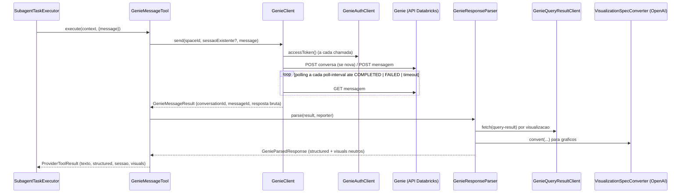

# 09 — Provider Genie: cliente, autenticação, polling, parser, tabelas e conversão de gráficos

> Spec do projeto **Hub de IA** (pacote base `com.lamorim.hubdeia`). Leia antes `00-LEIA-ME.md` e `08-execucao-do-subagente-e-conteudo.md` (contrato `ProviderTool`).

## Objetivo

Especificar o **único provider concreto** do sistema: o *Genie* (Databricks Genie Space / "data room"). Ele implementa o contrato neutro `ProviderTool` e é o **único** lugar do código que conhece o formato de resposta do Genie; transforma a resposta em texto + `Visual`s neutros. Tudo aqui fica em `application/provider/genie/`.

## Arquivos cobertos

`GenieAuthClient`, `GenieClient`, `GenieQueryResultClient`, `GenieMessageTool`, `GenieResponseParser`, `GenieTableRenderer`, `VisualizationSpecConverter` e os records `GenieMessageResult`, `GenieQueryResult`, `GenieQueryColumn`, `GenieParsedResponse` (todos em `src/main/java/com/lamorim/hubdeia/application/provider/genie/`).

## Depende de

`02` (propriedades `hub.genie.*`, `HubRestClientFactory`), `03` (`ProviderSession`, `Visual`, `VisualFormat`, `SubagentProvider`), `08` (`ProviderTool`, `ProviderToolContext`, `ProviderToolResult`, `ProgressReporter`, `OpenAiChatClient`), `04` (a tool `tool-enviar-mensagem-genie` e o `space_id` por subagente).

## 1. Visão geral



Autenticação: **OAuth2 client credentials** contra `hub.genie.auth-url`. API de dados: `hub.genie.base-url`.

## 2. `GenieAuthClient`

**Arquivo `src/main/java/com/lamorim/hubdeia/application/provider/genie/GenieAuthClient.java`** (literal):

```java
package com.lamorim.hubdeia.application.provider.genie;

import java.nio.charset.StandardCharsets;
import java.util.Base64;
import java.util.Map;

import org.springframework.beans.factory.annotation.Value;
import org.springframework.http.HttpHeaders;
import org.springframework.http.MediaType;
import org.springframework.stereotype.Component;
import org.springframework.web.client.RestClient;

import com.lamorim.hubdeia.config.HubRestClientFactory;

@Component
public class GenieAuthClient {

	private final RestClient restClient;
	private final String clientId;
	private final String clientSecret;

	public GenieAuthClient(
			RestClient.Builder restClientBuilder,
			HubRestClientFactory restClients,
			@Value("${hub.genie.auth-url:}") String authUrl,
			@Value("${hub.genie.client-id:}") String clientId,
			@Value("${hub.genie.client-secret:}") String clientSecret,
			@Value("${hub.genie.request-timeout-ms:60000}") long requestTimeoutMs
	) {
		this.restClient = restClients.create(restClientBuilder, authUrl, requestTimeoutMs);
		this.clientId = clientId;
		this.clientSecret = clientSecret;
	}

	@SuppressWarnings("unchecked")
	public String accessToken() {
		String credentials = Base64.getEncoder()
				.encodeToString((clientId + ":" + clientSecret).getBytes(StandardCharsets.UTF_8));
		Map<String, Object> response = restClient.post()
				.uri("/oidc/v1/token")
				.header(HttpHeaders.AUTHORIZATION, "Basic " + credentials)
				.contentType(MediaType.APPLICATION_FORM_URLENCODED)
				.body("grant_type=client_credentials&scope=all-apis")
				.retrieve()
				.body(Map.class);

		Object token = response == null ? null : response.get("access_token");
		if (token == null || token.toString().isBlank()) {
			throw new IllegalStateException("GENIE auth did not return access_token.");
		}
		return token.toString();
	}
}
```

- `RestClient` com base `hub.genie.auth-url` e timeout `hub.genie.request-timeout-ms`.
- `accessToken()`: `POST /oidc/v1/token`, `Authorization: Basic base64(clientId:clientSecret)` (UTF-8), `Content-Type: application/x-www-form-urlencoded`, corpo exato `grant_type=client_credentials&scope=all-apis`. Lê o JSON, devolve `access_token`; ausente/em branco → `IllegalStateException("GENIE auth did not return access_token.")`. **Não há cache**: um token novo é pedido a cada chamada.

## 3. `GenieClient`

**Arquivo `src/main/java/com/lamorim/hubdeia/application/provider/genie/GenieClient.java`** (literal):

```java
package com.lamorim.hubdeia.application.provider.genie;

import java.time.Duration;
import java.util.Map;

import org.springframework.beans.factory.annotation.Value;
import org.springframework.http.HttpHeaders;
import org.springframework.http.MediaType;
import org.springframework.stereotype.Component;
import org.springframework.web.client.RestClient;
import org.springframework.web.client.RestClientResponseException;
import org.slf4j.Logger;
import org.slf4j.LoggerFactory;

import com.lamorim.hubdeia.application.provider.ProgressReporter;
import com.lamorim.hubdeia.config.HubRestClientFactory;

@Component
public class GenieClient {

	private static final Logger logger = LoggerFactory.getLogger(GenieClient.class);

	private final RestClient restClient;
	private final GenieAuthClient authClient;
	private final long pollIntervalMs;
	private final long pollTimeoutMs;

	public GenieClient(
			RestClient.Builder restClientBuilder,
			HubRestClientFactory restClients,
			GenieAuthClient authClient,
			@Value("${hub.genie.base-url:}") String baseUrl,
			@Value("${hub.genie.request-timeout-ms:60000}") long requestTimeoutMs,
			@Value("${hub.genie.poll-interval-ms:8000}") long pollIntervalMs,
			@Value("${hub.genie.poll-timeout-ms:1800000}") long pollTimeoutMs
	) {
		this.restClient = restClients.create(restClientBuilder, baseUrl, requestTimeoutMs);
		this.authClient = authClient;
		this.pollIntervalMs = pollIntervalMs;
		this.pollTimeoutMs = pollTimeoutMs;
	}

	public GenieMessageResult send(
			String spaceId,
			String conversationId,
			String message,
			ProgressReporter reporter
	) {
		String activeConversationId = conversationId;
		try {
			if (activeConversationId == null || activeConversationId.isBlank()) {
				reporter.report("GENIE_STARTING", "Iniciando conversa Genie");
				logger.info("Starting Genie conversation. spaceId={}", spaceId);
				activeConversationId = startConversation(spaceId, message);
			}

			reporter.report("GENIE_SENDING", "Consultando Genie");
			logger.info("Sending Genie message. spaceId={}, conversationId={}", spaceId, activeConversationId);
			String messageId = sendMessage(spaceId, activeConversationId, message);
			reporter.report("GENIE_POLLING", "Aguardando resposta Genie");
			Map<String, Object> result = poll(spaceId, activeConversationId, messageId, reporter);
			logger.info("Genie message completed. spaceId={}, conversationId={}, messageId={}", spaceId, activeConversationId, messageId);
			return new GenieMessageResult(activeConversationId, messageId, result);
		} catch (RestClientResponseException error) {
			logger.error("Genie HTTP request failed. spaceId={}, conversationId={}, status={}, response={}", spaceId, activeConversationId,
					error.getStatusCode(), error.getResponseBodyAsString(), error);
			throw error;
		} catch (Exception error) {
			logger.error("Genie execution failed. spaceId={}, conversationId={}", spaceId, activeConversationId, error);
			throw error;
		}
	}

	@SuppressWarnings("unchecked")
	private String startConversation(String spaceId, String message) {
		Map<String, Object> response = restClient.post()
				.uri("/api/2.0/data-rooms/{spaceId}/conversations", spaceId)
				.header(HttpHeaders.AUTHORIZATION, "Bearer " + authClient.accessToken())
				.contentType(MediaType.APPLICATION_JSON)
				.body(Map.of(
						"title", message,
						"model", "SMART_AI",
						"visibility", "PRIVATE",
						"conversation_type", "DEEP_RESEARCH",
						"utm_metadata", Map.of()))
				.retrieve()
				.body(Map.class);
		return String.valueOf(response.get("conversation_id"));
	}

	@SuppressWarnings("unchecked")
	private String sendMessage(String spaceId, String conversationId, String message) {
		Map<String, Object> response = restClient.post()
				.uri("/api/2.0/data-rooms/{spaceId}/conversations/{conversationId}/messages", spaceId, conversationId)
				.header(HttpHeaders.AUTHORIZATION, "Bearer " + authClient.accessToken())
				.contentType(MediaType.APPLICATION_JSON)
				.body(Map.of(
						"content", message,
						"client_context", Map.of(
								"genie_app_context", Map.of("force_deep_research_planning", true))))
				.retrieve()
				.body(Map.class);
		return String.valueOf(response.get("message_id"));
	}

	@SuppressWarnings("unchecked")
	private Map<String, Object> poll(
			String spaceId,
			String conversationId,
			String messageId,
			ProgressReporter reporter
	) {
		long deadline = System.nanoTime() + Duration.ofMillis(pollTimeoutMs).toNanos();
		while (System.nanoTime() < deadline) {
			sleep();
			Map<String, Object> response = restClient.get()
					.uri("/api/2.0/data-rooms/{spaceId}/conversations/{conversationId}/messages/{messageId}",
							spaceId,
							conversationId,
							messageId)
					.header(HttpHeaders.AUTHORIZATION, "Bearer " + authClient.accessToken())
					.retrieve()
					.body(Map.class);

			String status = String.valueOf(response.get("status"));
			reporter.report("GENIE_" + status, "Genie: " + status);
			if ("COMPLETED".equals(status)) {
				return response;
			}
			if ("FAILED".equals(status)) {
				logger.error("Genie returned FAILED. spaceId={}, conversationId={}, messageId={}, response={}", spaceId, conversationId, messageId, response);
				throw new IllegalStateException("A consulta Genie falhou.");
			}
		}
		throw new IllegalStateException("A consulta Genie excedeu o timeout configurado.");
	}

	private void sleep() {
		try {
			Thread.sleep(pollIntervalMs);
		} catch (InterruptedException error) {
			Thread.currentThread().interrupt();
			throw new IllegalStateException("Polling Genie interrompido.", error);
		}
	}
}
```

- Base `hub.genie.base-url`, timeout `hub.genie.request-timeout-ms`; `poll-interval-ms` (default 8000) e `poll-timeout-ms` (default 1.800.000 = 30 min).
- `send(spaceId, conversationId, message, reporter)`: se `conversationId` é nulo/em branco, reporta `GENIE_STARTING` (`"Iniciando conversa Genie"`) e cria a conversa; reporta `GENIE_SENDING` (`"Consultando Genie"`), envia a mensagem, reporta `GENIE_POLLING` (`"Aguardando resposta Genie"`) e faz o polling. Devolve `GenieMessageResult(conversationId ativo, messageId, resposta bruta)`.
- Criar conversa: `POST /api/2.0/data-rooms/{spaceId}/conversations` com corpo `{title: <mensagem>, model: "SMART_AI", visibility: "PRIVATE", conversation_type: "DEEP_RESEARCH", utm_metadata: {}}`; usa `conversation_id` da resposta.
- Enviar mensagem: `POST /api/2.0/data-rooms/{spaceId}/conversations/{conversationId}/messages` com `{content: <mensagem>, client_context: {genie_app_context: {force_deep_research_planning: true}}}`; usa `message_id`.
- Polling: `deadline = agora + poll-timeout`; a cada volta **dorme** `poll-interval` e faz `GET .../messages/{messageId}`; reporta `GENIE_<STATUS>` (`"Genie: <STATUS>"`); `COMPLETED` → devolve a resposta; `FAILED` → loga a resposta e lança `IllegalStateException("A consulta Genie falhou.")`; esgotado o prazo → `IllegalStateException("A consulta Genie excedeu o timeout configurado.")`; interrupção da thread → restaura a flag e lança `IllegalStateException("Polling Genie interrompido.")`.
- Toda chamada obtém `Authorization: Bearer <accessToken()>`. Erros HTTP (`RestClientResponseException`) e demais exceções são registrados com `logger.error` (sem segredos) e **relançados**.

## 4. `GenieQueryResultClient` e records

**Arquivo `src/main/java/com/lamorim/hubdeia/application/provider/genie/GenieQueryResultClient.java`** (literal):

```java
package com.lamorim.hubdeia.application.provider.genie;

import java.util.ArrayList;
import java.util.List;
import java.util.Map;

import org.springframework.beans.factory.annotation.Value;
import org.springframework.http.HttpHeaders;
import org.springframework.stereotype.Component;
import org.springframework.web.client.RestClient;

import com.lamorim.hubdeia.config.HubRestClientFactory;

@Component
public class GenieQueryResultClient {

	private final RestClient restClient;
	private final GenieAuthClient authClient;

	public GenieQueryResultClient(
			RestClient.Builder restClientBuilder,
			HubRestClientFactory restClients,
			GenieAuthClient authClient,
			@Value("${hub.genie.base-url:}") String baseUrl,
			@Value("${hub.genie.request-timeout-ms:60000}") long requestTimeoutMs
	) {
		this.restClient = restClients.create(restClientBuilder, baseUrl, requestTimeoutMs);
		this.authClient = authClient;
	}

	@SuppressWarnings("unchecked")
	public GenieQueryResult fetch(String spaceId, String conversationId, String messageId, String attachmentId) {
		Map<String, Object> response = restClient.get()
				.uri("/api/2.0/genie/spaces/{spaceId}/conversations/{conversationId}/messages/{messageId}/attachments/{attachmentId}/query-result",
						spaceId, conversationId, messageId, attachmentId)
				.header(HttpHeaders.AUTHORIZATION, "Bearer " + authClient.accessToken())
				.retrieve()
				.body(Map.class);

		Map<String, Object> statement = map(response == null ? null : response.get("statement_response"));
		if (statement.isEmpty()) {
			statement = response == null ? Map.of() : response;
		}
		Map<String, Object> manifest = map(statement.get("manifest"));
		Map<String, Object> schema = map(manifest.get("schema"));
		List<GenieQueryColumn> columns = columns((List<Map<String, Object>>) schema.getOrDefault("columns", List.of()));
		Map<String, Object> result = map(statement.get("result"));
		List<Map<String, Object>> rows = rows(columns, (List<?>) result.getOrDefault("data_array", List.of()));
		long rowCount = number(result.get("row_count"), number(manifest.get("total_row_count"), rows.size()));
		String state = String.valueOf(map(statement.get("status")).getOrDefault("state", ""));
		return new GenieQueryResult(columns, rows, rowCount, Boolean.TRUE.equals(manifest.get("truncated")), state);
	}

	private List<GenieQueryColumn> columns(List<Map<String, Object>> rawColumns) {
		List<GenieQueryColumn> columns = new ArrayList<>();
		for (Map<String, Object> column : rawColumns) {
			String name = String.valueOf(column.getOrDefault("name", column.getOrDefault("column_name", column.getOrDefault("label", "column"))));
			String type = String.valueOf(column.getOrDefault("type_name", column.getOrDefault("type_text", column.getOrDefault("type", "string"))));
			columns.add(new GenieQueryColumn(name, type));
		}
		return columns;
	}

	private List<Map<String, Object>> rows(List<GenieQueryColumn> columns, List<?> rawRows) {
		List<Map<String, Object>> rows = new ArrayList<>();
		for (Object rawRow : rawRows) {
			List<?> values = values(rawRow);
			java.util.LinkedHashMap<String, Object> row = new java.util.LinkedHashMap<>();
			for (int index = 0; index < columns.size(); index++) {
				Object value = index < values.size() ? values.get(index) : null;
				row.put(columns.get(index).name(), coerce(value, columns.get(index).type()));
			}
			rows.add(row);
		}
		return rows;
	}

	private List<?> values(Object row) {
		if (row instanceof List<?> values) return values;
		if (row instanceof Map<?, ?> map && map.get("values") instanceof List<?> values) return values;
		return List.of();
	}

	private Object coerce(Object value, String type) {
		if (value == null || !(value instanceof String text)) return value;
		if (type.toUpperCase().matches(".*(INT|LONG|FLOAT|DOUBLE|DECIMAL|NUMBER|NUMERIC).*") && !text.isBlank()) {
			try { return Double.valueOf(text); } catch (NumberFormatException ignored) { return value; }
		}
		return value;
	}

	private long number(Object value, long fallback) {
		if (value instanceof Number number) return number.longValue();
		try { return Long.parseLong(String.valueOf(value)); } catch (Exception ignored) { return fallback; }
	}

	@SuppressWarnings("unchecked")
	private Map<String, Object> map(Object value) {
		return value instanceof Map<?, ?> map ? (Map<String, Object>) map : Map.of();
	}
}
```

**Arquivo `src/main/java/com/lamorim/hubdeia/application/provider/genie/GenieQueryResult.java`** (literal):

```java
package com.lamorim.hubdeia.application.provider.genie;

import java.util.List;
import java.util.Map;

public record GenieQueryResult(
		List<GenieQueryColumn> columns,
		List<Map<String, Object>> rows,
		long rowCount,
		boolean truncated,
		String state
) {
}
```

**Arquivo `src/main/java/com/lamorim/hubdeia/application/provider/genie/GenieQueryColumn.java`** (literal):

```java
package com.lamorim.hubdeia.application.provider.genie;

public record GenieQueryColumn(String name, String type) {
}
```

**Arquivo `src/main/java/com/lamorim/hubdeia/application/provider/genie/GenieMessageResult.java`** (literal):

```java
package com.lamorim.hubdeia.application.provider.genie;

import java.util.Map;

public record GenieMessageResult(
		String conversationId,
		String messageId,
		Map<String, Object> rawResponse
) {
}
```

**Arquivo `src/main/java/com/lamorim/hubdeia/application/provider/genie/GenieParsedResponse.java`** (literal):

```java
package com.lamorim.hubdeia.application.provider.genie;

import java.util.List;
import java.util.Map;

import com.lamorim.hubdeia.domain.model.Visual;

/** A Genie answer split into what the core understands (text + neutral visuals) and Genie's own details. */
public record GenieParsedResponse(Map<String, Object> structured, List<Visual> visuals) {
}
```

- `fetch(spaceId, conversationId, messageId, attachmentId)`: `GET /api/2.0/genie/spaces/{spaceId}/conversations/{conversationId}/messages/{messageId}/attachments/{attachmentId}/query-result`. Usa `statement_response` (ou a própria resposta se vazio); colunas de `manifest.schema.columns` (nome: `name`, senão `column_name`, senão `label`, senão `"column"`; tipo: `type_name`, `type_text`, `type`, default `"string"`); linhas de `result.data_array` (cada linha lista ou objeto com `values`); valores `String` em colunas de tipo numérico (regex `.*(INT|LONG|FLOAT|DOUBLE|DECIMAL|NUMBER|NUMERIC).*`, maiúsculas) viram `Double` quando não vazios; `rowCount` = `result.row_count`, senão `manifest.total_row_count`, senão tamanho das linhas; `truncated` = `manifest.truncated`; `state` = `status.state`.

## 5. `GenieMessageTool` — a tool exposta ao modelo

**Arquivo `src/main/java/com/lamorim/hubdeia/application/provider/genie/GenieMessageTool.java`** (literal):

```java
package com.lamorim.hubdeia.application.provider.genie;

import java.time.Instant;
import java.util.Map;
import java.util.UUID;

import org.bson.Document;
import org.springframework.stereotype.Component;

import com.lamorim.hubdeia.application.provider.ProviderTool;
import com.lamorim.hubdeia.application.provider.ProviderToolContext;
import com.lamorim.hubdeia.application.provider.ProviderToolResult;
import com.lamorim.hubdeia.domain.model.ProviderSession;

@Component
public class GenieMessageTool implements ProviderTool {

	private final GenieClient genieClient;
	private final GenieResponseParser parser;

	public GenieMessageTool(GenieClient genieClient, GenieResponseParser parser) {
		this.genieClient = genieClient;
		this.parser = parser;
	}

	@Override
	public String name() {
		return "tool-enviar-mensagem-genie";
	}

	@Override
	public Document schema() {
		return new Document()
				.append("type", "function")
				.append("function", new Document()
						.append("name", name())
						.append("description", "Consulta a Genie usando a conversa existente quando disponivel.")
						.append("strict", true)
						.append("parameters", new Document()
								.append("type", "object")
								.append("additionalProperties", false)
								.append("required", java.util.List.of("message"))
								.append("properties", new Document()
										.append("message", new Document()
												.append("type", "string")
												.append("description", "Pergunta ou instrucao de negocio para a Genie.")))));
	}

	@Override
	public ProviderToolResult execute(ProviderToolContext context, Document arguments) {
		String spaceId = resolveSpaceId(context);
		String existingConversationId = context.existingSession() == null
				? null
				: context.existingSession().externalSessionId();
		GenieMessageResult result = genieClient.send(
				spaceId,
				existingConversationId,
				arguments.getString("message"),
				context.progressReporter()
		);
		context.progressReporter().report("GENIE_PROCESSING", "Processando resposta Genie");
		GenieParsedResponse parsed = parser.parse(result, context.progressReporter());
		Map<String, Object> structured = parsed.structured();
		Instant now = Instant.now();
		ProviderSession session = new ProviderSession(
				context.existingSession() == null ? UUID.randomUUID().toString() : context.existingSession().id(),
				context.conversationId(),
				context.subagentId(),
				context.subagentProvider().providerId(),
				result.conversationId(),
				"ACTIVE",
				Map.of("message_id", result.messageId(), "space_id", spaceId),
				context.existingSession() == null ? now : context.existingSession().createdAt(),
				now
		);

		return new ProviderToolResult(
				String.valueOf(structured.get("content")),
				structured,
				session,
				parsed.visuals()
		);
	}

	@SuppressWarnings("unchecked")
	private String resolveSpaceId(ProviderToolContext context) {
		Object space = context.subagentProvider().config().get("space_id");
		if (space instanceof String value) {
			return value;
		}
		if (space instanceof Map<?, ?> map) {
			Object env = map.get("$env");
			if (env != null && System.getenv(String.valueOf(env)) != null) {
				return System.getenv(String.valueOf(env));
			}
			Object fallbackEnv = map.get("fallback_env");
			if (fallbackEnv != null && System.getenv(String.valueOf(fallbackEnv)) != null) {
				return System.getenv(String.valueOf(fallbackEnv));
			}
			return String.valueOf(map.get("fallback"));
		}
		throw new IllegalStateException("Genie provider config requires space_id.");
	}
}
```

- `name()` = **`tool-enviar-mensagem-genie`** (igual a `Tool.functionName` e ao `id` da tool semente). `schema()`: função com parâmetro único `message` (string, obrigatório, `strict: true`, `additionalProperties:false`) — o texto literal da `description` está no código acima.
- `execute`: resolve o `space_id` (ver abaixo); `existingSession.externalSessionId()` é a conversa Genie a continuar (nula → cria); chama `GenieClient.send`; reporta `GENIE_PROCESSING` (`"Processando resposta Genie"`); `GenieResponseParser.parse`; monta a `ProviderSession` (id da existente ou novo UUID; `conversationId`, `subagentId`, `providerId` do `SubagentProvider`, `externalSessionId` = conversa Genie, status `"ACTIVE"`, `metadata {message_id, space_id}`, `createdAt` da existente ou agora, `updatedAt` agora) e devolve `ProviderToolResult(texto, structured, sessão, visuals)`.
- **`space_id`** vem de `subagentProvider.config().space_id`: se for texto, é o valor; se for objeto: usa `System.getenv(<$env>)` se definida, senão `System.getenv(<fallback_env>)` se definida, senão o texto de `fallback`; ausente → `IllegalStateException("Genie provider config requires space_id.")`. Assim **cada subagente aponta para um Genie Space diferente**.

## 6. `GenieResponseParser`

**Arquivo `src/main/java/com/lamorim/hubdeia/application/provider/genie/GenieResponseParser.java`** (literal):

```java
package com.lamorim.hubdeia.application.provider.genie;

import java.util.ArrayList;
import java.util.LinkedHashMap;
import java.util.List;
import java.util.Map;
import java.util.regex.Matcher;
import java.util.regex.Pattern;

import org.slf4j.Logger;
import org.slf4j.LoggerFactory;
import org.springframework.stereotype.Component;

import com.lamorim.hubdeia.application.provider.ProgressReporter;
import com.lamorim.hubdeia.domain.model.Visual;
import com.lamorim.hubdeia.domain.model.VisualFormat;

@Component
public class GenieResponseParser {

	private static final Logger logger = LoggerFactory.getLogger(GenieResponseParser.class);
	private static final Pattern EMBED_ID = Pattern.compile("(?:!\\[Visualization\\]\\(#|:embedVisualization\\[)(viz_[^\\])]+)");
	private static final Pattern SQL_CITATION = Pattern.compile("\\s*:sqlCitation\\[[^]]+]", Pattern.CASE_INSENSITIVE);

	private final GenieQueryResultClient queryResults;
	private final GenieTableRenderer tableRenderer;
	private final VisualizationSpecConverter visualizationSpecConverter;

	public GenieResponseParser(GenieQueryResultClient queryResults, GenieTableRenderer tableRenderer, VisualizationSpecConverter visualizationSpecConverter) {
		this.queryResults = queryResults;
		this.tableRenderer = tableRenderer;
		this.visualizationSpecConverter = visualizationSpecConverter;
	}

	public GenieParsedResponse parse(GenieMessageResult result, ProgressReporter reporter) {
		Map<String, Object> raw = message(result.rawResponse());
		logger.debug("Genie completed payload. conversationId={}, messageId={}, payload={}", result.conversationId(), result.messageId(), raw);
		List<Map<String, Object>> attachments = attachments(raw);
		Map<String, Map<String, Object>> queries = queries(attachments);
		Map<String, Map<String, Object>> visualizations = visualizations(attachments);
		Map<String, Object> report = report(attachments);
		List<Map<String, Object>> artifacts = new ArrayList<>();
		String markdown = markdown(raw, report, visualizations, queries, artifacts, result, reporter);

		Map<String, Object> structured = Map.of(
				"content", markdown,
				"visualizations", artifacts,
				"provider", Map.of(
						"provider_id", "GENIE",
						"conversation_id", result.conversationId(),
						"message_id", result.messageId())
		);
		return new GenieParsedResponse(structured, visuals(artifacts));
	}

	/** Genie's ready visualizations as neutral visuals: tables arrive as HTML, charts as Vega-Lite. */
	private List<Visual> visuals(List<Map<String, Object>> rendered) {
		List<Visual> visuals = new ArrayList<>();
		for (Map<String, Object> item : rendered) {
			if (!"READY".equals(item.get("status"))) {
				continue;
			}
			String id = String.valueOf(item.get("id"));
			String title = String.valueOf(item.getOrDefault("title", ""));
			if (item.get("html") instanceof String html && !html.isBlank()) {
				visuals.add(new Visual(id, title, VisualFormat.HTML, html));
			} else if (item.get("spec") instanceof String spec && !spec.isBlank()) {
				visuals.add(new Visual(id, title, VisualFormat.VEGA_LITE, spec));
			}
		}
		return visuals;
	}

	private String markdown(
			Map<String, Object> raw,
			Map<String, Object> report,
			Map<String, Map<String, Object>> visualizations,
			Map<String, Map<String, Object>> queries,
			List<Map<String, Object>> artifacts,
			GenieMessageResult result,
			ProgressReporter reporter
	) {
		List<Map<String, Object>> chunks = list(report.get("content_chunks"));
		if (chunks.isEmpty()) {
			return clean(String.valueOf(report.getOrDefault("report_summary", raw.getOrDefault("content", ""))));
		}

		StringBuilder markdown = new StringBuilder();
		for (Map<String, Object> chunk : chunks) {
			String text = String.valueOf(chunk.getOrDefault("text", ""));
			String embedId = embedId(chunk, text);
			if (embedId == null) {
				append(markdown, clean(text));
				continue;
			}

			Map<String, Object> visualization = visualizations.get(embedId);
			if (visualization == null) {
				artifacts.add(unavailableVisualization(embedId));
				continue;
			}
			Map<String, Object> artifact = renderVisualization(visualization, queries, raw, result, reporter);
			artifacts.add(artifact);
			if ("READY".equals(artifact.get("status"))) {
				append(markdown, visualizationMarker(String.valueOf(artifact.get("id"))));
			}
		}
		return clean(markdown.toString());
	}

	private Map<String, Object> renderVisualization(
			Map<String, Object> visualization,
			Map<String, Map<String, Object>> queries,
			Map<String, Object> raw,
			GenieMessageResult result,
			ProgressReporter reporter
	) {
		String title = String.valueOf(visualization.getOrDefault("title", "Visualizacao"));
		String queryAttachmentId = String.valueOf(visualization.getOrDefault("query_attachment_id", ""));
		Map<String, Object> query = queries.get(queryAttachmentId);
		Map<String, Object> artifact = artifact(visualization, "PENDING");
		if (query == null) {
			artifact.put("status", "DATA_UNAVAILABLE");
			artifact.put("error", "Query associada nao encontrada.");
			return artifact;
		}

		try {
			String spaceId = String.valueOf(raw.getOrDefault("space_id", raw.getOrDefault("data_room_id", "")));
			boolean table = "table".equalsIgnoreCase(String.valueOf(visualization.getOrDefault("type", "")));
			reporter.report("GENIE_QUERY_RESULT", "Preparando dados da visualizacao: " + title);
			GenieQueryResult queryResult = queryResults.fetch(spaceId, result.conversationId(), result.messageId(), queryAttachmentId);
			artifact.put("status", "READY");
			artifact.put("render_mode", table ? "HTML" : "VEGA_LITE");
			if (table) {
				artifact.put("html", tableRenderer.render(visualization.get("definition"), title, queryResult));
				reporter.report("GENIE_TABLE_READY", "Tabela pronta: " + title);
			} else {
				reporter.report("GENIE_VIZ_CONVERTING", "Convertendo grafico: " + title);
				artifact.put("spec", visualizationSpecConverter.convert(
						visualization.get("definition"), title,
						String.valueOf(visualization.getOrDefault("type", "bar")), queryResult));
				reporter.report("GENIE_VIZ_READY", "Grafico pronto: " + title);
			}
			artifact.put("query_result", Map.of(
					"row_count", queryResult.rowCount(),
					"truncated", queryResult.truncated(),
					"state", queryResult.state(),
					"columns", columns(queryResult)));
			return artifact;
		} catch (Exception error) {
			logger.warn("Could not prepare Genie visualization. title={}, queryAttachmentId={}", title, queryAttachmentId, error);
			artifact.put("status", "FAILED");
			artifact.put("error", error.getMessage());
			reporter.report("GENIE_VIZ_FAILED", "Nao foi possivel preparar o grafico: " + title);
			return artifact;
		}
	}

	private Map<String, Object> artifact(Map<String, Object> visualization, String status) {
		Map<String, Object> artifact = new LinkedHashMap<>();
		artifact.put("id", visualization.getOrDefault("asset_id", visualization.getOrDefault("id", "")));
		artifact.put("type", "visualization");
		artifact.put("title", visualization.getOrDefault("title", "Visualizacao"));
		artifact.put("visualization_type", visualization.getOrDefault("type", "unknown"));
		artifact.put("source_query_attachment_id", visualization.getOrDefault("query_attachment_id", ""));
		artifact.put("status", status);
		return artifact;
	}

	private Map<String, Object> unavailableVisualization(String embedId) {
		Map<String, Object> artifact = new LinkedHashMap<>();
		artifact.put("id", embedId);
		artifact.put("type", "visualization");
		artifact.put("status", "DATA_UNAVAILABLE");
		artifact.put("error", "Visualizacao referenciada pela resposta nao encontrada.");
		return artifact;
	}

	private Map<String, Map<String, Object>> queries(List<Map<String, Object>> attachments) {
		Map<String, Map<String, Object>> indexed = new LinkedHashMap<>();
		for (Map<String, Object> attachment : attachments) {
			Map<String, Object> query = map(attachment.get("query"));
			if (!query.isEmpty()) indexed.put(String.valueOf(query.get("id")), query);
		}
		return indexed;
	}

	private Map<String, Map<String, Object>> visualizations(List<Map<String, Object>> attachments) {
		Map<String, Map<String, Object>> indexed = new LinkedHashMap<>();
		for (Map<String, Object> attachment : attachments) {
			Map<String, Object> visualization = map(attachment.get("viz"));
			if (!visualization.isEmpty()) indexed.put(String.valueOf(visualization.get("asset_id")), visualization);
		}
		return indexed;
	}

	private Map<String, Object> report(List<Map<String, Object>> attachments) {
		Map<String, Object> result = Map.of();
		for (Map<String, Object> attachment : attachments) {
			Map<String, Object> report = map(attachment.get("deep_research_report"));
			if (!report.isEmpty()) result = report;
		}
		return result;
	}

	private String embedId(Map<String, Object> chunk, String text) {
		Map<String, Object> metadata = map(chunk.get("metadata"));
		Object value = metadata.get("embed_id");
		if (value != null) return String.valueOf(value);
		Matcher matcher = EMBED_ID.matcher(text);
		return matcher.find() ? matcher.group(1) : null;
	}

	private void append(StringBuilder target, String value) {
		if (value == null || value.isBlank()) return;
		if (!target.isEmpty()) target.append("\n\n");
		target.append(value.trim());
	}

	private String visualizationMarker(String id) {
		return "[[visualization:" + id + "]]";
	}

	private String clean(String markdown) {
		return SQL_CITATION.matcher(markdown == null ? "" : markdown)
				.replaceAll("")
				.replaceAll("(?m)^\\s*:embedVisualization\\[[^]]+]\\s*$", "")
				.replaceAll("\\n{3,}", "\n\n")
				.trim();
	}

	private Map<String, Object> message(Map<String, Object> raw) {
		if (raw.containsKey("attachments")) return raw;
		List<Map<String, Object>> messages = list(raw.get("messages"));
		return messages.isEmpty() ? raw : messages.getLast();
	}

	private List<Map<String, Object>> attachments(Map<String, Object> raw) { return list(raw.get("attachments")); }

	@SuppressWarnings("unchecked")
	private List<Map<String, Object>> list(Object value) {
		if (!(value instanceof List<?> list)) return List.of();
		return list.stream().filter(Map.class::isInstance).map(item -> (Map<String, Object>) item).toList();
	}

	@SuppressWarnings("unchecked")
	private Map<String, Object> map(Object value) {
		return value instanceof Map<?, ?> map ? (Map<String, Object>) map : Map.of();
	}

	private List<Map<String, String>> columns(GenieQueryResult result) {
		return result.columns().stream().map(column -> Map.of("name", column.name(), "type", column.type())).toList();
	}
}
```

Algoritmo:

1. Extrai a mensagem (`message(raw)`: se há `attachments` usa o próprio objeto; senão a última de `messages`), e dela os `attachments`, indexando: `queries` (por `query.id`), `visualizations` (por `viz.asset_id`) e o `deep_research_report`.
2. Monta o markdown percorrendo `content_chunks` do relatório (se não houver, usa `report_summary`/`content` limpo): textos viram parágrafos (separados por linha em branco); um chunk que referencia uma visualização (`metadata.embed_id`, ou pelas regexes ` é resolvido: visualização inexistente → registro `DATA_UNAVAILABLE`; senão `renderVisualization`. Só quando a visualização fica `READY` o texto recebe o marcador `[[visualization:<id>]]`.
3. `renderVisualization`: busca a query associada (`query_attachment_id`); sem ela → `DATA_UNAVAILABLE`; senão `GenieQueryResultClient.fetch`; se o tipo é `table` gera **HTML** com `GenieTableRenderer` (reporta `GENIE_QUERY_RESULT`, `GENIE_TABLE_READY`), senão gera uma **spec Vega-Lite** com `VisualizationSpecConverter` (reporta `GENIE_VIZ_CONVERTING`, `GENIE_VIZ_READY`); exceção → status `FAILED` + `GENIE_VIZ_FAILED`. `render_mode` é `HTML` ou `VEGA_LITE`.
4. `clean` remove citações `:sqlCitation[...]`, linhas `:embedVisualization[...]` e comprime 3+ quebras de linha.
5. Saída `structured` = `{content, visualizations (lista de registros com id, type "visualization", title, visualization_type, source_query_attachment_id, status, render_mode, html|spec, query_result{row_count, truncated, state, columns[]}, error?), provider{provider_id "GENIE", conversation_id, message_id}}` — **só para auditoria**.
6. `visuals(...)` converte os registros `READY` em `Visual` neutros: `html` → `VisualFormat.HTML`; `spec` → `VisualFormat.VEGA_LITE`.

## 7. `GenieTableRenderer`

**Arquivo `src/main/java/com/lamorim/hubdeia/application/provider/genie/GenieTableRenderer.java`** (literal):

```java
package com.lamorim.hubdeia.application.provider.genie;

import java.util.ArrayList;
import java.util.List;
import java.util.Map;

import org.bson.Document;
import org.springframework.stereotype.Component;
import org.springframework.util.StringUtils;

@Component
public class GenieTableRenderer {

	private static final int MAX_ROWS = 100;

	public String render(Object providerDefinition, String title, GenieQueryResult queryResult) {
		List<TableColumn> columns = columns(providerDefinition, queryResult);
		StringBuilder html = new StringBuilder("<section class=\"data-table\">");
		if (StringUtils.hasText(title)) {
			html.append("<h3>").append(escape(title)).append("</h3>");
		}
		html.append("<div class=\"table-scroll\"><table><thead><tr>");
		for (TableColumn column : columns) {
			html.append("<th>").append(escape(column.label())).append("</th>");
		}
		html.append("</tr></thead><tbody>");
		for (Map<String, Object> row : queryResult.rows().stream().limit(MAX_ROWS).toList()) {
			html.append("<tr>");
			for (TableColumn column : columns) {
				html.append("<td>").append(escape(String.valueOf(row.getOrDefault(column.field(), "")))).append("</td>");
			}
			html.append("</tr>");
		}
		html.append("</tbody></table></div></section>");
		return html.toString();
	}

	private List<TableColumn> columns(Object providerDefinition, GenieQueryResult queryResult) {
		List<TableColumn> result = new ArrayList<>();
		Document definition = definition(providerDefinition);
		Document renderSpec = definition.get("renderSpec", Document.class);
		Document encodings = renderSpec == null ? null : renderSpec.get("encodings", Document.class);
		List<Document> configured = encodings == null ? List.of() : encodings.getList("columns", Document.class, List.of());
		for (Document column : configured) {
			String field = column.getString("fieldName");
			if (StringUtils.hasText(field)) {
				result.add(new TableColumn(field, column.getString("displayName") == null ? field : column.getString("displayName")));
			}
		}
		if (!result.isEmpty()) return result;
		return queryResult.columns().stream().map(column -> new TableColumn(column.name(), column.name())).toList();
	}

	@SuppressWarnings("unchecked")
	private Document definition(Object value) {
		if (value instanceof String text && StringUtils.hasText(text)) return Document.parse(text);
		if (value instanceof Map<?, ?> map) return new Document((Map<String, Object>) map);
		return new Document();
	}

	private String escape(String value) {
		return value.replace("&", "&amp;").replace("<", "&lt;").replace(">", "&gt;")
				.replace("\"", "&quot;").replace("'", "&#39;");
	}

	private record TableColumn(String field, String label) { }
}
```

HTML exato: `<section class="data-table">` + (se há título) `<h3>título</h3>` + `<div class="table-scroll"><table><thead><tr><th>…</th></tr></thead><tbody>` + linhas `<tr><td>…</td></tr>` + `</tbody></table></div></section>`. Máximo de **100** linhas; todos os textos escapados (`&`, `<`, `>`, `"`, `'`→`&#39;`); colunas vêm de `definition.renderSpec.encodings.columns` (`fieldName`, `displayName`) ou, na falta, das colunas do resultado. A classe CSS é **`data-table`** (neutra; o frontend a estiliza).

## 8. `VisualizationSpecConverter`

**Arquivo `src/main/java/com/lamorim/hubdeia/application/provider/genie/VisualizationSpecConverter.java`** (literal):

```java
package com.lamorim.hubdeia.application.provider.genie;

import java.util.List;
import java.util.Map;
import java.util.Set;
import java.util.concurrent.CompletableFuture;
import java.util.concurrent.ExecutionException;
import java.util.concurrent.ExecutorService;
import java.util.concurrent.Executors;
import java.util.concurrent.TimeUnit;
import java.util.concurrent.TimeoutException;

import org.bson.Document;
import org.springframework.beans.factory.annotation.Value;
import org.springframework.stereotype.Component;
import org.springframework.util.StringUtils;
import org.slf4j.Logger;
import org.slf4j.LoggerFactory;
import jakarta.annotation.PreDestroy;

import com.lamorim.hubdeia.application.llm.OpenAiChatClient;

@Component
public class VisualizationSpecConverter {

	private static final Logger logger = LoggerFactory.getLogger(VisualizationSpecConverter.class);

	private final OpenAiChatClient chat;
	private final String model;
	private final long conversionTimeoutMs;
	private final ExecutorService conversionExecutor = Executors.newVirtualThreadPerTaskExecutor();

	public VisualizationSpecConverter(
			OpenAiChatClient chat,
			@Value("${hub.genie.viz-conversion-model:gpt-5}") String model,
			@Value("${hub.genie.viz-conversion-timeout-ms:15000}") long conversionTimeoutMs
	) {
		this.chat = chat;
		this.model = model;
		this.conversionTimeoutMs = Math.max(1_000, conversionTimeoutMs);
	}

	public String convert(Object providerDefinition, String title, String chartType, GenieQueryResult queryResult) {
		if (!chat.isConfigured()) {
			return fallbackSpec(title, chartType, queryResult);
		}

		Document payload = new Document()
				.append("model", model)
				.append("messages", List.of(
						new Document()
								.append("role", "system")
								.append("content", "Converta uma especificacao de GRAFICO Genie/Helios para Vega-Lite v5. Tabelas Genie sao renderizadas pelo backend como HTML e nunca devem ser convertidas para Vega-Lite. Retorne obrigatoriamente um JSON Vega-Lite valido e nao vazio no campo spec_json, sem markdown. Nunca retorne string vazia, null, tabela, mark text ou texto livre. Use somente os campos recebidos e nao inclua data.values; o backend inserira os dados. Defina mark e encoding com campos existentes. Inclua titulo descritivo, titulo nos eixos quando houver x/y, legenda nomeada quando houver color e tooltip com as metricas relevantes. Para pie/donut use mark arc, theta com a medida quantitativa, color com a categoria e tooltip com categoria e medida. Para line use x temporal/categorico e y quantitativo. Para bar use uma categoria e uma medida quantitativa. Se a definicao Helios estiver incompleta, escolha o grafico simples mais adequado pelos tipos das colunas. A resposta precisa ser renderizavel pelo Vega-Lite sem ajustes adicionais."),
						new Document()
								.append("role", "user")
								.append("content", new Document()
										.append("title", title)
										.append("chart_type", chartType)
										.append("columns", columns(queryResult))
										.append("sample_rows", queryResult.rows().stream().limit(5).toList())
										.append("provider_definition", providerDefinition)
										.toJson())))
				.append("response_format", responseFormat());

		logger.info("Starting Genie visualization conversion. model={}, timeoutMs={}, title={}", model, conversionTimeoutMs, title);
		long startedAt = System.nanoTime();
		CompletableFuture<String> conversion = CompletableFuture.supplyAsync(() -> requestConversion(payload, title, chartType, queryResult), conversionExecutor);
		try {
			String spec = conversion.get(conversionTimeoutMs, TimeUnit.MILLISECONDS);
			logger.info("Genie visualization conversion completed. elapsedMs={}, title={}", elapsedMs(startedAt), title);
			return spec;
		} catch (TimeoutException error) {
			conversion.cancel(true);
			logger.warn("Genie visualization conversion timed out. timeoutMs={}, elapsedMs={}, title={}", conversionTimeoutMs, elapsedMs(startedAt), title);
			return fallbackSpec(title, chartType, queryResult);
		} catch (InterruptedException error) {
			Thread.currentThread().interrupt();
			logger.warn("Genie visualization conversion interrupted. elapsedMs={}, title={}", elapsedMs(startedAt), title, error);
			return fallbackSpec(title, chartType, queryResult);
		} catch (ExecutionException error) {
			Throwable cause = error.getCause() == null ? error : error.getCause();
			logger.warn("Genie visualization conversion failed. elapsedMs={}, title={}", elapsedMs(startedAt), title, cause);
			return fallbackSpec(title, chartType, queryResult);
		}
	}

	private String requestConversion(Document payload, String title, String chartType, GenieQueryResult queryResult) {
		Document message = chat.complete(payload);
		String content = message.getString("content");
		if (!StringUtils.hasText(content)) {
			String refusal = message.getString("refusal");
			return fallbackWithReason(title, chartType, queryResult, StringUtils.hasText(refusal) ? "OpenAI recusou a conversao." : "OpenAI retornou content vazio.");
		}

		Document responseContent;
		try {
			responseContent = Document.parse(content);
		} catch (RuntimeException error) {
			return fallbackWithReason(title, chartType, queryResult, "OpenAI retornou content fora do JSON esperado.");
		}
		Object serializedSpec = responseContent.get("spec_json");
		if (!(serializedSpec instanceof String value) || !StringUtils.hasText(value)) {
			return fallbackWithReason(title, chartType, queryResult, "OpenAI retornou spec_json vazio.");
		}

		Document spec;
		try {
			spec = Document.parse(value);
		} catch (RuntimeException error) {
			return fallbackWithReason(title, chartType, queryResult, "OpenAI retornou spec_json invalido.");
		}
		if (!isRenderableChart(spec, queryResult)) {
			return fallbackWithReason(title, chartType, queryResult, "OpenAI retornou uma visualizacao nao renderizavel.");
		}
		spec.put("$schema", "https://vega.github.io/schema/vega-lite/v5.json");
		spec.put("data", new Document("values", queryResult.rows().stream().limit(500).toList()));
		return enrichInteractivity(spec, queryResult).toJson();
	}

	private String fallbackWithReason(String title, String chartType, GenieQueryResult queryResult, String reason) {
		logger.info("Using data-driven Vega-Lite fallback. title={}, reason={}", title, reason);
		return fallbackSpec(title, chartType, queryResult);
	}

	private long elapsedMs(long startedAt) {
		return TimeUnit.NANOSECONDS.toMillis(System.nanoTime() - startedAt);
	}

	private boolean isRenderableChart(Document spec, GenieQueryResult queryResult) {
		String mark = markType(spec.get("mark"));
		Document encoding = spec.get("encoding", Document.class);
		if (!StringUtils.hasText(mark) || "text".equalsIgnoreCase(mark) || encoding == null || encoding.isEmpty()) {
			return false;
		}

		Set<String> fields = queryResult.columns().stream().map(GenieQueryColumn::name).collect(java.util.stream.Collectors.toSet());
		return List.of("x", "y", "theta", "size", "color", "detail", "row", "column").stream()
				.map(encoding::get)
				.anyMatch(channel -> referencesKnownField(channel, fields));
	}

	private String markType(Object mark) {
		if (mark instanceof String value) return value;
		if (mark instanceof Document document) return document.getString("type");
		return "";
	}

	private boolean referencesKnownField(Object channel, Set<String> fields) {
		if (!(channel instanceof Document document)) return false;
		String field = document.getString("field");
		return StringUtils.hasText(field) && fields.contains(field);
	}

	private Document responseFormat() {
		Document schema = new Document()
				.append("type", "object")
				.append("additionalProperties", false)
				.append("required", List.of("spec_json"))
				.append("properties", new Document("spec_json", new Document("type", "string").append("minLength", 2)));
		return new Document()
				.append("type", "json_schema")
				.append("json_schema", new Document()
						.append("name", "vega_lite_conversion")
						.append("strict", true)
						.append("schema", schema));
	}

	@PreDestroy
	void shutdown() {
		conversionExecutor.shutdownNow();
	}

	private String fallbackSpec(String title, String chartType, GenieQueryResult queryResult) {
		String category = categoryField(queryResult);
		String numeric = numericField(queryResult);
		String temporal = temporalField(queryResult);
		Document encoding = new Document();
		String mark = "bar";
		if ("pie".equalsIgnoreCase(chartType) && StringUtils.hasText(category) && StringUtils.hasText(numeric)) {
			mark = "arc";
			encoding.append("theta", quantitative(numeric)).append("color", nominal(category));
		} else if ("line".equalsIgnoreCase(chartType) && StringUtils.hasText(numeric)) {
			mark = "line";
			encoding.append("x", StringUtils.hasText(temporal) ? temporal(temporal) : nominal(category))
					.append("y", quantitative(numeric));
		} else {
			encoding.append("x", quantitative(numeric)).append("y", nominal(category));
		}
		Document spec = new Document()
				.append("$schema", "https://vega.github.io/schema/vega-lite/v5.json")
				.append("title", title == null ? "Visualizacao" : title)
				.append("mark", mark)
				.append("data", new Document("values", queryResult.rows().stream().limit(500).toList()))
				.append("encoding", encoding);
		return enrichInteractivity(spec, queryResult).toJson();
	}

	private Document enrichInteractivity(Document spec, GenieQueryResult queryResult) {
		Document encoding = spec.get("encoding", Document.class);
		if (encoding == null) return spec;

		axisTitle(encoding, "x");
		axisTitle(encoding, "y");
		legendTitle(encoding);
		if (!encoding.containsKey("tooltip")) {
			encoding.put("tooltip", queryResult.columns().stream()
					.map(column -> new Document("field", column.name()).append("type", vegaType(column)).append("title", label(column.name())))
					.toList());
		}
		return spec;
	}

	private void axisTitle(Document encoding, String channelName) {
		Document channel = encoding.get(channelName, Document.class);
		if (channel == null) return;
		Document axis = channel.get("axis", Document.class);
		if (axis == null) axis = new Document();
		axis.putIfAbsent("title", label(channel.getString("field")));
		channel.put("axis", axis);
	}

	private void legendTitle(Document encoding) {
		Document color = encoding.get("color", Document.class);
		if (color == null) return;
		Document legend = color.get("legend", Document.class);
		if (legend == null) legend = new Document();
		legend.putIfAbsent("title", label(color.getString("field")));
		color.put("legend", legend);
	}

	private String vegaType(GenieQueryColumn column) {
		return isNumeric(column) ? "quantitative" : isTemporal(column) ? "temporal" : "nominal";
	}

	private String label(String field) {
		return field == null ? "" : field.replace('_', ' ');
	}

	private String categoryField(GenieQueryResult result) {
		return result.columns().stream().filter(column -> !isNumeric(column) && !isTemporal(column)).map(GenieQueryColumn::name).findFirst()
				.orElse(result.columns().isEmpty() ? "label" : result.columns().getFirst().name());
	}

	private String numericField(GenieQueryResult result) {
		return result.columns().stream().filter(this::isNumeric).map(GenieQueryColumn::name).findFirst()
				.orElse(result.columns().size() > 1 ? result.columns().get(1).name() : "value");
	}

	private String temporalField(GenieQueryResult result) {
		return result.columns().stream().filter(this::isTemporal).map(GenieQueryColumn::name).findFirst().orElse("");
	}

	private boolean isNumeric(GenieQueryColumn column) { return column.type().toUpperCase().matches(".*(INT|LONG|FLOAT|DOUBLE|DECIMAL|NUMBER|NUMERIC).*"); }
	private boolean isTemporal(GenieQueryColumn column) { return column.type().toUpperCase().matches(".*(DATE|TIME|TIMESTAMP).*"); }
	private Document quantitative(String field) { return new Document("field", field).append("type", "quantitative"); }
	private Document nominal(String field) { return new Document("field", field).append("type", "nominal"); }
	private Document temporal(String field) { return new Document("field", field).append("type", "temporal"); }
	private List<Map<String, String>> columns(GenieQueryResult result) { return result.columns().stream().map(column -> Map.of("name", column.name(), "type", column.type())).toList(); }
}
```

- Converte a definição de gráfico do Genie em **Vega-Lite v5**, usando `OpenAiChatClient` (modelo `hub.genie.viz-conversion-model`), com timeout próprio `hub.genie.viz-conversion-timeout-ms` (mínimo de **1 segundo**: `Math.max(1_000, valor)`) aplicado por um `CompletableFuture` executado em threads virtuais; se estoura/ falha/ não há chave → **spec de fallback** dirigida pelos dados.
- Pedido ao modelo: `system` com o prompt literal do código; `user` com JSON `{title, chart_type, columns, sample_rows (5), provider_definition}`; `response_format` `json_schema` `vega_lite_conversion` estrito com um único campo `spec_json` (string, `minLength 2`).
- Validação da resposta: `content` vazio (ou recusa) → fallback com o motivo; JSON inválido → fallback; `spec_json` inválido/vazio → fallback; spec **não renderizável** (`isRenderableChart`: `mark` válido e diferente de `text`, `encoding` não vazio e algum canal `x/y/theta/size/color/detail/row/column` referenciando coluna existente) → fallback. Aprovada: define `$schema` `https://vega.github.io/schema/vega-lite/v5.json`, `data.values` = até **500** linhas e aplica `enrichInteractivity` (títulos de eixos/legenda a partir do nome do campo com `_`→espaço e `tooltip` com todas as colunas).
- Fallback (`fallbackSpec`): `bar` por padrão (x quantitativo, y nominal), `arc` para `pie` (theta quantitativo, color nominal), `line` para `line` (x temporal ou nominal, y quantitativo); campos escolhidos pela primeira coluna categórica/numérica/temporal; título padrão `"Visualizacao"`.

## Armadilhas e decisões não óbvias

1. **Isolamento total**: nenhuma classe fora deste pacote sabe o formato do Genie; a saída para o núcleo é `ProviderToolResult` (texto + `Visual`s). Um segundo provider seguiria o mesmo contrato.
2. O token é pedido **a cada** requisição (sem cache); aceitável porque as chamadas são poucas e demoradas.
3. O polling padrão é lento de propósito (8 s) e longo (30 min): consultas "deep research" demoram.
4. Falha do Genie (`FAILED`) lança exceção e derruba a run (a task vira `FAILED`); não há *retry* automático no provider.
5. Só visualizações `READY` recebem marcador no texto; as demais ficam só no `structured`.
6. Segredos (`client-secret`, token) nunca aparecem em logs.

## Critérios de aceite

- Com credenciais válidas, uma pergunta de negócio devolve texto e, quando o Genie gera visualizações, `Visual`s `HTML`/`VEGA_LITE` com marcadores `[[visualization:<id>]]` no texto.
- Sem OpenAI (ou com falha na conversão) um gráfico ainda é gerado pela spec de fallback.
- A sessão (`provider_sessions`) é reaproveitada: a segunda pergunta do mesmo subagente na conversa **continua** a conversa Genie.
- Não há testes automáticos deste pacote no repositório (ver spec 11); a verificação é manual contra o Genie real.

## Ordem de implementação sugerida

Records → `GenieAuthClient` → `GenieClient` → `GenieQueryResultClient` → `GenieTableRenderer` → `VisualizationSpecConverter` → `GenieResponseParser` → `GenieMessageTool`.
